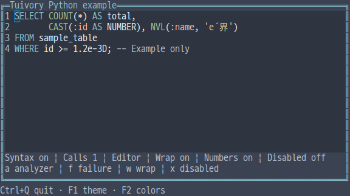
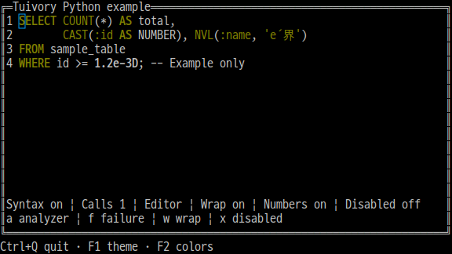
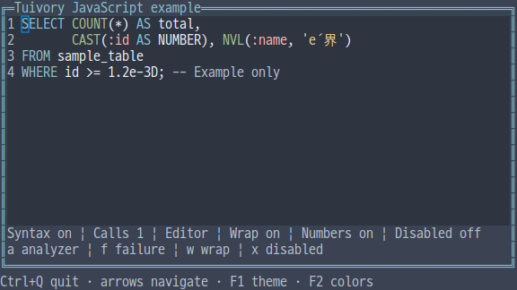
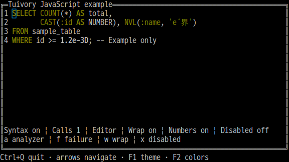
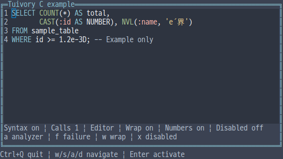
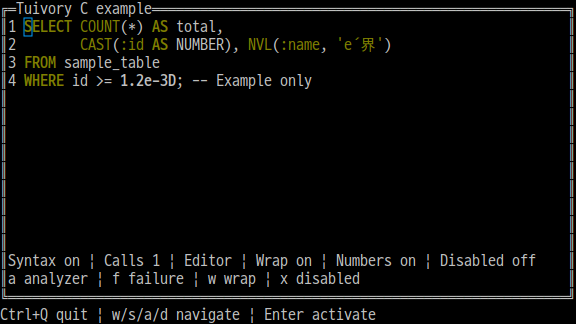
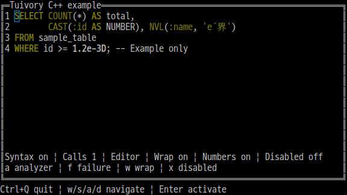
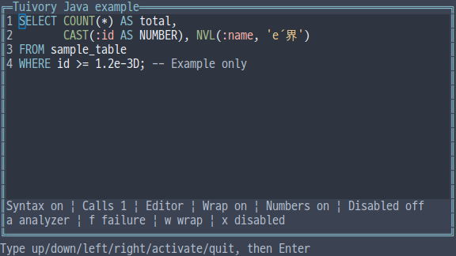
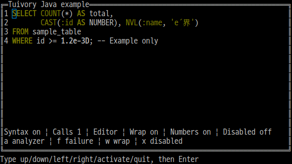

# Independent-language syntax highlighting and SQL classification APIs

[한국어 (기본)](language-syntax.md) · **English**

This is unreleased TVR-15/16/30/31/32 work. Python, TypeScript/JavaScript, C, C++ and Java analyze/render independently. They do not call another Tuivory implementation through FFI/JNI, subprocesses or shared engines. Published0.11.1 is unchanged.

| Feature | Python | TS/JS | C | C++ | Java |
| --- | --- | --- | --- | --- | --- |
| Analysis values | SyntaxToken/Request/Analysis | Value types with these names | TuiSyntaxToken/Request/Analysis | SyntaxToken/Request/Analysis | Records with these names |
| Built-in SQL | SQLAnalyzer.analyze_syntax | SQLAnalyzer.analyzeSyntax | tui_sql_analyze | SQLAnalyzer::analyze_syntax | SQLAnalyzer.analyzeSyntax |
| Automatic binding | set_syntax_analyzer | setSyntaxAnalyzer | tui_document_set_syntax_analyzer | set_syntax_analyzer | setSyntaxAnalyzer |
| Supplied analysis | set_syntax_analysis | setSyntaxAnalysis | tui_document_set_syntax_analysis | set_syntax_analysis | setSyntaxAnalysis |
| Validation | analysis.validate(text) | validateSyntaxAnalysis | tui_syntax_validate | analysis.validate(text) | analysis.validate(text) |
| Semantic style | syntax_style | syntaxStyle | tui_syntax_style | syntax_style | syntaxStyle |

Use one public import/include. SQLAnalyzer supports sql/plsql with the oracle dialect; empty requests select sql/oracle. It optionally classifies text for highlighting. Apps own execution, validation and business semantics. Functions/types/keywords follow shared vocabulary; parentheses alone do not make an identifier a function.

    import tuivory as ui
    doc = ui.TextDocument.editor("SELECT COUNT(*) FROM sample_table WHERE id=:id")
    doc.set_syntax_analyzer(ui.SQLAnalyzer(), ui.SyntaxRequest('sql', 'oracle'))
    doc.draw(canvas, ui.Rect(1, 1, 60, 10))
    result = ui.SQLAnalyzer().analyze_syntax(doc.buffer.value)
    doc.set_syntax_analysis(result)

TypeScript/JavaScript uses ordinary values and functions/objects.

    import { TextDocument, SQLAnalyzer, rect } from 'tuivory';
    const doc = TextDocument.editor('SELECT COUNT(*) FROM sample_table');
    doc.setSyntaxAnalyzer(new SQLAnalyzer(), { language: 'sql', dialect: 'oracle' });
    doc.draw(canvas, rect(1, 1, 60, 10));

C provides a built-in callback signature adapter.

    #include <tuivory.h>
    TuiDocument *doc = tui_document_new("SELECT COUNT(*) FROM sample_table", 0);
    TuiSyntaxRequest request = {"sql", "oracle"};
    TuiResult result = tui_document_set_syntax_analyzer(
        doc, tui_sql_analyzer, NULL, &request);
    /* Check result before use; eventually call tui_document_free(doc). */

SyntaxToken.start/end are **half-open original UTF-8 byte ranges**; role is the classification. Do not substitute screen columns, character indices or UTF-16 offsets. SyntaxAnalysis contains source/language/dialect/tokens. Source must exactly match the current document. Tokens require positive length, ordering, no overlap and valid UTF-8 boundaries. Applying to a document additionally checks grapheme boundaries. A boundary between e and its combining accent can pass codepoint validation but fails application without replacing previous state.

Classifications include keyword/function/type/string/number/comment/parameter and identifier/operator/punctuation. Seven highlighted families map to syntax.keyword/function/type/string/number/comment/parameter. macro/attribute reuse function; character reuses string; constant number; directive comment; lifetime parameter. Identifiers and unknown classifications use body. syntax_role_style/syntaxRoleStyle/tui_syntax_role_style and syntax_palette_role equivalents are also public.

Python accepts a callable or analyze_syntax object; TS/JS a function or analyzeSyntax object; C++ a std::function-compatible callable; Java a SyntaxAnalyzer functional interface. Requests are copied or immutable. Analysis runs on changed source, not cursor/scroll/theme/color-only redraws. refresh_syntax/refreshSyntax or tui_document_refresh_syntax checks refresh state; syntax_error/syntaxError or tui_document_syntax_error reports the last error.

Failed initial attachment or supplied-result application preserves the existing analyzer/styles/selection. A failure after editing clears stale styles and records an error while retaining source/selection/undo history. The same failed source is not reanalyzed every frame. Change source or reattach to retry. null/None/empty callbacks detach and clear styles. Supplied analyses expire on source changes; explicit markup detaches automatic analysis.

Secret buffers reject analyzers/supplied analyses. Switching a bound document to secret clears styles, stops callbacks and hides cached errors. Returning to public mode performs any required analysis. Read-only/disabled/search/selection priority follows the [document API](language-documents.en.md).

Styles preserve actual document backgrounds and reuse info/success/header/warning/edited/hint/error colors. Dark ANSI8 uses indices3/7 plus bold/underline/italic to distinguish families, without bright indices, RGB or token background boxes. Monochrome underlines keywords/parameters and italicizes comments. If an accent has poor contrast on the actual background, a more readable base foreground is used. Terminal palette/font/attribute settings can change physical appearance.

Style.italic defaults to false and emits SGR3. It is an optional trailing Python/C++ field, optional TS/JS property and sixth Java record field with the five-argument constructor retained. C TuiStyle also has italic: zero-initialize raw styles or obtain tui_style before updating fields. Cell copying and Dim shadows preserve italic. C++ Palette.theme()/colors() returns current setting names.

Limits are1,000,000 source UTF-8 bytes,1,000,000 tokens and128 bytes per language/dialect/classification string. Checks use [shared SQL cases](../design/syntax-cases.json) and [additional edge cases](../design/syntax-extra-cases.json). These five implementations fix character classification to Unicode17.0.0 Alphabetic/General Category N/White_Space. Grapheme segmentation/width follows existing document backends; this does not certify every physical terminal font. [Data](../design/syntax-unicode.json) records source URLs/hashes; tools/generate_syntax_unicode.py regenerates it. Package NOTICE files retain [official UCD](https://www.unicode.org/Public/17.0.0/ucd/) and Unicode License V3 attribution.

C tui_sql_analyze/tui_syntax_analysis_new return owned results, freed with tui_syntax_analysis_free. Struct strings/tokens borrow that result's lifetime. C callbacks return owned analyses through out; the library frees them on success and failure. Apps own context and keep it valid while attached. Callback text/requests live only during the call; do not free/mutate the document or its borrowed buffer then. tui_sql_analyzer adapts the built-in analyzer to the callback signature. Manual application copies required ranges, so the original result can be freed afterward.

In integrated --demo syntax, a toggles binding. While editing, f inserts one blank to exercise analysis failure; pressing it again restores the binding. This is example host behavior. Calls shows whether rendering/wrapping/resizing causes unnecessary analysis. w/n/v/s/x/m retain document-demo behavior. Java uses fixed-size line input; four raw examples exercise actual keys/mouse/resize.

| Language | Dark True Color | Dark ANSI8 |
| --- | --- | --- |
| Python |  |  |
| JS |  |  |
| C |  |  |
| C++ |  |  |
| Java |  |  |

[Evidence](evidence/language-syntax-results.json) · [Support](languages.en.md) · [API](api/README.en.md) · [Examples](examples.en.md)
