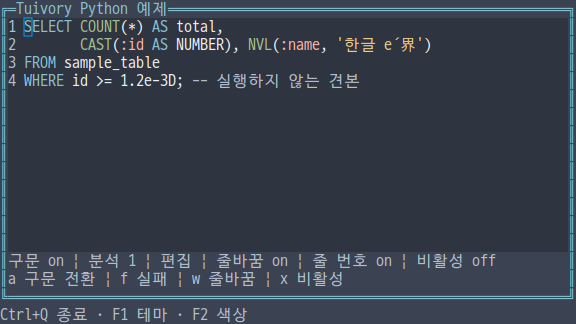
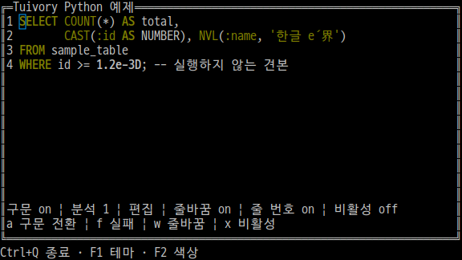
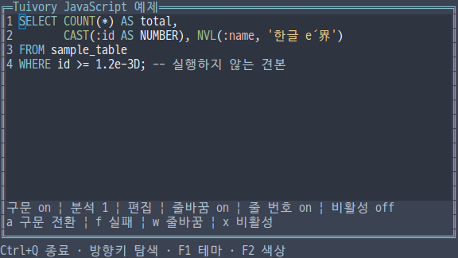
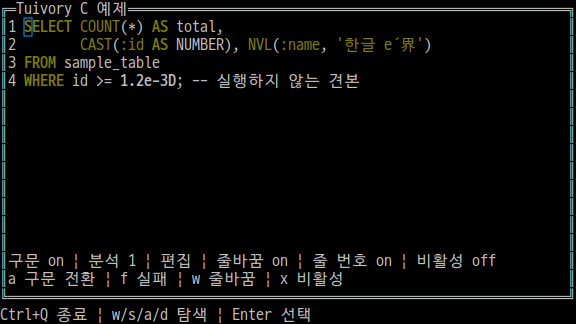
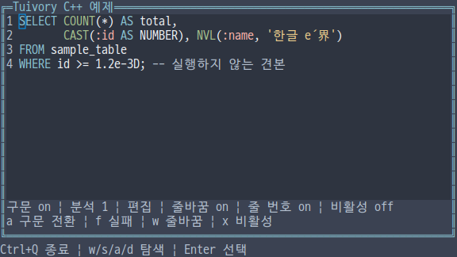
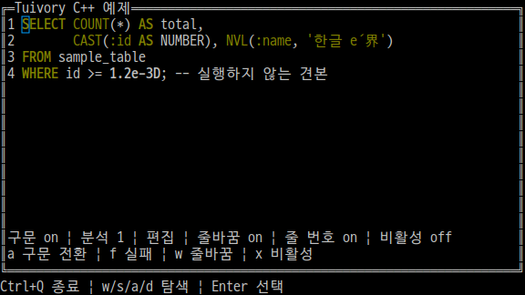
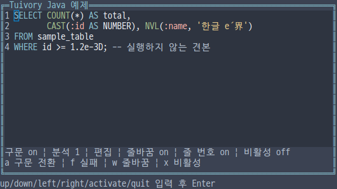
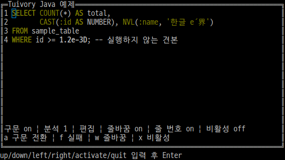

# 독립 언어의 구문 강조·SQL 분류 API

**한국어 (기본)** · [English](language-syntax.en.md)

TVR-15·16·30·31·32의 기능이다. Python·TypeScript/JavaScript·C·C++·Java는 각 언어에서 직접 분석하고 그린다. 다른 Tuivory 구현을 FFI/JNI·서브프로세스·공유 엔진으로 호출하지 않는다. 0.12.0에서 제공합니다.

| 기능 | Python | TS/JS | C | C++ | Java |
| --- | --- | --- | --- | --- | --- |
| 분석 값 | SyntaxToken/Request/Analysis | 같은 이름의 값 타입 | TuiSyntaxToken/Request/Analysis | SyntaxToken/Request/Analysis | 같은 이름의 record |
| 내장 SQL 분석 | SQLAnalyzer.analyze_syntax | SQLAnalyzer.analyzeSyntax | tui_sql_analyze | SQLAnalyzer::analyze_syntax | SQLAnalyzer.analyzeSyntax |
| 문서 자동 연결 | set_syntax_analyzer | setSyntaxAnalyzer | tui_document_set_syntax_analyzer | set_syntax_analyzer | setSyntaxAnalyzer |
| 외부 분석 결과 | set_syntax_analysis | setSyntaxAnalysis | tui_document_set_syntax_analysis | set_syntax_analysis | setSyntaxAnalysis |
| 결과 검사 | analysis.validate(text) | validateSyntaxAnalysis | tui_syntax_validate | analysis.validate(text) | analysis.validate(text) |
| 의미별 스타일 | syntax_style | syntaxStyle | tui_syntax_style | syntax_style | syntaxStyle |

하나의 공개 import/include로 사용한다. 내장 SQLAnalyzer는 sql/plsql 언어와 oracle 방언을 지원하며 빈 요청은 sql/oracle로 처리한다. 선택적인 화면 강조용 분류로, SQL 실행·유효성 판정·업무 의미 분석은 앱의 책임이다. 함수·타입·예약어는 공통 단어 목록으로 분류하고 괄호만 보고 함수로 추측하지 않는다.

    import tuivory as ui
    doc = ui.TextDocument.editor("SELECT COUNT(*) FROM sample_table WHERE id=:id")
    doc.set_syntax_analyzer(ui.SQLAnalyzer(), ui.SyntaxRequest('sql', 'oracle'))
    doc.draw(canvas, ui.Rect(1, 1, 60, 10))
    result = ui.SQLAnalyzer().analyze_syntax(doc.buffer.value)
    doc.set_syntax_analysis(result)

TypeScript/JavaScript는 일반 값과 함수·객체를 사용한다.

    import { TextDocument, SQLAnalyzer, rect } from 'tuivory';
    const doc = TextDocument.editor('SELECT COUNT(*) FROM sample_table');
    doc.setSyntaxAnalyzer(new SQLAnalyzer(), { language: 'sql', dialect: 'oracle' });
    doc.draw(canvas, rect(1, 1, 60, 10));

C는 내장 분석기용 콜백 어댑터를 제공한다.

    #include <tuivory.h>
    TuiDocument *doc = tui_document_new("SELECT COUNT(*) FROM sample_table", 0);
    TuiSyntaxRequest request = {"sql", "oracle"};
    TuiResult result = tui_document_set_syntax_analyzer(
        doc, tui_sql_analyzer, NULL, &request);
    /* result 검사 후 사용하며, 끝나면 tui_document_free(doc)를 호출한다. */

SyntaxToken의 start/end는 **원래 UTF-8 바이트의 반열림 범위**이고 role은 강조 분류다. 화면 열·문자 인덱스·UTF-16 위치로 바꾸지 않는다. SyntaxAnalysis는 source·language·dialect·tokens를 담는다. source가 현재 문서와 정확히 일치해야 하고 토큰은 양수 길이·정렬·비중첩·유효한 UTF-8 경계를 만족해야 한다. 문서에 적용할 때에는 grapheme 경계도 검사한다. e와 결합 악센트 사이처럼 코드 포인트 경계만 만족하는 결과는 이전 상태를 보존하고 적용을 거부한다.

분류는 keyword/function/type/string/number/comment/parameter 및 identifier/operator/punctuation이다. 일곱 강조 계열은 syntax.keyword/function/type/string/number/comment/parameter로 연결한다. macro/attribute는 function, character는 string, constant는 number, directive는 comment, lifetime은 parameter 계열을 사용한다. 식별자·알려지지 않은 분류는 body로 표시한다. syntax_role_style/syntaxRoleStyle/tui_syntax_role_style 및 syntax_palette_role 계열도 제공한다.

Python은 callable 또는 analyze_syntax 메서드 객체, TS/JS는 함수 또는 analyzeSyntax 객체, C++는 std::function 호환 함수 객체, Java는 SyntaxAnalyzer 함수형 인터페이스를 받는다. 요청은 복사하거나 불변 값으로 전달한다. 분석기는 원문이 바뀔 때 실행하며 스크롤·커서 이동·색상·테마만 바뀐 그리기에는 재실행하지 않는다. 문서의 refresh_syntax/refreshSyntax 또는 tui_document_refresh_syntax로 상태를 확인하고 syntax_error/syntaxError 또는 tui_document_syntax_error로 마지막 오류를 조회한다.

초기 연결·수동 결과 적용 실패는 기존 분석기·강조·선택을 보존한다. 편집 후 분석 실패는 오래된 강조를 지우고 오류를 기록하며 원문·선택·되돌리기 기록은 유지한다. 같은 실패 원문은 매 그리기마다 재분석하지 않는다. 원문 변경이나 분석기 재연결로 재시도한다. null/None/빈 콜백으로 해제하면 강조도 지운다. 수동 결과는 원문 변경 시 만료되며 명시적 마크업은 자동 연결을 해제한다.

secret 버퍼에는 분석기·수동 결과를 연결할 수 없다. 기존 문서가 secret으로 바뀌면 강조를 지우고 콜백을 중단하며 캐시된 오류도 표시하지 않는다. 다시 공개 상태가 되면 필요한 분석을 재실행한다. 읽기 전용·비활성·검색·선택 우선순위는 [문서 API](language-documents.md)를 따른다.

강조는 실제 문서 바탕을 유지하고 기존 info/success/header/warning/edited/hint/error 색상을 사용한다. 다크 8색은 ANSI 3·7과 굵게·밑줄·기울임 조합으로 분류를 구분한다. 밝은 색 인덱스·RGB·토큰별 바탕 상자를 추가하지 않는다. 흑백은 키워드·매개변수 밑줄과 주석 기울임을 사용한다. 대비가 부족한 바탕에서는 더 읽기 쉬운 기본 글자색을 사용한다. 터미널의 팔레트·글꼴·속성 설정에 따라 물리적 외관은 달라질 수 있다.

Style.italic은 기본 false이며 SGR3으로 출력한다. Python/C++는 끝의 선택적 필드, TS/JS는 선택적 속성, Java는 여섯 번째 record 필드이며 다섯 인자 생성자도 유지한다. C TuiStyle에도 italic을 제공한다. 원시 C 스타일은 0으로 초기화하거나 tui_style로 얻은 뒤 필요한 필드를 설정한다. 셀 복사와 Dim 그림자는 기울임을 보존한다. C++ Palette.theme()/colors()는 현재 설정 이름을 반환한다.

원문은 1,000,000 UTF-8바이트, 토큰은 최대 1,000,000개, 언어·방언·분류 문자열은 각각 128바이트다. [공통 SQL 사례](../design/syntax-cases.json)와 [추가 경계 사례](../design/syntax-extra-cases.json)로 검사한다. 새 다섯 구현의 문자 분류는 Unicode17.0.0 Alphabetic·일반 범주 N·White_Space 고정 데이터를 사용한다. grapheme 분할·폭은 기존 문서 백엔드를 따르며 모든 터미널의 글꼴 폭 검증을 뜻하지 않는다. 원본 URL·해시는 [데이터](../design/syntax-unicode.json), 재생성은 tools/generate_syntax_unicode.py에 있다. [공식 UCD](https://www.unicode.org/Public/17.0.0/ucd/)와 Unicode License V3 출처를 패키지 NOTICE에 보존한다.

C tui_sql_analyze·tui_syntax_analysis_new는 소유한 결과를 반환하며 tui_syntax_analysis_free로 해제한다. struct의 문자열·토큰은 결과의 빌린 값이다. C 콜백은 소유한 결과를 out에 반환하고 라이브러리가 성공·실패 모두 해제한다. context는 앱이 소유하며 연결된 동안 유효해야 한다. 콜백 원문·요청은 호출 중에만 유효하고 문서·빌린 버퍼를 해제·변경하지 않는다. tui_sql_analyzer는 콜백 서명 어댑터다. 수동 적용은 필요한 범위를 복사하므로 호출 후 원래 결과를 해제할 수 있다.

통합 --demo syntax에서 a는 연결 전환이다. 편집 상태의 f는 공백 한 칸을 입력해 분석 실패를 재현하며 다시 누르면 연결을 복구한다. 견본 앱의 동작이며 실제 업무 오류가 아니다. Calls/분석 횟수로 그리기·줄바꿈·리사이즈의 재분석 여부를 확인한다. w/n/v/s/x/m도 문서 예제와 같다. Java는 고정 크기 줄 입력이고 나머지 네 예제는 실제 키·마우스·리사이즈를 사용한다.

| 언어 | 다크 True Color | 다크 8색 |
| --- | --- | --- |
| Python |  |  |
| JS |  |  |
| C |  |  |
| C++ |  |  |
| Java |  |  |

[검증 근거](evidence/language-syntax-results.json) · [지원 범위](languages.md) · [API](api/README.md) · [예제](examples.md)
