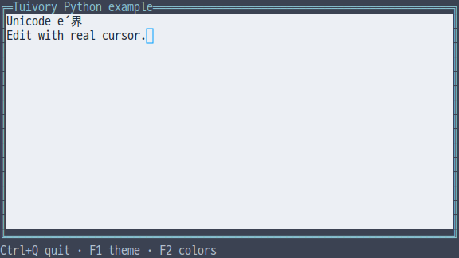
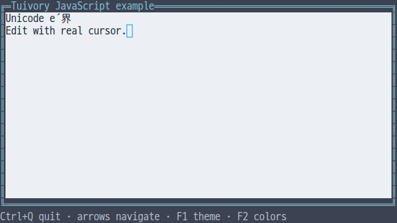
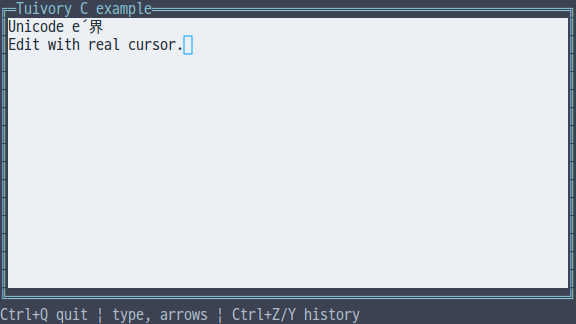
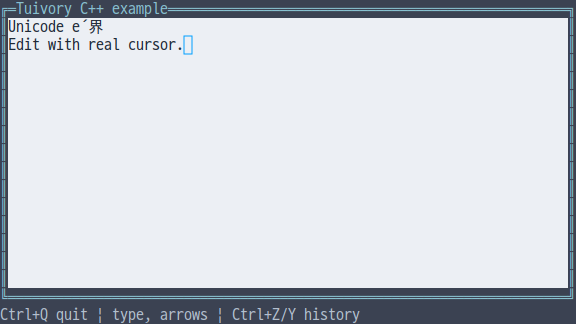
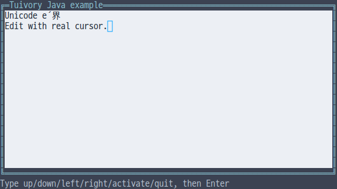

# Independent language text editing API

[한국어 (기본)](language-text.md) · **English**

This is an unreleased TVR-15/16/30/31/32 milestone. Python, TypeScript/JavaScript, C, C++, and Java independently provide a literal `Text` buffer and drawing. These changes are absent from public 0.11.1 and do not call another Tuivory language implementation.

## API

| Operation | Python | TS/JS | C | C++ | Java |
| --- | --- | --- | --- | --- | --- |
| Construct | `Text(value)` | `new Text(value)` | `tui_text_new(value)` | `Text(value)` | `new Text(value)` |
| Raw value | `.value` | `.value` | `tui_text_value` | `.value` | `.value()` |
| Display value | `display()` | `display()` | `tui_text_display` | `display()` | `display()` |
| Actions | `handle(action, text)` | same | `tui_text_handle` | same | same |
| Selection | `select(anchor, cursor)` | same | `tui_text_select` | same | same |
| UTF-8 ranges | `select_bytes/selection_bytes/replace_bytes` | `selectBytes/selectionBytes/replaceBytes` | `tui_text_select_bytes/selection_bytes/replace_bytes` | Python names | TS names |
| Drawing/pointer | `draw/click` | same | `tui_text_draw/click` | same | same |

Ordinary selection uses extended grapheme indices, preserving Hangul, emoji, and combining sequences. UTF-8 APIs use **original UTF-8 byte offsets**, rather than JS/Java UTF-16 indices or screen cells. Offsets inside graphemes, out-of-range offsets and reversed replacement ranges fail without changing content, selection, or history. JS/Java/Python/C++ throw; C returns `TUI_INVALID`.

Actions include `left/right/home/end/up/down`, selection movement with the `select_` prefix, `select_all`, `insert/paste/newline/backspace/delete`, and `copy/cut/undo/redo`. Movement emits `select`, editing emits `change`, and clipboard requests emit `copy/cut`. Unsupported actions, blocked edits and empty history emit empty events. `change/select` events contain no raw value. Hosts connect the strings from `copy/cut` events to their own clipboard.

User input normalizes CRLF/CR to LF, converts tabs to spaces and removes C0/C1 controls. Single-line mode removes newlines. Construction and `replace_bytes` preserve literal source, including line endings and tag-like strings. Rendering sanitizes controls rather than emitting them as ANSI commands. History retains up to 128 changes.

## State and ownership

Python uses `read_only/secret/multiline` constructor options and `disabled`; TS uses `readOnly/secret/multiline` and `disabled`. C uses `tui_text_options(text, state, secret, multiline)`; C++/Java expose `.state`, `.secret`, and `.multiline`. Read-only buffers permit selection/copy and block editing. Disabled buffers block keyboard and pointer input. Passwords display `*` and block copy/cut. Explicit raw-value access remains available so the host can submit a password. Public Python/TS Form fields do not retain the raw password.

C construction copies its input and `tui_text_free` releases the complete history. Raw-value and event strings are borrowed until the next change/operation or destruction. `tui_text_display` returns an owned string: release it with `tui_string_free`. Check the event's `result` for errors. Other languages follow value, RAII, or runtime ownership.

`draw` confines editor cells to the supplied rectangle. Cell-based horizontal/vertical scrolling and selection styles preserve grapheme boundaries; focused editable buffers provide the **actual terminal cursor position**. No fake `|` cursor is inserted, and cursor shape/blink policy is not forced. Clipped wide glyphs are omitted and pointer positions map back to source graphemes. Hosts own focus order, clipboard transport, and business logic.

## Examples and validation

Select `--demo text` in each language's unified example, with `--lang ko|en --theme dark|light|blackwhite --colors 8|16|256|truecolor --ascii`. Python/JS/C/C++ support typing, arrows, Home/End, Backspace, Enter, Ctrl+A selection, Ctrl+Z/Y history, and Ctrl+Q exit. Java currently uses line commands such as `home`, `insert text`, `backspace`, `undo`, and `quit`, followed by Enter. Applications may opt into the separately provided [POSIX raw session](language-terminal.en.md).

[Shared editing fixtures](../design/controls-cases.json) cover combining insertion, selection, secrets, read-only behavior and single-line paste. Additional checks cover atomic UTF-8 range failures, narrow bounds, isolated static SDK/JAR consumers, and C/C++ ASan/UBSan. Actual PTY input and theme/profile/glyph results are recorded separately in the [evidence](evidence/language-text-results.json). Images do not establish physical terminal font or blink behavior.

[Independent languages](languages.en.md) · [Workspace](language-workspace.en.md) · [API](api/README.en.md)
