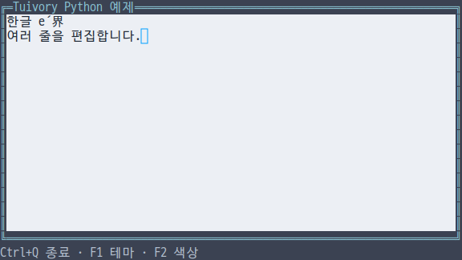
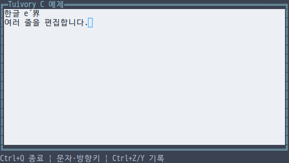
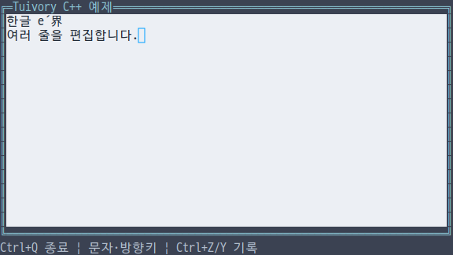
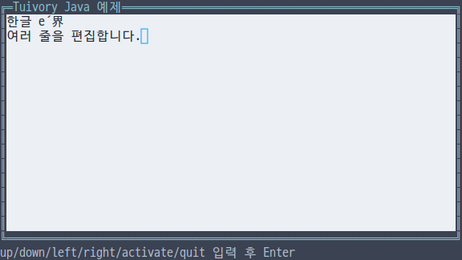

# 독립 언어 입력·편집 API

**한국어 (기본)** · [English](language-text.en.md)

TVR-15·16·30·31·32의 미배포 단계입니다. Python·TypeScript/JavaScript·C·C++·Java가 각자 원문을 보존하는 `Text` 버퍼와 그리기를 제공합니다. 공개 0.11.1에는 포함되지 않으며 다른 Tuivory 언어 구현을 호출하지 않습니다.

## API

| 동작 | Python | TS/JS | C | C++ | Java |
| --- | --- | --- | --- | --- | --- |
| 생성 | `Text(value)` | `new Text(value)` | `tui_text_new(value)` | `Text(value)` | `new Text(value)` |
| 원문 접근 | `.value` | `.value` | `tui_text_value` | `.value` | `.value()` |
| 표시 문자열 | `display()` | `display()` | `tui_text_display` | `display()` | `display()` |
| 조작 | `handle(action, text)` | 동일 | `tui_text_handle` | 동일 | 동일 |
| 선택 | `select(anchor, cursor)` | 동일 | `tui_text_select` | 동일 | 동일 |
| UTF-8 범위 | `select_bytes/selection_bytes/replace_bytes` | `selectBytes/selectionBytes/replaceBytes` | `tui_text_select_bytes/selection_bytes/replace_bytes` | Python과 같은 이름 | TS와 같은 이름 |
| 출력·마우스 | `draw/click` | 동일 | `tui_text_draw/click` | 동일 | 동일 |

일반 선택의 단위는 확장 grapheme 인덱스입니다. 한글·이모지·결합 문자를 중간에서 자르지 않습니다. UTF-8 API는 **원문 UTF-8 바이트** 단위이며 JS/Java의 UTF-16 인덱스나 화면 셀 수가 아닙니다. grapheme 경계 사이의 바이트, 범위를 벗어난 값과 역순 교체는 실패하며 원문·선택·히스토리를 유지합니다. JS/Java/Python/C++는 예외, C는 `TUI_INVALID`를 반환합니다.

`left/right/home/end/up/down`, `select_` 접두사를 붙인 선택 이동, `select_all`, `insert/paste/newline/backspace/delete`, `copy/cut/undo/redo`를 지원합니다. 선택 이동은 `select`, 편집은 `change`, 복사와 잘라내기는 각각 `copy/cut` 이벤트입니다. 처리하지 않는 조작, 막힌 편집과 빈 히스토리는 빈 이벤트를 반환합니다. `change/select` 이벤트는 원문을 포함하지 않습니다. 앱은 `copy/cut` 이벤트의 문자열을 자신의 클립보드에 연결합니다.

사용자 입력은 CRLF/CR을 LF로 통일하고 탭을 공백으로 바꾸며 C0/C1 제어 문자를 제거합니다. 한 줄 모드에서는 개행을 제거합니다. 생성 시 원문과 `replace_bytes`는 개행·태그처럼 보이는 문자열도 그대로 보존합니다. 출력에서는 제어 문자를 안전하게 표시하며 ANSI 명령으로 내보내지 않습니다. 변경 히스토리는 최대 128개입니다.

## 상태·수명

Python은 생성 옵션 `read_only/secret/multiline`와 `disabled`, TS는 `readOnly/secret/multiline`와 `disabled`를 사용합니다. C는 `tui_text_options(text, state, secret, multiline)`, C++/Java는 `.state`, `.secret`, `.multiline`를 사용합니다. 읽기 전용은 선택·복사를 허용하고 편집을 막습니다. 비활성은 키·마우스를 막습니다. 비밀번호는 표시를 `*`로 바꾸고 복사·잘라내기를 막습니다. 명시적인 원문 접근 API는 앱이 비밀번호를 제출하기 위해 사용할 수 있습니다. Python/TS Form의 공개 필드에는 원문 비밀번호를 보관하지 않습니다.

C의 `tui_text_new`는 입력을 복사하고 `tui_text_free`가 전체 히스토리를 해제합니다. `tui_text_value`와 이벤트 문자열은 빌린 포인터이며 다음 변경/조작 또는 해제 전에만 사용합니다. `tui_text_display`는 소유 문자열이므로 `tui_string_free`로 해제합니다. C 이벤트의 `result`로 성공·오류를 확인합니다. 다른 언어는 값·RAII·런타임의 소유권을 따릅니다.

`draw`는 전달받은 사각형 안에서만 편집기 셀을 그립니다. 화면 셀 기준 수평·수직 스크롤과 선택 스타일을 적용하고, 입력 가능한 포커스 버퍼는 **실제 터미널 커서 위치**를 제공합니다. 가짜 `|` 문자를 넣지 않으며 커서 모양·깜빡임 설정을 강제하지 않습니다. 두 칸 문자가 잘리는 부분은 출력하지 않고 마우스 좌표를 원래 grapheme로 연결합니다. 앱의 포커스 순서·클립보드·업무 처리는 앱이 결정합니다.

## 예제·검증

언어별 통합 예제의 `--demo text`를 사용합니다. `--lang ko|en --theme dark|light|blackwhite --colors 8|16|256|truecolor --ascii`를 선택할 수 있습니다. Python/JS/C/C++는 문자·방향키·Home/End·Backspace·Enter, Ctrl+A 전체 선택, Ctrl+Z/Y Undo/Redo와 Ctrl+Q 종료를 제공합니다. Java는 현재 줄 입력 예제이므로 `home`, `insert text`, `backspace`, `undo`, `quit` 등을 Enter로 실행합니다. 앱은 별도로 제공하는 [POSIX raw 세션](language-terminal.md)을 선택할 수 있습니다.

[공유 편집 사례](../design/controls-cases.json)는 결합 문자 삽입·전체 선택·비밀번호·읽기 전용·한 줄 붙여넣기를 검사합니다. UTF-8 범위의 원자적 실패, 좁은 영역, 외부 정적 SDK/JAR 사용 앱와 C/C++ ASan/UBSan도 검사합니다. 실제 PTY 입력과 테마·색상·문자 모드의 결과는 [검증 기록](evidence/language-text-results.json)에 별도로 기록합니다. 이미지가 물리 터미널의 글꼴·깜빡임 검증을 대신하지 않습니다.

[독립 언어 지원](languages.md) · [작업 영역](language-workspace.md) · [API](api/README.md)
