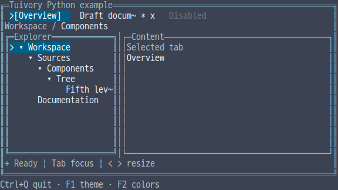
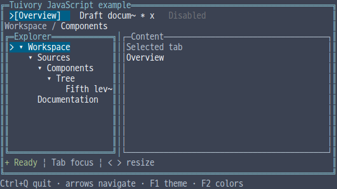
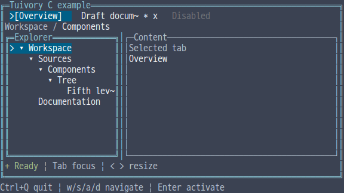
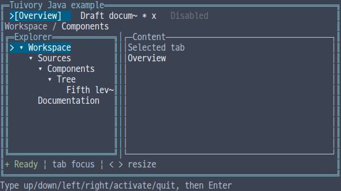

# Independent-language workspace components

[한국어 (기본)](language-workspace.md) · **English**

This is an unreleased follow-up for TVR-15, 16, 30, 31 and 32, adding tabs, panels, splits, breadcrumbs and status lines to all five independent Tree implementations. Only common behavior cases are shared. These additions are absent from published 0.11.1.

## API mapping

| Feature | Python | TypeScript/JavaScript | C | C++ | Java |
| --- | --- | --- | --- | --- | --- |
| Tabs | `Tab/Tabs/TabCell` | `Tab/Tabs/TabCell` | `TuiTab/TuiTabs/TuiTabCell` | `Tab/Tabs/TabCell` | `Tab/Tabs/TabCell` |
| Actions/output | `handle/click/layout/draw` | `handle/click/layout/draw` | `tui_tabs_handle/click/layout/draw` | `handle/click/layout/draw` | `handle/click/layout/draw` |
| Split | `Split.layout/resize` | `Split.layout/resize` | `tui_split_layout/resize` | `Split.layout/resize` | `Split.layout/resize` |
| Panel | `Canvas.panel` | `Canvas.panel` | `tui_canvas_panel` | `Canvas.panel` | `Canvas.panel` |
| Breadcrumbs | `path_runs` | `pathRuns` | `tui_breadcrumbs` | `breadcrumbs` | `breadcrumbs` |
| Status line | `status_line` | `statusLine` | `tui_status_line` | `status_line` | `statusLine` |
| Semantic runs | `LineLayout/LineRun` | `LineLayout/LineRun` | `TuiLine/TuiLineRun` | `LineLayout/LineRun` | `LineLayout/LineRun` |

C line objects use `tui_line_free`; strings returned by `tui_line_text` use `tui_string_free`. Tabs copy their input. Layout strings remain valid until the next layout or destruction. Other languages use values, RAII or their normal runtime ownership. Applications import/include a single Tuivory entry point.

## Behavior

Tabs distinguish the active document (`active`) from the keyboard candidate (`focused`). `previous/next/first/last` skip disabled candidates; `activate` changes the active tab. `close` emits a request for the host to apply. Disabled/nonclosable tabs never emit close requests. Titles are grapheme-clipped, the current candidate remains visible in narrow layouts, and edge indicators support overflow navigation. Active backgrounds cover the full clickable tab width.

Panels provide titles and Unicode/ASCII borders; focused panels use double borders. Splits preserve minimum sizes and `preferred`. If both minima and the divider cannot fit, the first pane collapses and the second receives the allocation. `resize(total, position)` applies the same constraints to pointer coordinates and keyboard increments. Hosts choose panes and global input routing.

Breadcrumbs show all items when possible and collapse intermediate items to `...` under pressure. The last item is retained, with a `~` prefix when its beginning must be clipped. Runs expose stable IDs, cell starts and widths for host hit testing.

Status lines place higher priorities first, preserving input order for ties. Warning/error, edited, success and info roles also use `!/*/+/i` cues. Omitted lower priorities produce `+N`; the most important message is clipped first to remain visible in small areas. Layouts expose `omitted` and per-run `role/id/start/width`.

## Examples and validation

Select `--demo workspace` in each existing unified example. Presentation options are consistent: `--lang ko|en --theme dark|light|blackwhite --colors 8|16|256|truecolor --ascii`. Python/JS use arrows, Tab and Enter; C/C++ use w/s/a/d, Tab and Enter; Java's line-input example accepts up/down/left/right/tab/activate commands. `<` and `>` resize the split. These are host compositions, not mandatory application structures.

```sh
make build-c build-cpp build-java
python tools/check_language_workspace.py --language c
python tools/check_language_workspace.py --language cpp
python tools/check_language_workspace.py --language java
python tools/check_language_examples.py --demo workspace --matrix
```

[Shared cases](../design/components-cases.json) verify tab movement/activation/close/overflow, breadcrumb clipping and status omission. Isolated Python/JS/TS and C/C++/Java consumers, actual PTY tab activation and terminal restoration are also checked. [Stage evidence](evidence/language-workspace-results.json) distinguishes local results, CI, dev integration and product release.

## English references










[Independent languages](languages.en.md) · [Common workspace principles](workspace.en.md) · [API](api/README.en.md)
