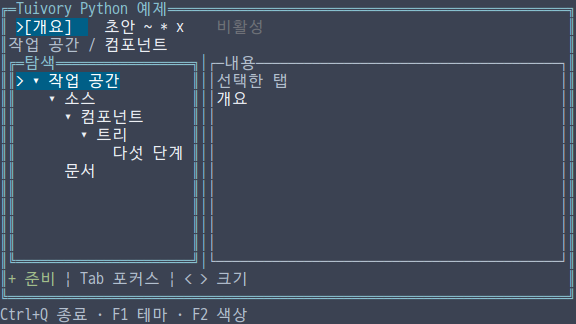
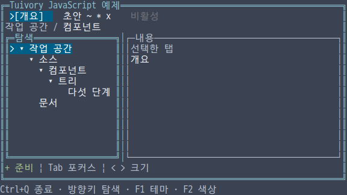
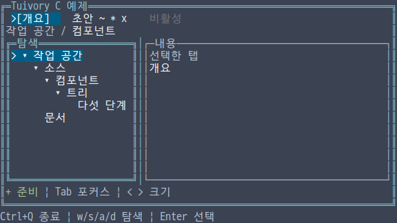
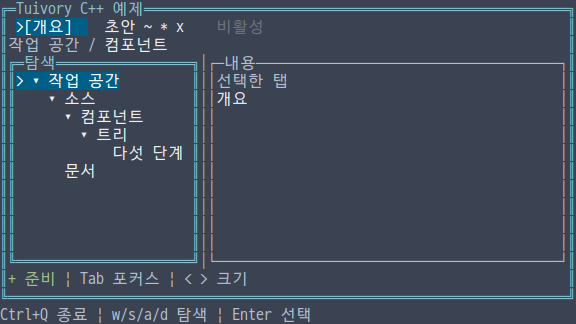
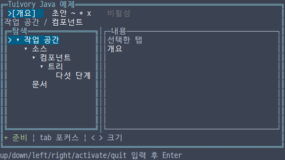

# 독립 언어 workspace 컴포넌트

**한국어 (기본)** · [English](language-workspace.en.md)

TVR-15·16·30·31·32의 미배포 후속 단계입니다. 다섯 언어의 Tree에 탭·패널·분할·경로·상태줄을 더합니다. 각 언어 구현은 독립적이며 공통 동작 사례만 공유합니다. 기존 공개 0.11.1에는 포함되지 않습니다.

## API 대응

| 기능 | Python | TypeScript/JavaScript | C | C++ | Java |
| --- | --- | --- | --- | --- | --- |
| 탭 | `Tab/Tabs/TabCell` | `Tab/Tabs/TabCell` | `TuiTab/TuiTabs/TuiTabCell` | `Tab/Tabs/TabCell` | `Tab/Tabs/TabCell` |
| 조작·출력 | `handle/click/layout/draw` | `handle/click/layout/draw` | `tui_tabs_handle/click/layout/draw` | `handle/click/layout/draw` | `handle/click/layout/draw` |
| 분할 | `Split.layout/resize` | `Split.layout/resize` | `tui_split_layout/resize` | `Split.layout/resize` | `Split.layout/resize` |
| 패널 | `Canvas.panel` | `Canvas.panel` | `tui_canvas_panel` | `Canvas.panel` | `Canvas.panel` |
| 경로 | `path_runs` | `pathRuns` | `tui_breadcrumbs` | `breadcrumbs` | `breadcrumbs` |
| 상태줄 | `status_line` | `statusLine` | `tui_status_line` | `status_line` | `statusLine` |
| 의미별 구간 | `LineLayout/LineRun` | `LineLayout/LineRun` | `TuiLine/TuiLineRun` | `LineLayout/LineRun` | `LineLayout/LineRun` |

C의 line 객체는 `tui_line_free`로 해제합니다. `tui_line_text`가 반환한 문자열은 `tui_string_free`로 해제합니다. 탭은 입력을 복사하며 layout 문자열은 다음 layout 호출/해제까지 유효합니다. 다른 언어는 값·RAII·각 런타임의 소유권을 따릅니다. 앱은 Tuivory 진입점 하나만 import/include합니다.

## 동작

탭은 활성 문서 `active`와 키보드 후보 `focused`를 구분합니다. `previous/next/first/last`는 비활성을 건너뛰고 후보를 이동하며 `activate`가 활성 탭을 변경합니다. `close`는 닫기 요청이며 앱이 실제 데이터 변경을 결정합니다. 비활성 탭과 닫기 불가 탭에서는 닫기 요청을 만들지 않습니다. 긴 제목은 grapheme 단위로 축약하고 좁은 폭에서도 현재 후보를 표시하며 양끝 탐색 표시를 제공합니다. 활성 배경은 탭의 클릭 영역 전체에 적용합니다.

패널은 선택한 문자 모드에 맞는 테두리와 제목을 제공하며 포커스 패널은 이중선으로 구분합니다. 분할은 양쪽 최소 크기와 `preferred`를 보존합니다. 두 최소 크기와 분할선이 들어가지 않는 화면에서는 첫 패널을 접고 두 번째 패널을 사용합니다. `resize(total, position)`은 마우스 좌표와 키보드 증감에 같은 제한을 적용합니다. 어떤 패널을 배치하고 전역 키·마우스를 연결할지는 앱 책임입니다.

경로는 전체가 들어가면 모두 표시하고 공간이 줄면 중간을 `...`로 생략합니다. 마지막 항목은 유지하며 필요한 경우 앞부분을 `~`로 축약합니다. 각 구간은 안정 ID·시작 셀·폭을 제공하므로 앱이 좌표를 ID로 연결할 수 있습니다.

상태줄은 높은 우선순위부터 배치하며 동일 우선순위는 입력 순서를 유지합니다. 경고/오류·수정·성공·정보는 색상 외에도 `!/*/+/i`로 의미를 표시합니다. 낮은 우선순위가 생략되면 `+N`을 표시하고 가장 중요한 메시지는 작은 화면에서도 먼저 축약해 남깁니다. 줄의 `omitted`, 구간의 `role/id/start/width`를 사용할 수 있습니다.

## 예제와 검증

언어별 기존 통합 예제에서 `--demo workspace`를 선택합니다. `--lang ko|en --theme dark|light|blackwhite --colors 8|16|256|truecolor --ascii` 옵션은 동일합니다. Python/JS는 방향키·Tab·Enter, C/C++는 w/s/a/d·Tab·Enter, Java 줄 입력 예제는 up/down/left/right/tab/activate 명령을 사용합니다. `<`·`>`로 분할 크기를 조절합니다. 예제 화면은 호스트 조합이며 필수 앱 구조가 아닙니다.

```sh
make build-c build-cpp build-java
python tools/check_language_workspace.py --language c
python tools/check_language_workspace.py --language cpp
python tools/check_language_workspace.py --language java
python tools/check_language_examples.py --demo workspace --matrix
```

[공통 사례](../design/components-cases.json)로 탭 이동·활성·닫기·넘침, 경로 축약과 상태줄 생략을 검사합니다. 외부 Python/JS/TS 및 C/C++/Java 검사와 실제 PTY 탭 활성화·단말 복원을 함께 확인합니다. 로컬 결과는 [단계 기록](evidence/language-workspace-results.json)에 보존하며 CI·dev 병합·제품 릴리스를 구분합니다.

## 한글 참조 화면











[독립 언어 지원](languages.md) · [공통 workspace 원칙](workspace.md) · [API](api/README.md)
