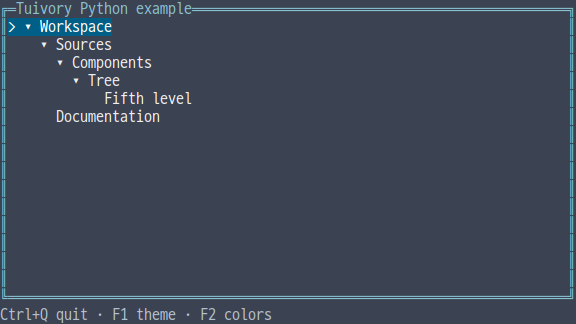
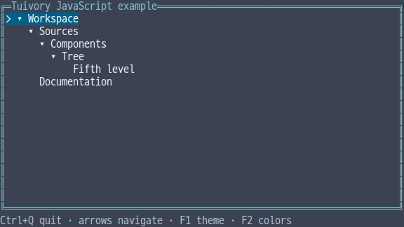
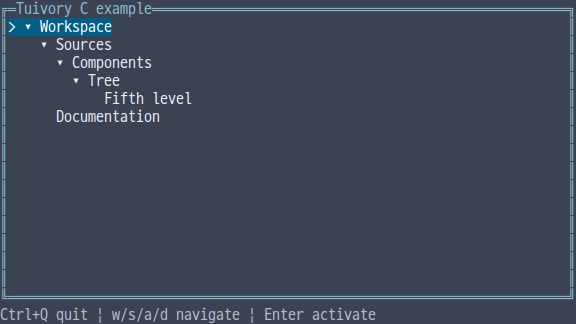
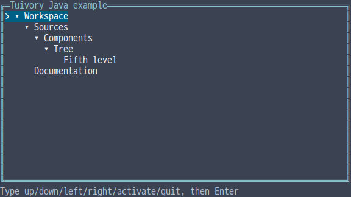

# Independent language support

[한국어 (기본)](languages.md) · **English**

**Unreleased work for TVR-15, 16, 30, 31 and 32. Not included in published 0.11.1.** Source stages integrate through dev; registry and product releases are separate publication stages. The epics remain in progress; this is not a completed port of the full Go/Rust catalog.

## Independence and availability

Each language implements its own models, state and drawing. There is no FFI/JNI, shared native engine or subprocess calling another Tuivory language implementation. C++ does not link Tuivory C. Only common design/Unicode/palette data, specifications, fixtures and build-time tools are shared. TypeScript/JavaScript use one TS implementation emitting JS and declarations.

The first verification unit covers installation/import/include, 12 embedded palettes, semantic states, cell buffers/panels and Tree. Trees provide stable IDs, contiguous parent-first preorder with a 128-level limit, expansion, selection, scrolling, horizontal panning, action routing and coordinate-based clicks. Hosts replace Trees when data changes, reconnect state and choose application composition, global keys, cross-component focus, terminal lifecycle and business I/O.

| Language | One public entry point | Package | Current adapter scope |
| --- | --- | --- | --- |
| [Python](../python/README.en.md) | `import tuivory` | Normal wheel/sdist, Python 3.11+, regex/wcwidth | Independent canvas, opt-in POSIX session, bilingual source execution |
| [TypeScript/JavaScript](../javascript/README.en.md) | `import * as ui from 'tuivory'` | ESM npm package, JS and declarations, Node.js 22+ | Independent canvas and Node TTY example |
| [C](../c/README.en.md) | `#include "tuivory.h"` | C11 static library and headers | Independent canvas and POSIX example |
| [C++](../cpp/README.en.md) | `#include "tuivory.hpp"` | Independent C++17 header package | Independent canvas and POSIX RAII example |
| [Java](../java/README.en.md) | `import static io.tuivory.Tuivory.*;` | Java 17 JAR, no JNI | Independent canvas and line-input example; no raw-terminal adapter |

All five languages provide [workspace](language-workspace.en.md) and [text editing](language-text.en.md), checked with shared fixtures and external consumers. [Forms and controls](language-forms.en.md) are also validated in all five languages. [Lists and search pickers](language-collections.en.md) are also validated in all five languages. [Menus and context menus](language-menu.en.md) are validated in all five languages. [Notices, progress and data states](language-feedback.en.md) are also validated in all five languages. [Spacing/stacks and supporting components](language-layout.en.md) are also validated in all five languages. Python/TS grids and full containers remain follow-up prototypes and do not imply full Go/Rust parity. Remaining catalog components, advanced grids, drag/drop, popup shadows, optional syntax analysis and framework adapters require separate implementation/validation in each epic.

## API use

```python
import tuivory as ui
model = ui.Tree([ui.Node("root", "Workspace"), ui.Node("child", "Child", parent="root")])
model.handle("right", height=10)
canvas = ui.Canvas(40, 10, ui.Palette("dark", "8"))
model.draw(canvas, ui.Rect(0, 0, 40, 10))
output = canvas.ansi()  # The host chooses output and terminal lifecycle.
```

```javascript
import * as ui from 'tuivory';
const tree = new ui.Tree([{id:'root',name:'Workspace'},{id:'child',parent:'root',name:'Child'}]);
tree.handle('right', 10);
const canvas = new ui.Canvas(40, 10, new ui.Palette('dark', '8'));
tree.draw(canvas, ui.rect(0, 0, 40, 10));
```

```c
#include "tuivory.h"
/* Inside a function: Tree creation copies input strings. */
TuiNode nodes[] = {{.id="root", .name="Workspace"}, {.id="child", .parent="root", .name="Child"}};
TuiTree *tree = tui_tree_new(nodes, 2);
/* Check for NULL before use. */
tui_tree_free(tree);
```

```cpp
#include "tuivory.hpp"
tuivory::Tree tree({{"root", "Workspace"}, {"child", "Child", "root"}});
tree.handle("right", 10);
```

```java
import static io.tuivory.Tuivory.*;
// Inside a method
var tree = new Tree(java.util.List.of(new Node("root", "Workspace"), new Node("child", "Child", "root")));
tree.handle("right", 10);
```

Tree actions are `up/down/left/right/home/end/page_up/page_down/pan_left/pan_right/toggle/activate`. Events return `select/expand/collapse/activate` and a stable ID, or an empty event if unchanged. Click coordinates are relative to the inner Tree viewport. Changing theme/profile means drawing the same model with a new canvas/palette, preserving selection, expansion and scrolling.

C copies inputs and uses `tui_tree_free`, `tui_canvas_free` and `tui_string_free`. Event IDs remain valid until Tree destruction; returned output strings belong to the caller. C++ uses values/RAII, while Python/JS/Java use their own runtime ownership. Concurrent model mutation is unsupported: serialize through the host event loop.

Drawing clips by grapheme, repairs wide glyphs intersecting either horizontal overlay edge and preserves outside styles. ANSI output sanitizes literal control characters and uses cursor position/visibility without forcing shape/blink modes. Actual fonts, terminals and Unicode versions can disagree on width; physical-client validation is distinct from model/PTY checks.

## Builds, validation and next steps

```sh
make build-c build-cpp build-java
make test-c test-cpp test-java
```

C/C++ examples build only for the current Linux host at `bin/c/tuivory-linux-<arch>` and `bin/cpp/tuivory-linux-<arch>`. Static libraries, temporary validation output and JARs stay in `.cache/`. Python/JS run from source. Python/JS/Java are exempt from runtime-free static executable/ELF requirements. CentOS validation is not performed.

Local checks cover shared Tree/state scenarios, 12 palettes, CJK/emoji/wide-glyph edges and isolated installation/linking. Actual results, unexecuted checks, remote CI and publication status are distinguished in the [evidence](evidence/language-foundation-results.json).

[Python TVR-15](https://leechis7.atlassian.net/browse/TVR-15) → [TS/JS TVR-16](https://leechis7.atlassian.net/browse/TVR-16) → [C TVR-30](https://leechis7.atlassian.net/browse/TVR-30) → [C++ TVR-31](https://leechis7.atlassian.net/browse/TVR-31) → [Java TVR-32](https://leechis7.atlassian.net/browse/TVR-32). Continue the remaining components within each epic.

## Tree references

Captured from each implementation’s actual ANSI buffer in dark/True Color. These reference captures do not validate physical terminals or blinking.











Native C/C++/Java style colors encode RGB as `0x1000000 | RRGGBB`; other values are ANSI indices 0–255. Python/TS use `#RRGGBB` strings or decimal index strings. The canvas handles this conversion internally. Unicode width cases explicitly cover emoji modifiers, flags, combining marks, Hangul Jamo and presentation selectors.

## Reproducing local package checks

Activate a Python virtual environment first, then prepare development tools and local archives. These are development dependencies, not cross-language runtime dependencies:

```sh
python -m pip install ./python build cairosvg
python -m build python --outdir .cache/packages/python
python -m pip download --only-binary=:all: --dest .cache/packages/python/deps regex wcwidth
npm --prefix javascript install
npm --prefix javascript run build
mkdir -p .cache/packages/javascript
NPM_CONFIG_CACHE="$PWD/.cache/npm" npm pack ./javascript --pack-destination .cache/packages/javascript
python tools/check_runtime_languages.py
python tools/export_language_data.py --check
python tools/check_language_examples.py --matrix
python tools/capture_language_trees.py
```

Build C/C++/Java first as shown above. Reference capture also needs a CJK-capable D2Coding font and Cairo; these are tooling dependencies. Local results used Python 3.14.4, Node 26.13.0, TypeScript 7.0.2 and JDK 27. Java was compiled with `--release 17`; a JVM 17 runtime was not executed locally. Six unreleased local preview archives and checksums are assembled by `python tools/package_languages.py` under `.cache/packages/languages/`. No registry publish command is run.

[Independent-language workspace APIs and examples](language-workspace.en.md): tabs/panels/splits/breadcrumbs/status lines are verified in all five implementations. Other catalog ports remain in progress.

[Independent text editing API](language-text.en.md)

[Independent forms and controls API](language-forms.en.md)

[Independent focus scope API](language-focus.en.md)

[Independent lists and search pickers API](language-collections.en.md)

[Independent menu/context-menu API](language-menu.en.md)

[Independent notices/progress/data-state API](language-feedback.en.md)

[Independent spacing/stack and badge/chip/hint API](language-layout.en.md)
