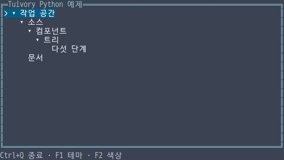
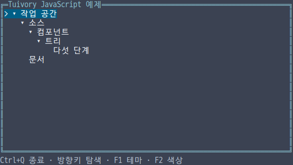
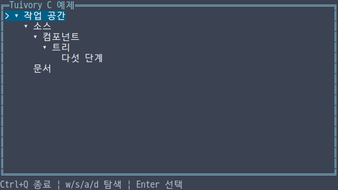
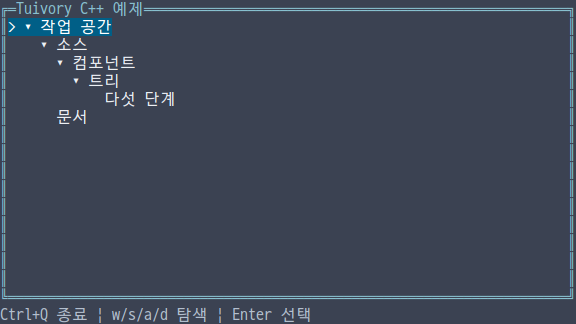
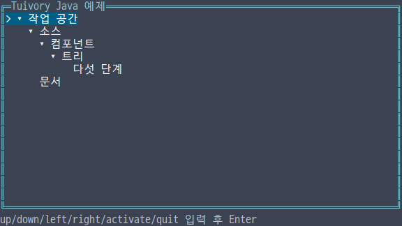

# 독립 언어 지원

**한국어 (기본)** · [English](languages.en.md)

**TVR-15·16·30·31·32의 미배포 작업입니다. 기존 공개 0.11.1에 포함되지 않습니다.** 단계별 소스는 dev로 통합하며 레지스트리·제품 릴리스는 별도 배포 단계입니다. 에픽은 진행 중이며 전체 Go/Rust 카탈로그 이식을 완료했다는 뜻이 아닙니다.

## 독립 원칙과 제공 범위

각 언어가 자체 데이터 모델·상태·그리기를 구현합니다. Rust/Go/C 등 다른 Tuivory 언어 코어를 호출하는 FFI/JNI·공유 네이티브 라이브러리·서브프로세스가 없습니다. C++도 Tuivory C를 링크하지 않습니다. 공통 디자인·Unicode/팔레트 데이터·테스트 사례·개발 시 생성 도구만 공유합니다. TypeScript/JavaScript는 한 TS 구현에서 JS와 타입 선언을 제공합니다.

첫 검증 단위는 설치·import/include, 내장 12팔레트, 상태, 셀 버퍼·패널, Tree입니다. 안정 ID, 부모 선행 연속 preorder와 128단계 제한, 펼침/선택/스크롤/가로 이동, 키 동작과 좌표 기반 클릭을 구현합니다. 앱이 데이터 변경 시 새 Tree를 만들고 상태를 연결하며, 화면 전체·전역 키·컴포넌트 간 포커스·단말 수명·업무 I/O를 결정합니다.

| 언어 | 하나의 공개 진입점 | 배포 형태 | 현재 어댑터 범위 |
| --- | --- | --- | --- |
| [Python](../python/README.md) | `import tuivory` | 일반 wheel/sdist, Python 3.11+, regex/wcwidth | 독립 캔버스·선택적 POSIX 세션·한영 소스 실행 |
| [TypeScript/JavaScript](../javascript/README.md) | `import * as ui from 'tuivory'` | ESM npm 패키지·JS·타입 선언, Node.js 22+ | 독립 캔버스·Node TerminalIO·TTY 예제 |
| [C](../c/README.md) | `#include "tuivory.h"` | C11 정적 라이브러리·헤더 | 독립 캔버스·선택적 POSIX Terminal·예제 |
| [C++](../cpp/README.md) | `#include "tuivory.hpp"` | 독립 C++17 헤더 패키지 | 독립 캔버스·선택적 POSIX Terminal·RAII 예제 |
| [Java](../java/README.md) | `import static io.tuivory.Tuivory.*;` | Java 17 JAR, JNI 없음 | 독립 캔버스·줄 입력 예제, 선택적 POSIX Terminal(stty) |

## 컴포넌트 API

| 영역 | 제공 API | 규격·사용법 |
| --- | --- | --- |
| 작업 영역 | Tree·Tabs·패널·분할·경로·상태줄 | [API](language-workspace.md) |
| 텍스트 | Text·실제 커서·원문 범위 | [API](language-text.md) |
| 폼·컨트롤 | Form·Field·선택·비활성 상태 | [API](language-forms.md) |
| 포커스 범위 | Focus·팝업 입력 차단·복귀 | [API](language-focus.md) |
| 목록·검색 선택기 | List·SearchPicker | [API](language-collections.md) |
| 메뉴 | 계층·메뉴바·문맥 메뉴 | [API](language-menu.md) |
| 알림·진행 | NoticeQueue·Progress·DataState | [API](language-feedback.md) |
| 배치·보조 컴포넌트 | 간격·스택·Badge·Chip·Help | [API](language-layout.md) |
| 컨테이너·셀 복사 | Container·가상 자식·Canvas 복사 | [API](language-containers.md) |
| 바탕·스타일 | Surface·실제 바탕의 의미별 스타일 | [API](language-surfaces.md) |
| 팝업·대화상자 | Shadow·Dialog | [API](language-popups.md) |
| 문서 | TextDocument·마크업·강조 범위 | [API](language-documents.md) |
| 구문 강조 | SQLAnalyzer·선택적 분석 연결 | [API](language-syntax.md) |
| 데이터 그리드 | 가상 데이터·편집·붙여넣기·범위·보기 | [API](language-grid.md) |
| 드래그앤드롭 | DragState·이동 요청·앱 승인 | [API](language-drag.md) |
| 입력·터미널 | InputDecoder·선택적 Terminal | [API](language-terminal.md) |

각 규격은 실제 API·소유권·앱 책임·검증 범위를 설명합니다. 그리드의 추가 포인터 동작과 전체 카탈로그 점검은 진행 중이며 에픽을 완료 처리하지 않습니다.

## API 사용

```python
import tuivory as ui
model = ui.Tree([ui.Node("root", "작업 공간"), ui.Node("child", "한글", parent="root")])
model.handle("right", height=10)
canvas = ui.Canvas(40, 10, ui.Palette("dark", "8"))
model.draw(canvas, ui.Rect(0, 0, 40, 10))
output = canvas.ansi()  # 출력·단말 수명은 호스트가 선택
```

```javascript
import * as ui from 'tuivory';
const tree = new ui.Tree([{id:'root',name:'Workspace'},{id:'child',parent:'root',name:'Child'}]);
tree.handle('right', 10);
const canvas = new ui.Canvas(40, 10, new ui.Palette('dark', '8'));
tree.draw(canvas, ui.rect(0, 0, 40, 10));
```

```c
#include "tuivory.h"
/* 함수 내부: 모든 입력 문자열은 Tree 생성 시 복사합니다. */
TuiNode nodes[] = {{.id="root", .name="Workspace"}, {.id="child", .parent="root", .name="Child"}};
TuiTree *tree = tui_tree_new(nodes, 2);
/* NULL을 검사하고 사용합니다. */
tui_tree_free(tree);
```

```cpp
#include "tuivory.hpp"
tuivory::Tree tree({{"root", "Workspace"}, {"child", "Child", "root"}});
tree.handle("right", 10);
```

```java
import static io.tuivory.Tuivory.*;
// 메서드 내부
var tree = new Tree(java.util.List.of(new Node("root", "Workspace"), new Node("child", "Child", "root")));
tree.handle("right", 10);
```

Tree 동작 이름은 `up/down/left/right/home/end/page_up/page_down/pan_left/pan_right/toggle/activate`입니다. 이벤트는 `select/expand/collapse/activate`와 안정 ID를 반환하며 변화가 없으면 빈 이벤트입니다. 클릭 좌표는 내부 Tree 영역 기준입니다. 색상/테마 변경은 같은 모델에 새 캔버스/팔레트를 연결하므로 선택·펼침·스크롤이 보존됩니다.

C는 입력을 복사하며 `tui_tree_free`, `tui_canvas_free`, `tui_string_free`로 자원을 해제합니다. 이벤트 ID는 Tree 수명까지 유효하고 출력 문자열은 호출자가 해제합니다. C++는 값·RAII, Python/JS/Java는 각 런타임의 소유권을 사용합니다. 동시 모델 변경은 지원하지 않으며 호스트 이벤트 루프에서 직렬화합니다.

그리기는 grapheme 단위로 클리핑하며 오버레이의 양쪽 가로 경계에 걸친 두 칸 글자를 공백으로 수리하고 바깥 스타일을 보존합니다. ANSI 출력은 평문 제어 문자를 정리하고 위치·가시성을 사용하되 커서 모양/깜빡임을 강제하지 않습니다. 실제 터미널·폰트·Unicode 버전에 따라 폭 차이는 가능하며 물리 클라이언트 검증을 별도로 구분합니다.

## 빌드·검증과 다음 단계

```sh
make build-c build-cpp build-java
make test-c test-cpp test-java
```

C/C++ 기본 예제는 현재 Linux 호스트 하나만 `bin/c/tuivory-linux-<arch>`, `bin/cpp/tuivory-linux-<arch>`에 생성합니다. 정적 라이브러리·임시 검증 자료·JAR는 `.cache/`에 둡니다. Python/JS는 소스로 실행하며 Python·JS·Java에 별도 런타임 없는 정적 실행파일/ELF 조건을 적용하지 않습니다. CentOS는 검증하지 않습니다.

로컬 공통 Tree·상태·12팔레트·한글/이모지·두 칸 문자 경계와 외부 설치/링크 검증을 수행합니다. 자세한 실제 실행 결과는 [검증 기록](evidence/language-foundation-results.json)에 기록하며, 미실행 항목과 원격 CI·공개 게시 상태를 구분합니다.

[Python TVR-15](https://leechis7.atlassian.net/browse/TVR-15) → [TS/JS TVR-16](https://leechis7.atlassian.net/browse/TVR-16) → [C TVR-30](https://leechis7.atlassian.net/browse/TVR-30) → [C++ TVR-31](https://leechis7.atlassian.net/browse/TVR-31) → [Java TVR-32](https://leechis7.atlassian.net/browse/TVR-32). 각 에픽에서 나머지 컴포넌트를 확장합니다.

## Tree 참조 화면

각 구현의 실제 ANSI 버퍼에서 다크/True Color 화면을 캡처했습니다. 참조 캡처이며 물리 터미널이나 깜빡임 검증을 뜻하지 않습니다.











C/C++/Java 스타일 색상은 `0x1000000 | RRGGBB`로 RGB를, 그 밖의 값은 ANSI 0–255 인덱스로 나타냅니다. Python/TS는 `#RRGGBB` 또는 인덱스의 십진 문자열을 사용하며 캔버스가 변환합니다. Unicode 공통 검사는 피부색 이모지·국기·결합 문자·한글 자모·표현 선택자를 포함합니다.

## 로컬 패키지 검사 재현

Python 가상 환경을 먼저 활성화한 뒤 개발 도구와 로컬 아카이브를 준비합니다. 아래 개발 의존성은 다른 Tuivory 언어 런타임 연결을 의미하지 않습니다.

```sh
python -m pip install ./python build cairosvg
python -m build python --outdir .cache/packages/python
python -m pip download --only-binary=:all: --dest .cache/packages/python/deps regex wcwidth
npm --prefix javascript install
npm --prefix javascript run build
mkdir -p .cache/packages/javascript
NPM_CONFIG_CACHE="$PWD/.cache/npm" npm pack ./javascript --pack-destination .cache/packages/javascript
python tools/check_runtime_languages.py
python tools/export_language_data.py --check
python tools/check_language_examples.py --matrix
python tools/capture_language_trees.py
```

C/C++/Java는 위의 명령으로 먼저 빌드합니다. 참조 화면 캡처에는 한글을 지원하는 D2Coding 폰트와 Cairo도 필요하며 개발 도구 조건입니다. 실제 로컬 검증은 Python 3.14.4, Node 26.13.0, TypeScript 7.0.2, JDK 27로 수행했습니다. Java는 `--release 17`로 컴파일했고 JVM 17 실행은 로컬에서 수행하지 않았습니다. `python tools/package_languages.py`는 `.cache/packages/languages/`에 미배포 로컬 미리보기 6개와 체크섬을 모으며 레지스트리 게시 명령은 실행하지 않습니다.
