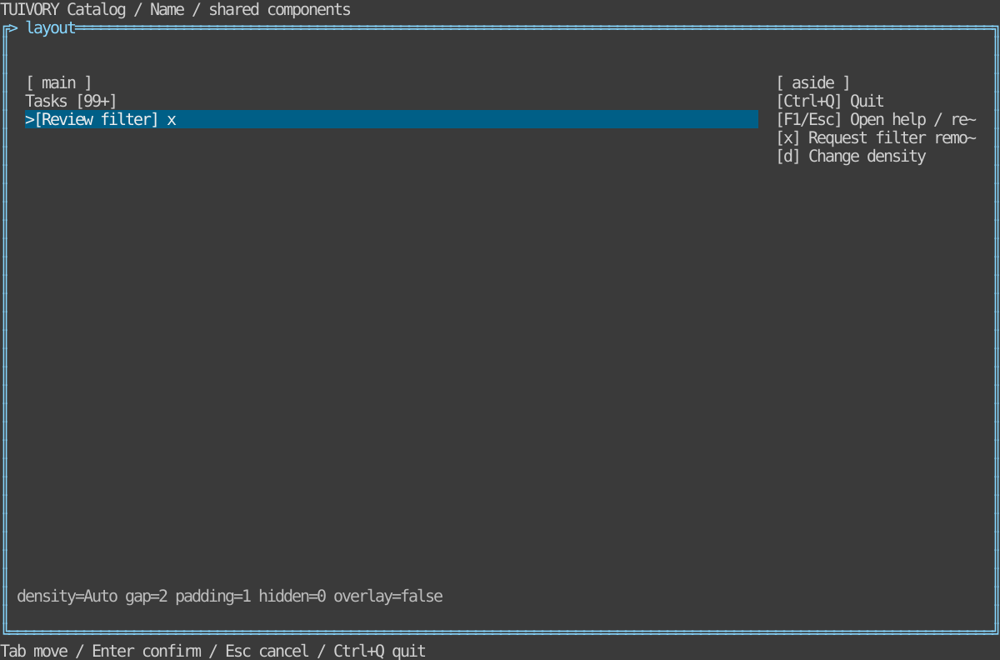

# Layout, density and supporting components — TVR-13

[한국어 (default)](layout.md) · **English**

Public Go APIs: ResolveSpacing, StackLayout/StackRects, DrawerLayout, Badge/Chip/Help and corresponding views. Rust provides layout models, Badge/Chip/HelpWidget and ratatui::stack_rects. Shared defaults live in design/layout-tokens.json and are checked in both modules; no runtime JSON file is required.

Density: auto/compact/comfortable; auto chooses compact below 80 terminal cells. Compact gap/padding/control_gap is 0/0/1; comfortable is 2/1/2. Hosts connect tokens to layout/control spacing without forcing existing controls to change. Stack items carry unique IDs, positive minima, preferred sizes and remaining-space weights. Allocate preferences in input order, then weighted extra cells. Narrow layouts reduce gaps, shrink the first item or hide items that do not fit; immutable preferences restore on expansion. Adapters return cell rectangles and hidden IDs for host children.

Badges distinguish unspecified counts from zero and default to 99+. Chips render common states/removal hints and emit remove requests only; hosts own filter/value changes. Pointer removal targets the visible x only. Read-only/busy/disabled chips cannot request removal.

Help validates nonempty case-insensitive unique display keys, orders by priority, handles disabled hints and reports omission. It neither parses key protocols nor registers global bindings. Demo: F1 help, Esc return, x removal request, d density; background removal is blocked during help. All catalog modes support F2/F3 theme/profile changes without rebuilding models.

Accordion composes existing Tree expansion and Panel content. Drawer combines new placement with Panel and uses FocusStack scopes for overlay routing/restoration. Stepper composes breadcrumbs/status with Form previous/next buttons; hosts decide validation and workflow. No redundant parallel widget state machines were added.

Tests cover shared defaults, widths 0–240, bounds/non-overlap/narrow fallback/preference preservation, drawer mode, zero/99+ counts, removal immutability/guards, help conflicts/priorities and localized PTY help/background blocking/density/removal/theme/resize.

## Run and boundaries

```sh
make run-catalog-go ARGS="--mode layout --lang ko"
make run-catalog-rust ARGS="--mode layout --lang en"
```

Hosts own data, business actions, clocks and terminal lifecycle. Public models emit requests and render literal cell-clipped rows. Existing v0.1.0 tags do not include these APIs; approved changes merge into dev only. Static linking, Unicode/ASCII and color-profile requirements remain.



[Light](images/layout-light-en.svg) · [Blackwhite](images/layout-blackwhite-en.svg)

Actual Rust TestBackend 120×36 reference, not a Go capture or physical/SSH terminal result. Generate six localized references with `tools/snapshot_catalog.py BINARY --mode layout`.

[Backlog](components-backlog.en.md) · [Static distribution](static-build.en.md)
