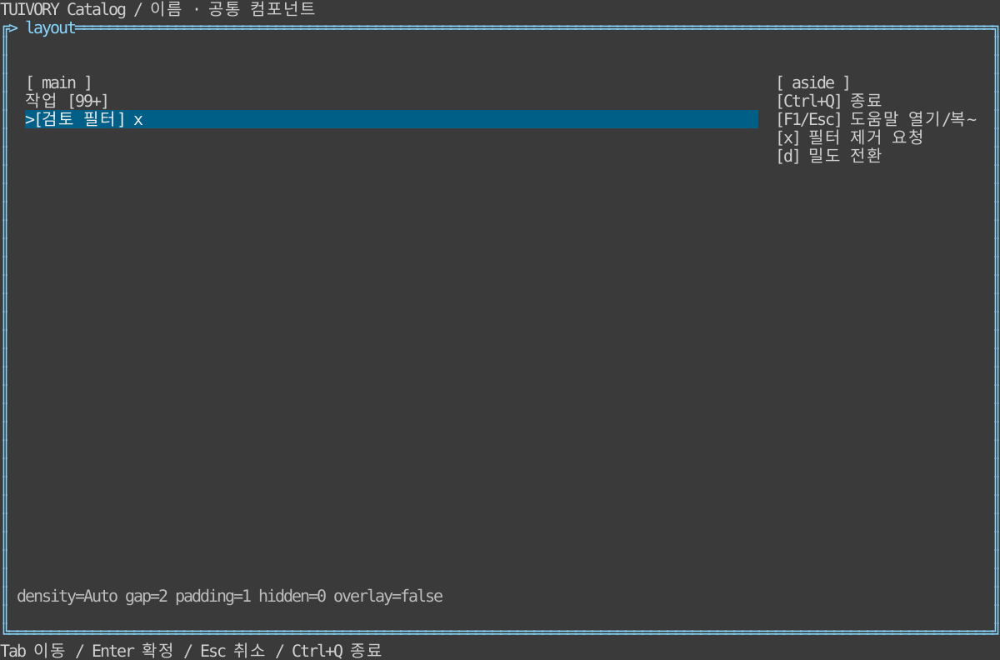

# 배치·밀도·부가 컴포넌트 — TVR-13

**한국어 (기본)** · [English](layout.en.md)

Go `ResolveSpacing`, `StackLayout`/`StackRects`, `DrawerLayout`, `Badge`/`Chip`/`Help`와 대응 뷰, Rust `layout` 코어·Badge/Chip/HelpWidget·`ratatui::stack_rects`를 제공합니다. 공통 기본값은 design/layout-tokens.json이며 두 모듈의 검사가 같은 값을 확인합니다. 런타임 외부 JSON 파일은 요구하지 않습니다.

밀도는 auto/compact/comfortable입니다. auto는 80셀 미만에서 compact를 선택합니다. compact는 gap=0/padding=0/control_gap=1, comfortable은 2/1/2입니다. 호스트가 토큰을 배치·컨트롤 간격에 연결하며 기존 컨트롤 간격을 강제로 바꾸지 않습니다. StackItem은 고유 ID, 최소 크기(1 이상), 선호 크기, 남는 공간 가중치를 받습니다. 선호 크기까지 입력 순서로 배분한 뒤 가중치로 남는 셀을 배분합니다. 부족하면 간격부터 줄이고 우선 항목을 축소하거나 맞지 않는 항목을 숨깁니다. 원래 선호 크기는 변경하지 않으므로 창 확대 시 복원됩니다. 축 방향·패딩·숨김 ID를 받아 실제 프레임워크 자식 배치에 연결합니다.

Badge는 개수 미지정과 0을 구분하고 기본 99+ 상한을 표시합니다. Chip은 선택/오류/비활성 등 공통 상태와 제거 표식을 표시하며 RequestRemove/request_remove만 반환합니다. 필터 삭제·값 변경은 앱 책임입니다. 클릭 제거는 보이는 x 영역에만 연결하고 읽기 전용/busy/disabled는 제거하지 않습니다.

Help는 표시 키·설명·우선순위·비활성을 받으며 빈/중복(대소문자 무시) 키를 거부합니다. 중요 단축키를 먼저 표시하고 공간 부족을 생략 개수로 나타냅니다. 키 프로토콜이나 전역 등록기는 아닙니다. 카탈로그 F1은 키보드 도움말, Esc는 복귀, x는 필터 제거 요청, d는 밀도 전환입니다. 도움말 중 배경 제거를 막습니다. 전체 모드에서 F2/F3으로 모델 상태를 보존하며 테마/색상을 바꿉니다.

Accordion은 기존 Tree 펼침 상태와 Panel 내용 조합을 사용합니다. Drawer는 새 배치 판정과 Panel을 사용하고 Overlay=true이면 기존 FocusStack 팝업 스코프로 입력 차단·복귀를 연결합니다. Stepper는 기존 경로/상태 표시와 Form 이전/다음 버튼을 조합하며 검증·진행 가능 여부는 앱이 결정합니다. 동일 상태를 관리하는 별도 위젯을 중복 추가하지 않았습니다.

검증은 공통 JSON 기본값, 0~240셀 배치의 경계·비겹침·좁은 화면·선호 값 보존, Drawer 전환, 개수 0/99+, 제거 요청 불변성·읽기 전용, 도움말 충돌·우선순위, 한영 PTY 도움말/배경 차단/밀도/제거/테마/리사이즈를 포함합니다.

## 실행과 경계

```sh
make run-catalog-go ARGS="--mode layout --lang ko"
make run-catalog-rust ARGS="--mode layout --lang en"
```

호스트가 데이터·업무 동작·시간·단말 수명주기를 소유합니다. 공개 모델은 요청을 반환하고 실제 행은 셀 폭에 맞춰 문자 그대로 렌더링합니다. 0.2.0 태그에 포함합니다. 정적 링크·Unicode/ASCII·색상 프로필 조건을 유지합니다.



[Light](images/layout-light.svg) · [Blackwhite](images/layout-blackwhite.svg)

실제 Rust TestBackend 120×36 참조이며 Go 캡처나 실제 서버/SSH 단말 결과가 아닙니다. `tools/snapshot_catalog.py BINARY --mode layout`로 한영 6장을 생성합니다.

[Backlog](components-backlog.md) · [Static distribution](static-build.md)

Stack/Drawer는 호스트가 지정한 영역·항목·최소 크기에 대한 배치 도구입니다. 앱 전체의 패널 순서·숨김 우선순위·화면별 breakpoint를 강제하지 않습니다. Help는 제공된 단축키 설명의 표시이며 도움말 화면 전체·목차·전역 명령 등록은 앱 책임입니다. [책임 범위](component-boundary.md).
