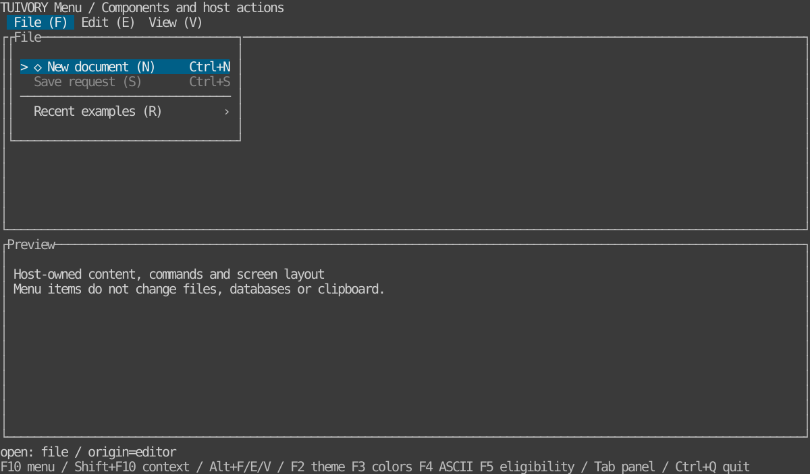

# Shared menus — TVR-7

[한국어 (default)](menus.md) · **English**

Go `Menu / NewMenuView / NewMenuBarView` and Rust `menu::Menu / MenuWidget / MenuBarWidget / MenuPopupWidget` provide flat/hierarchical menus. **Included in 0.3.0; absent from existing v0.2.0 tags.** Existing `ListModel / SearchPicker` APIs remain unchanged.

References: [LazyOra v0.11.2 pinned menu](https://github.com/leechis7/lazyora/blob/98a2f47e8621838101d5db781232a699dba382f3/internal/ui/menu.go) and [groups/back navigation](https://github.com/leechis7/lazyora/blob/98a2f47e8621838101d5db781232a699dba382f3/internal/ui/menu_groups.go). Adopt a single-popup drill-down/back flow, restored parent selection, separators/disabled/shortcut cues, original caller preservation and drawing only the assigned popup area. No command-ID taxonomy, automatic grouping threshold, SQL/Oracle or transaction implementation was imported.

## Run

```sh
make run-menu-go ARGS="--lang en"
make run-menu-rust ARGS="--lang ko --ascii"
```

The same database-free data demonstrates F10 main menu, Shift+F10 context menu and Alt+F/E/V root groups. These global bindings are **host-example choices**. Tab switches editor/preview, F2/F3/F4 changes theme/profile/ASCII, F5 changes save-request eligibility, Ctrl+Q quits. Menus emit requests and do not change files, databases or clipboard.



[Child groups and Back](images/menu-nested-en.svg) · [Light](images/menu-light-en.svg) · [Blackwhite](images/menu-blackwhite-en.svg) · [ASCII](images/menu-ascii-en.svg). Rust TestBackend 120×32 reference, not a Go/SSH capture or actual LazyOra integration. [Go host](../go/examples/menu/main.go) · [Rust host](../rust/examples/menu/main.rs).

## Data, state and requests

`MenuItem` fields: stable `ID`, `Parent` (empty at root), `Label`, optional `Secondary / Shortcut / Mnemonic / Icon / ASCIIIcon`, `Disabled / Separator`. Rust uses snake_case. Input order is retained; an item with children is a group. Hosts choose taxonomy, groups and eligibility.

IDs must be globally unique, nonempty and not start with `@`. Missing parents, cycles, separator children, depth above 32 and more than 10,000 items are rejected. Mnemonics are one ASCII letter/digit, case-insensitively unique among siblings; separators cannot have mnemonics. `Shortcut` is display text: Ctrl+C and other global protocols are neither parsed nor registered.

```go
menu, err := tuivory.NewMenu([]tuivory.MenuItem{
    {ID: "edit", Label: "Edit", Mnemonic: "e"},
    {ID: "clipboard", Parent: "edit", Label: "Clipboard requests", Mnemonic: "c"},
    {ID: "copy", Parent: "clipboard", Label: "Copy request", Mnemonic: "c", Shortcut: "Ctrl+C"},
})
if err != nil { return err }
menu.BackLabel, menu.EmptyLabel = "Back", "No items"
event := menu.Open("edit", "editor") // Original panel or host-defined context ID
view, err := tuivory.NewMenuView(menu, palette, false, onEvent)
if err != nil { return err }
_ = event
_ = view
```

```rust
use tuivory::menu::{Menu, MenuItem};
let mut menu = Menu::new(vec![
    MenuItem { id: "edit".into(), label: "Edit".into(), mnemonic: "e".into(), ..Default::default() },
    MenuItem { id: "copy".into(), parent: "edit".into(), label: "Copy request".into(), ..Default::default() },
])?;
menu.back_label = "Back".into();
menu.empty_label = "No items".into();
let event = menu.open("edit", "editor");
```

`Open / open(id, returnID)` opens a group or, with an empty ID, the context root list. Deep group IDs record their ancestor selection path. Directly opening a valid leaf returns activate without a popup. Disabled items/ancestors cannot open or activate. A context root shows the supplied model’s root items. For panel-specific context commands, hosts build items from the original panel and may connect a separate Menu model to the same renderer. Read state through `Opened/Path/FocusedID/ReturnID/BarFocusedID/Title` and Rust equivalents.

`MenuEvent` carries `Kind / ID / ReturnID`. No request is an empty Kind in Go, `None` in Rust. open/back/focus describe navigation; open_request asks the host to open a bar item; activate/close allow the host to restore the caller after closing. **ReturnID is the original host-supplied context**, avoiding use of the popup widget as the business target. Hosts recheck eligibility against that original panel's data and connect execution/storage/clipboard actions.

Apply data updates on the host UI thread. `SetItems / set_items` validates everything before mutation. Errors preserve state; surviving stable IDs and per-level selection/scroll persist. Removing/moving/disabling an open ancestor or removing its children returns close, so hosts close the layer and restore ReturnID. Focus reconciles to an available item, and obsolete level state is pruned.

## Internal interaction and rendering

`Handle / handle(action, value, height)`:

| Action | Result |
| --- | --- |
| previous/next or up/down | Wrap within the level, skipping separators/disabled items |
| first/last, page_up/page_down | Move to available endpoints/pages and keep focus visible |
| activate or right on a group | Enter children or request a command |
| left / cancel / back | Return to the parent selection; root Esc/back closes |
| left/right in a top-level group | Switch root groups without executing adjacent leaf commands |
| mnemonic + one character | Select/enter/request the designated current-level item |

Context roots do not open other main menus through left/right. Child levels include an `@back` row and separator; localize `BackLabel`. `Focus/focus` accepts available current-level items or Back. `Click/click` focuses then requests an action. Hover changes focus only. Go wires wheels/clicks and ignores duplicate double-click actions. Rust hosts translate framework mouse events into model requests.

`HandleBar / handle_bar` previous/next/left/right/first/last moves bar focus; activate/down/mnemonic emits open_request. `BarLayout / bar_layout` supplies cell ranges and overflow ends; `BarClick / bar_click` requests opening or overflow navigation. Hosts own actual input focus/global F10/Alt wiring. `MenuKey` translates only component-local arrows/Enter/Esc/mnemonics.

Primary/secondary text, shortcuts and child indicators fit terminal cells. Long labels use `~`; shortcut width is limited. Cues include focus `>`, Back `<`, child `›` (ASCII `>`), separator `─` (ASCII `-`), and `*` when an icon lacks an ASCII alternative. ASCII mode does not translate Korean labels/original data. Control characters display as spaces; tag-looking text remains literal. Styles reuse surface/selection/disabled/header/hint roles.

## Popup and host boundary

Menu popups always use a single border and no separate focus marker in the title. The current item uses selection background and `>`; the bar marks the open menu as active. Input focus does not add menu underlining. Input routing, background blocking and caller restoration remain. This visual change applies to 0.4.0; existing tags/assets are unchanged.

`ContentSize / content_size` excludes border/padding. `MenuPlacement / menu_placement(anchor, viewport, width, height)` places below the host-chosen anchor, moves above when needed and clamps inside the viewport. Menus do not own screens, backdrops or DB state.

Go wraps `NewPanelView(menuView, palette)` and draws the computed rectangle. Changing `MenuView.ASCII` or `SetPalette` does not recreate model state. Rust `MenuWidget` renders content; `MenuPopupWidget` adds the shared panel/padding and both wide-glyph edge repairs. `MenuBarWidget` occupies one row. Drawing preserves the outside area apart from blanking intersected wide glyphs. Hosts redraw the backdrop when closing.

Hosts must block background key/paste/mouse events while open, choose outside-click dismissal and restore the caller. The example does not forward the same click into background work. Keep the menu object/original values across theme/profile/character changes. Automatic grouping thresholds, contextual commands and real business operations stay out of the core. [Boundary](component-boundary.en.md).

[Validation](../evidence/menu.en.md) · [Shared navigation scenarios](../design/menu-cases.json)

[Single-border menu follow-up validation](../evidence/menu-single-border.en.md)

In 0.4.0, plain text follows the actual surface while explicit field/selection/edit backgrounds remain. See [surface/contrast design rules](../design/surfaces.en.md) and [fix evidence](../evidence/background-fix.en.md).

Disabled menus and menu bars use color/brightness without an extra disabled prefix. Check/radio selection indicators remain.

See [API lifecycle/migration](api-lifecycle.en.md) for deprecated APIs in unreleased source. Existing tags remain unchanged and legacy paths remain compatible.

Unreleased TVR-19 adds optional popup shadows, disabled by default: `off/auto/solid/dim`, placement including the full footprint, card-only hit testing and wide-glyph boundary protection. Hosts own backdrop redraws and opening/closing. [APIs, runnable examples and 12-palette views](popup-shadows.en.md).
