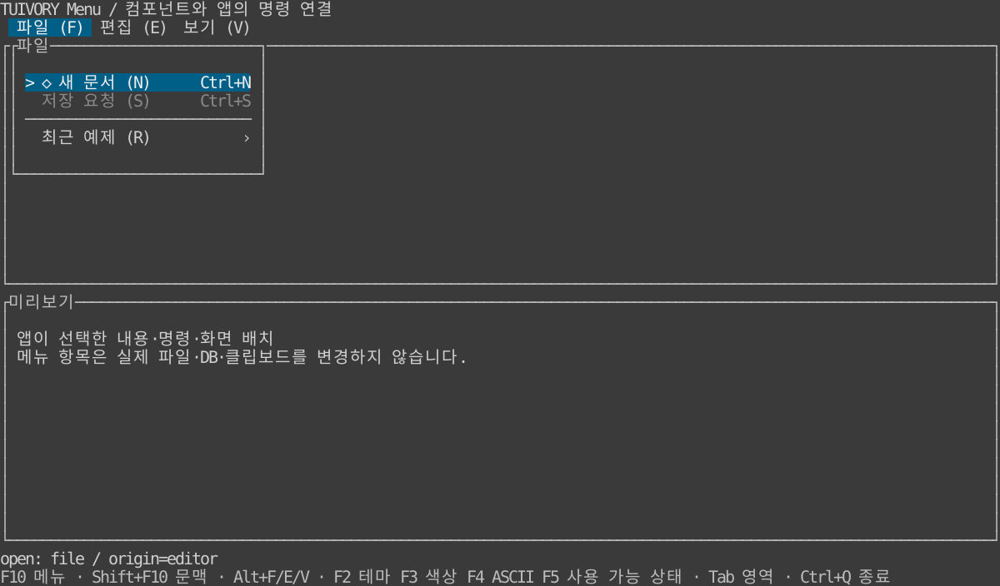

# 공통 메뉴 — TVR-7

**한국어 (기본)** · [English](menus.en.md)

Go `Menu / NewMenuView / NewMenuBarView`와 Rust `menu::Menu / MenuWidget / MenuBarWidget / MenuPopupWidget`으로 평면·계층 메뉴를 제공합니다. **미배포 작업 소스이며 기존 v0.2.0 태그에는 없습니다.** 기존 `ListModel / SearchPicker`는 그대로 유지합니다.

[LazyOra v0.11.2의 고정 커밋](https://github.com/leechis7/lazyora/blob/98a2f47e8621838101d5db781232a699dba382f3/internal/ui/menu.go)과 [그룹/뒤로가기](https://github.com/leechis7/lazyora/blob/98a2f47e8621838101d5db781232a699dba382f3/internal/ui/menu_groups.go)를 참고했습니다. 한 팝업 안에서 하위 그룹으로 진입하고 부모의 선택 위치로 돌아오는 흐름, 구분선·비활성·단축키 표시·원래 패널 보존·팝업 영역만 그리는 원칙을 적용합니다. LazyOra 명령 ID 분류·자동 그룹 임계값·SQL/Oracle/트랜잭션 구현을 가져오지 않았습니다.

## 실행

```sh
make run-menu-go ARGS="--lang ko"
make run-menu-rust ARGS="--lang en --ascii"
```

같은 DB 없는 데이터로 F10 주 메뉴, Shift+F10 문맥 메뉴, Alt+F/E/V 루트 그룹을 연결합니다. 전역 키는 **예제 앱의 선택**입니다. Tab은 편집/미리보기 패널을 바꾸고 F2/F3/F4는 테마/색상/ASCII, F5는 저장 요청의 사용 가능 상태, Ctrl+Q는 종료입니다. 메뉴는 요청만 반환하며 실제 파일·DB·클립보드를 변경하지 않습니다.



[하위 그룹·뒤로가기](images/menu-nested.svg) · [라이트](images/menu-light.svg) · [흑백](images/menu-blackwhite.svg) · [ASCII](images/menu-ascii.svg). Rust TestBackend 120×32 참조이며 Go 캡처·SSH·실제 LazyOra 적용 결과가 아닙니다. [Go 호스트](../go/examples/menu/main.go) · [Rust 호스트](../rust/examples/menu/main.rs).

## 데이터·상태·요청

`MenuItem` 필드: 안정된 `ID`, 부모 `Parent`(루트는 빈 문자열), `Label`, 선택적 `Secondary / Shortcut / Mnemonic / Icon / ASCIIIcon`, `Disabled / Separator`. Rust는 snake_case입니다. 입력 순서를 유지하고 그룹은 자식을 가진 항목입니다. 메뉴 분류·그룹 구성·사용 가능 상태는 앱이 정합니다.

ID는 전체에서 고유하고 비어 있거나 `@`로 시작할 수 없습니다. 부모 누락·순환·구분선 아래 자식·32단계 초과·10,000항목 초과는 오류입니다. Mnemonic은 ASCII 영문/숫자 한 자이며 형제끼리 대소문자를 무시해 고유해야 합니다. Separator에는 mnemonic을 지정할 수 없습니다. `Shortcut`은 표시 문구이며 Ctrl+C 같은 전역 프로토콜을 해석하거나 등록하지 않습니다.

```go
menu, err := tuivory.NewMenu([]tuivory.MenuItem{
    {ID: "edit", Label: "편집", Mnemonic: "e"},
    {ID: "clipboard", Parent: "edit", Label: "클립보드 요청", Mnemonic: "c"},
    {ID: "copy", Parent: "clipboard", Label: "복사 요청", Mnemonic: "c", Shortcut: "Ctrl+C"},
})
if err != nil { return err }
menu.BackLabel, menu.EmptyLabel = "뒤로", "항목 없음"
event := menu.Open("edit", "editor") // 호출 패널 또는 앱이 정한 원본 문맥 ID
view, err := tuivory.NewMenuView(menu, palette, false, onEvent)
if err != nil { return err }
_ = event
_ = view
```

```rust
use tuivory::menu::{Menu, MenuItem};
let mut menu = Menu::new(vec![
    MenuItem { id: "edit".into(), label: "편집".into(), mnemonic: "e".into(), ..Default::default() },
    MenuItem { id: "copy".into(), parent: "edit".into(), label: "복사 요청".into(), ..Default::default() },
])?;
menu.back_label = "뒤로".into();
menu.empty_label = "항목 없음".into();
let event = menu.open("edit", "editor");
```

`Open / open(id, returnID)`는 특정 그룹부터 열거나 빈 ID로 문맥 메뉴 루트 목록을 엽니다. 깊은 그룹 ID도 사용할 수 있으며 부모 선택 경로를 기록합니다. 유효한 명령(리프) ID를 직접 열면 팝업 없이 activate 요청을 반환합니다. 비활성 조상/항목은 열거나 실행하지 않습니다. 문맥 루트는 전달한 모델의 루트 항목입니다. 패널마다 다른 문맥 명령이 필요하면 앱이 원래 패널을 기준으로 항목을 구성하고 별도 Menu 모델을 같은 렌더러에 연결할 수 있습니다. `Opened/Path/FocusedID/ReturnID/BarFocusedID/Title`과 Rust 대응 메서드로 상태를 읽습니다.

`MenuEvent`는 `Kind / ID / ReturnID`를 가집니다. Go는 요청이 없으면 빈 Kind, Rust는 `None`입니다. open/back/focus는 내부 탐색, open_request는 메뉴 바에서 앱에 그룹 열기를 요청, activate/close는 닫힌 뒤 호출 패널로 복귀할 수 있는 요청입니다. **ReturnID는 앱이 제공한 원래 문맥**이며 현재 팝업 위젯을 업무 대상처럼 사용하지 않게 합니다. 앱은 원래 패널의 데이터를 기준으로 명령 가능 여부를 다시 확인하고 실행/저장·클립보드를 연결합니다.

데이터 변경은 호스트의 UI 스레드에서 적용합니다. `SetItems / set_items`는 먼저 전체 유효성을 검사하고 실패 시 상태를 유지합니다. 살아 있는 안정 ID와 레벨별 선택/스크롤을 보존합니다. 열린 조상이 제거·이동·비활성화되거나 자식이 없어지면 close 이벤트를 반환하므로 앱이 레이어를 닫고 ReturnID로 복귀해야 합니다. 사용 가능한 첫 항목으로 포커스를 보정하며 오래된 레벨 상태는 정리합니다.

## 내부 조작과 표시

`Handle / handle(action, value, height)` 동작:

| 동작 | 결과 |
| --- | --- |
| previous/next 또는 up/down | 구분선·비활성을 건너뛰고 레벨 안에서 순환 |
| first/last, page_up/page_down | 사용 가능한 끝/페이지로 이동하고 보이는 영역에 포커스 유지 |
| activate 또는 자식이 있는 항목에서 right | 그룹 진입 또는 명령 요청 |
| left / cancel / back | 하위에서 부모 선택 위치로 복귀. 최상위 Esc/back는 닫기 |
| 최상위 그룹의 left/right | 다른 루트 그룹으로 이동. 옆의 리프 명령을 자동 실행하지 않음 |
| mnemonic + 한 글자 | 현재 레벨의 지정된 항목 선택·진입/명령 요청 |

문맥 루트에서는 left/right로 다른 주 메뉴를 자동 열지 않습니다. 하위에는 `@back` 행과 구분선을 표시하며 `BackLabel`을 번역할 수 있습니다. `Focus/focus`는 활성 레벨의 사용 가능 항목 또는 뒤로 행만 선택합니다. `Click/click`은 선택 후 요청을 반환합니다. 호버는 포커스만 바꿉니다. Go 어댑터는 휠·클릭을 연결하고 더블 클릭의 중복 동작을 무시합니다. Rust 호스트는 프레임워크 마우스를 모델 요청으로 연결합니다.

`HandleBar / handle_bar`의 previous/next/left/right/first/last는 메뉴 바 포커스, activate/down/mnemonic은 open_request입니다. `BarLayout / bar_layout`은 셀 위치와 양끝 넘침 상태, `BarClick / bar_click`은 항목 열기/넘침 탐색 요청을 제공합니다. 실제 입력 포커스·전역 F10/Alt 연결은 앱 책임이며 `MenuKey`는 내부 방향키/Enter/Esc/mnemonic만 변환합니다.

주 텍스트·보조 설명·단축키·하위 표시를 셀 폭 안에 배치합니다. 긴 제목은 `~`로 줄이고 단축키에 쓰는 폭을 제한합니다. 포커스 `>`, 비활성 `-`, 뒤로 `<`, 하위 `›`(ASCII `>`)와 구분선 `─`(ASCII `-`)을 사용합니다. 아이콘은 ASCII 대체가 없으면 `*`로 표시합니다. ASCII 옵션이 앱의 한국어 라벨/원문을 영문으로 바꾸지는 않습니다. 제어 문자는 표시에서 공백으로 바꾸고 태그처럼 보이는 문구도 리터럴입니다. 범용 surface/selection/disabled/header/hint 역할을 재사용합니다.

## 팝업·앱 경계

`ContentSize / content_size`는 테두리/여백을 제외한 내용 선호 크기입니다. `MenuPlacement / menu_placement(anchor, viewport, width, height)`는 호스트가 정한 앵커 아래에 배치하고 부족하면 위로 옮겨 뷰포트 안으로 제한합니다. 메뉴는 화면 전체·배경·DB 상태를 소유하지 않습니다.

Go는 `NewPanelView(menuView, palette)`로 감싸고 계산한 사각형에 그립니다. `MenuView.ASCII`와 `SetPalette`를 바꿔도 모델을 재생성하지 않습니다. Rust `MenuWidget`은 내용만, `MenuPopupWidget`은 공통 패널/여백/양쪽 두 칸 문자 경계를 포함합니다. `MenuBarWidget`은 한 행입니다. 팝업 밖 그리기는 보존하며 일부 겹친 두 칸 문자만 공백으로 정리합니다. 닫을 때 배경을 다시 그리는 것은 앱 책임입니다.

앱은 메뉴가 열린 동안 배경 키/붙여넣기·마우스를 차단하고, 바깥 클릭의 닫기 정책과 호출 패널 복귀를 연결해야 합니다. 예제는 같은 클릭을 배경 작업으로 다시 전달하지 않습니다. 테마/색상/문자 표시를 바꿀 때 메뉴 객체와 원문을 유지합니다. 자동 그룹 임계값·화면별 명령·실제 업무 동작을 공통 코어에 넣지 않습니다. [책임 범위](component-boundary.md).

[검증 기록](../evidence/menu.md) · [공유 탐색 시나리오](../design/menu-cases.json)
