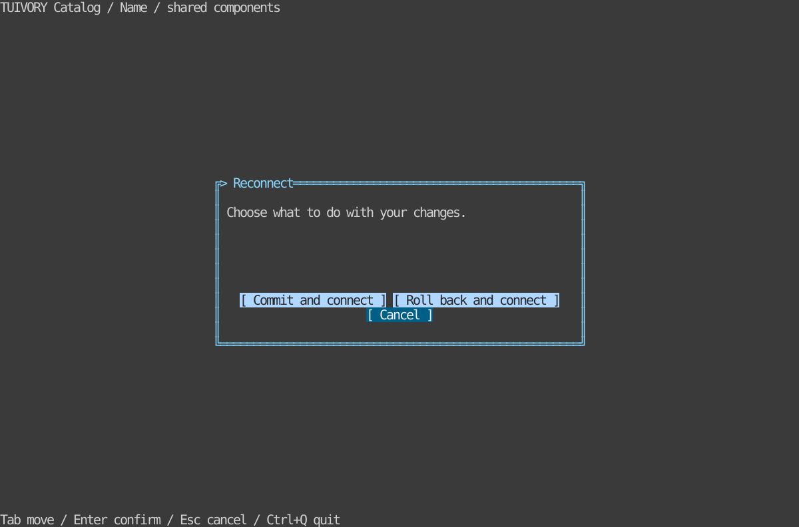

# Confirmation dialogs on small screens

[한국어 (default)](modals.md) · **English**

Go `NewModal()` fits its message and buttons within the terminal. Each button row is centered inside the content area after wrapping, including a row with a single button. The button rectangles also determine mouse hit testing.

```go
import ui "github.com/leechis7/tuivory/go"

modal := ui.NewModal().SetText("Handle pending changes.").
    AddButtons([]string{"Save changes and continue", "Discard changes and continue", "Cancel"}).SetFocus(2)
modal.SetDoneFunc(func(index int, label string) {
    // Original button index; Esc reports -1 and an empty label.
    // The host decides whether to save, discard or close the screen.
})
```

At small heights buttons take priority over message text. If all rows cannot fit, scroll to keep the focused button visible. At extreme sizes that cannot display a complete glyph, labels may be clipped. Enlarging the screen restores original labels and order. Tab/Shift+Tab, arrows, Enter, Esc, mouse and callbacks remain supported; `SetFocus` uses the original button order. Repeated `AddButtons` calls retain cumulative callback indices.

The root and compatibility `/ui` `Modal` is now an **SDK adapter embedding the backend Modal**, rather than a raw backend type alias. Existing SDK calls stay the same. For explicit interoperability with external code requiring the raw backend, pass `modal.Modal`; drawing that embedded object directly bypasses the responsive fix. Update text/buttons through SDK methods. `Styler.Modal` and `Apply` support both SDK and legacy backend Modals.

```sh
make build
./bin/go/tuivory-linux-arm64 --demo controls --modal --lang en --theme light --colors 8
```

The filename follows the host architecture. F2 changes theme, F3 color count; Ctrl+Q/Esc exits. The example only displays requests, without saving or DB connections.

In Rust, use `tuivory::dialog::Dialog` with `tuivory::ratatui::DialogWidget`. Call `DialogWidget::draw` to retain the absolute rectangles returned for the clipped frame. Pass that layout to `Dialog::click` and forward keyboard actions to `Dialog::handle`. An event identifies the action for the host to handle.

For an application-composed popup form, Go `PopupButtonRects` and Rust `dialog::popup_button_rects` return the same centered rows for supplied button widths. Use the same rectangles for painting and hit testing. Python, TypeScript/JavaScript, C, C++, and Java apply the rule in their Dialog components. [Independent Dialog APIs](language-popups.en.md)

```sh
make run-rust ARGS="--demo catalog --mode dialog --lang en"
```




Go physical post-`Show()` buffers check both languages × twelve palettes, 120→80→40→20→8→3→1 columns and recovery, button bounds/text/callbacks and keyboard/mouse. Images are references generated from those buffers, not physical font verification.

[Local alignment verification](evidence/tvr7-dialog-alignment-results.json) records the seven implementations, rendered buffers, and button hit checks.

[Components](components.en.md) · [Public UI paths](ui-facade.en.md) · [API](api/go.en.md)

[Local validation record](evidence/tvr7-18-results.json): 216 Modal palette/language/size cases, Go/Rust shared drag and physical-buffer regressions, 58 bilingual PTY scenarios, isolated Go/packaged Rust consumers, core Rust 1.85.1 and native ARM64 static executables passed. This record preserves pre-publication local evidence. Final CI/public-tag/download checks are recorded in the [0.10.0 release](release-0.10.0.en.md) asset manifest.
