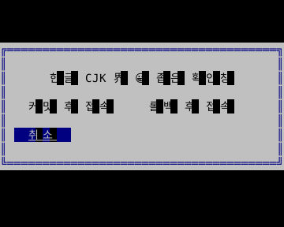
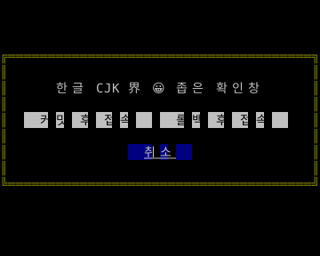

# 작은 화면의 확인창

**한국어 (기본)** · [English](modals.en.md)

0.10.0의 Go `NewModal()`은 창 너비를 실제 터미널 안으로 제한하고 긴 버튼을 여러 행으로 배치합니다. Rust에는 이 Go 호환 Modal 타입이 없으며, 공통 Form·배치 컨테이너로 확인창을 조합합니다.

```go
import ui "github.com/leechis7/tuivory/go"

modal := ui.NewModal().SetText("변경 사항을 처리하세요.").
    AddButtons([]string{"변경 저장 후 계속", "변경 취소 후 계속", "취소"}).SetFocus(2)
modal.SetDoneFunc(func(index int, label string) {
    // index는 원래 버튼 순서이며 Esc는 -1 / 빈 라벨입니다.
    // 실제 저장·취소·화면 닫기는 앱이 결정합니다.
})
```

좁은 높이에서는 메시지보다 버튼 영역을 우선하고, 모든 행이 들어가지 않으면 포커스 버튼을 보이도록 스크롤합니다. 셀보다 넓은 글자를 표시할 수 없는 극단적인 크기에서는 라벨을 자를 수 있습니다. 화면을 넓히면 원래 라벨과 순서가 복원됩니다. Tab/Shift+Tab·방향키·Enter·Esc·마우스와 기존 콜백을 유지하며, `SetFocus`는 버튼 순서로 선택합니다. `AddButtons`를 여러 번 불러도 콜백 인덱스는 누적 순서입니다.

Go 루트와 호환 `/ui`의 `Modal`은 이제 원시 backend의 타입 별칭 대신 **backend Modal을 내장한 SDK 어댑터**입니다. 기존 SDK 호출은 그대로 사용합니다. 원시 backend를 받는 외부 코드와의 명시적 상호 운용이 필요한 경우 `modal.Modal`을 전달할 수 있으나, 그 객체를 직접 그리면 반응형 수정이 적용되지 않습니다. 공통 API를 통해 텍스트·버튼을 갱신하세요. `Styler.Modal`·`Apply`는 SDK 어댑터와 기존 backend Modal 모두를 지원합니다.

```sh
make build
./bin/go/tuivory-linux-arm64 --demo controls --modal --lang ko --theme light --colors 8
```

실행파일 이름은 호스트 아키텍처를 따릅니다. F2 테마, F3 색상 수, Ctrl+Q/Esc 종료. 이 예제는 저장·DB 연결 없이 요청을 표시합니다.




Go 실제 `Show()` 이후 버퍼로 한영 × 12팔레트, 120→80→40→20→8→3→1열과 복원, 버튼 위치·텍스트·콜백·키보드·마우스를 검사합니다. 이미지는 그 출력 버퍼로 생성한 참조이며 물리 폰트 검증과 구분합니다.

[컴포넌트](components.md) · [공개 UI 경로](ui-facade.md) · [API](api/go.md)

[로컬 검증 기록](evidence/tvr7-18-results.json): Modal 216개 팔레트·언어·크기 사례, Go/Rust 공통 드래그·실제 버퍼 회귀, 한영 PTY 58개, 외부 Go/Rust 패키지·Rust core 1.85.1과 ARM64 정적 실행파일 검사를 통과했습니다. 이 기록은 게시 전 로컬 이력입니다. 최종 CI·공개 태그·다운로드 검증은 [0.10.0 릴리스](release-0.10.0.md)의 자산 명세에 기록합니다.
