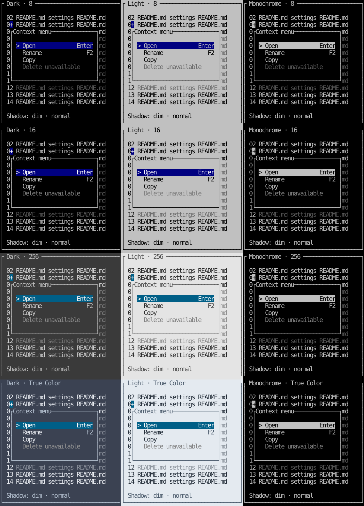

# Optional popup shadows

[한국어 (default)](popup-shadows.md) · **English**

TVR-19 ships in **0.5.0**, absent from previous 0.4.0 tags. Shadows are **off by default** and selected per menu/context menu/general popup by the host. They do not determine application focus, global keys or business actions.

## Modes

| Mode | Behavior | When to use |
| --- | --- | --- |
| `off` / Go zero value / Rust Default | No shadow; preserve existing card size/presentation | Default |
| `auto` | Fill exposed strips darker than the real surface. If black cannot be darkened, use `░`, or `.` in ASCII mode | Recommended when enabling shadows |
| `solid` | Blank-fill with the existing classic black shadow style | Classic black shadow; may be invisible on black backgrounds |
| `dim` | Retain underlying glyphs/colors/backgrounds and add Dim to text | Keep underlying content. Empty backgrounds do not darken; terminals ignoring Dim may show no effect |

Auto follows the supplied palette's color representation: RGB for True Color, gray indices for 256 colors, and black/patterns for 8/16 colors. It does not probe or modify the terminal. Custom palettes must fit actual terminal capabilities. Dim reference images approximate the attribute with 0.45 opacity, not a guarantee of physical-terminal brightness.

[Off](images/popup-shadow-off-en.svg) · [Auto/twelve palettes](images/popup-shadow-auto-en.svg) · [Dim/twelve palettes](images/popup-shadow-dim-en.svg) · [Black](images/popup-shadow-solid-en.svg) · [Edges](images/popup-shadow-edge-en.svg) · [ASCII](images/popup-shadow-ascii-en.svg). Columns are dark/light/monochrome and rows 8/16/256/True Color. `+` is a synthetic host-provided anchor, not a captured mouse event.



## Geometry

ShadowOptions contains Mode/OffsetX/OffsetY (Rust snake_case). Enabled modes with both offsets zero use **two cells right and one row down**. A single zero axis is allowed for custom offsets. Negative offsets are invalid. Select off to remove the shadow.

Pass the **desired card size**, host anchor and viewport to PopupPlacement/popup_placement:

- Bounds/bounds: full card-and-shadow allocation passed to the view/widget.
- Card/card: actual content/border and input hit area.
- Shadow/shadow: shifted shadow extent, potentially overlapping the card.
- ShadowRegions/shadow_regions(): disjoint exposed right/bottom strips, excluding the card so Dim cannot leak into content.

Placement flips the **whole Bounds** above an anchor or shifts it left to fit. Narrow allocations shrink the card/offset; a single cell may leave no room for a shadow. Use ShadowOptions.Layout/layout for an existing allocation. MenuPlacement/menu_placement remains the no-shadow card placement helper.

## Go

Wrap an existing panel/modal/other tview primitive with ShadowView. Configure titles/borders on the original child panel.

```go
options := tuivory.ShadowOptions{Mode: tuivory.ShadowAuto}
menuView, _ := tuivory.NewMenuView(menu, palette, false, onEvent)
card, _ := tuivory.NewPanelView(menuView, palette)
card.SetTitle("Context menu")
popup, err := tuivory.NewShadowView(card, palette, options)
if err != nil { return err }

// Host Draw: paint the backdrop first. w/h request the card size.
layout := tuivory.PopupPlacement(anchor, viewport, w, h, options)
r := layout.Bounds
popup.SetRect(r.X, r.Y, r.Width, r.Height)
popup.Draw(screen)
```

SetShadow validates before replacing options; errors retain previous state. SetPalette updates only the wrapper; update child panel/menu palettes as usual. ASCII affects the shadow pattern; configure the child's ASCII setting too. Layout() exposes current geometry.

InRect and mouse forwarding cover **only Card**. Shadow clicks do not invoke child action/focus callbacks. Keyboard/paste/focus delegate to the existing child. Hosts decide whether an outside click dismisses the popup.

## Rust

```rust
use tuivory::popup::{popup_placement, ShadowMode, ShadowOptions};
use tuivory::ratatui::{MenuPopupWidget, ShadowWidget};

let options = ShadowOptions { mode: ShadowMode::Auto, ..Default::default() };
let layout = popup_placement(anchor, viewport, width, height, options);
let b = layout.bounds;
frame.render_widget(
    MenuPopupWidget::new(&mut menu, &styles, "Context menu")
        .ascii(false)
        .shadow(options),
    ratatui::layout::Rect::new(b.x as u16, b.y as u16, b.width as u16, b.height as u16),
);
```

Wrap arbitrary widgets with ShadowWidget::new(widget, &styles, options). Configure menu ascii before shadow to carry it into the pattern. Generic wrapper ascii changes only its shadow pattern. Renderers only draw: hosts hit-test layout.card and call model input methods. Shadows add no input target.

## Boundaries, redraws and low-level APIs

Painting stays inside the allocation and clips to the screen/buffer. A wide grapheme crossing either horizontal card/shadow edge is blanked completely while retaining outside-cell styles. This repair can blank **one adjacent cell** belonging to a glyph intersecting the allocation. Check both menu and general-widget edges. [TVR-14 rules](overlay-drawing.en.md).

Hosts repaint the background when disabling, closing, moving or resizing a popup. No stale screen snapshot is restored over newer application data. Draw the backdrop before applying Dim so it can fade actual existing content.

Go PopupShadowStyle and DimRegion remain available. Solid uses the existing black style; Dim uses the existing safe region operation. The wrapper automates a bounded popup surround, not arbitrary backdrop areas or custom style composition. [API support status](api-lifecycle.en.md).

## Examples and validation

```sh
make run-menu-go ARGS="--lang ko --shadow dim"
make run-menu-rust ARGS="--lang en --shadow auto"
# F6 in menu examples: off → auto → solid → dim → off
cargo run --manifest-path rust/Cargo.toml --features ratatui --example shadows -- \
  --lang en --shadow dim --snapshot popup-shadows.svg
```

The example host chooses opening, caller restoration and global shortcuts. Its context-menu anchor remains fixed; this task does not newly wire right-click coordinates. The shadows example renders real shared widgets to TestBackend without a DB or interactive terminal. Validate modes/profiles, Unicode/ASCII, geometry/backdrop edges, Go post-Show output and Rust TestBackend. Separate local results, remote CI and publication in the [validation record](../evidence/popup-shadow-results.json). No CentOS checks are performed.

```sh
python3 tools/snapshot_popup_shadows.py rust/target/debug/examples/shadows
```

Auto uses 80% of surface RGB brightness in True Color and a nearby quantized gray in 256 colors for a subtle shadow. The 8/16-color and black-surface pattern fallbacks remain coarser because of palette limits.
