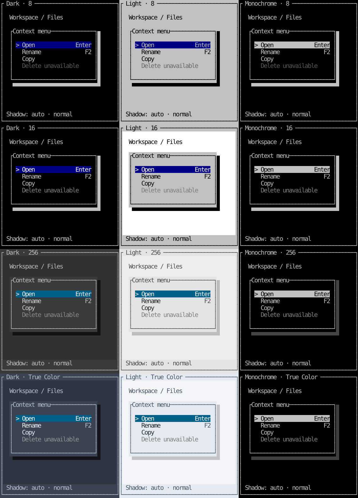

# Optional popup shadows

[한국어 (default)](popup-shadows.md) · **English**

Shadows are **off by default** and selected per menu/context menu/general popup by the host. Hosts own focus, global keys and business actions. TVR-19 introduced the APIs; **0.10.2 TVR-29** unifies auto/solid as **one cell right and half a row down**. Tags through 0.10.0 do not include this change.

## Modes

| Mode | Behavior | When to use |
| --- | --- | --- |
| `off` / Go zero value / Rust Default | No shadow | Default |
| `auto` | Shade the actual backdrop with visible contrast and `▄`/`▀` half-row caps | Recommended |
| `solid` | Same compact half-row shape in fixed black | May be invisible on black backgrounds |
| `dim` | Retain underlying glyphs/colors/backgrounds and add Dim to text | Compatibility mode: whole-cell attributes cannot represent half rows; excluded from the ordinary example cycle |

Auto uses 40% RGB brightness for dark backdrops (maximum channel 17–96), retaining a little hue while keeping contrast. The 256-color form uses a nearby gray and 8/16 colors use black. Near-black backdrops (maximum channel at most 16) use a neutral fallback: RGB 64/64/64, index 238 in 256 colors, or index 7 in 8/16 colors. Other backdrops use 80% RGB brightness in True Color, a nearby gray in 256 colors, or black in 8/16 colors. The same rules apply to custom palettes without assuming theme names.

The unfilled half retains its original background color. **Half-block cells replace underlying text**, unlike Dim. ASCII uses `.` in the same whole-cell footprint; it cannot represent an actual half row. Palettes must fit actual terminal capabilities; no terminal probing or palette mutation is performed. Dim references approximate the attribute with 0.45 opacity.

[Off](images/popup-shadow-off-en.svg) · [Auto/twelve palettes](images/popup-shadow-auto-en.svg) · [Black](images/popup-shadow-solid-en.svg) · [Edges](images/popup-shadow-edge-en.svg) · [ASCII](images/popup-shadow-ascii-en.svg) · [Compatibility Dim](images/popup-shadow-dim-en.svg). Columns are dark/light/monochrome and rows 8/16/256/True Color. `+` is a synthetic host-provided anchor.



## Geometry

ShadowOptions contains Mode/OffsetX/OffsetY (Rust snake_case). Enabled modes with both offsets zero use **one cell right and half a row down**. The former two-cell/one-row default is removed. Half rows still **reserve one whole terminal row**: Bounds is one cell wider and one row taller than Card. The first right-hand cell uses `▄`, the bottom row uses `▀`, and intermediate right-hand cells are solid.

Explicit offsets remain supported. For auto/solid, OffsetY=N reserves N rows and paints a visual N−0.5-row shift. A single zero axis is allowed; explicit Y=0 draws only a horizontal shift without half caps. One-row allocations omit the vertical shadow. Dim uses the same one-cell/one-row default allocation with whole-cell attributes. Negative offsets are invalid; select off to remove shadows.

Pass the desired card size, host anchor and viewport to PopupPlacement/popup_placement:

- Bounds/bounds: full whole-cell allocation for the card and shadow.
- Card/card: actual content/border and input hit area.
- Shadow/shadow: whole-cell bounding rectangle including half blocks, potentially overlapping Card; auto/solid height is one row greater than Card.
- ShadowRegions/shadow_regions(): disjoint right/bottom strips excluding Card.

Placement flips the whole Bounds above an anchor or shifts it left to fit. Narrow allocations shrink Card/offsets; a single cell may leave no room for shadows. Use ShadowOptions.Layout/layout for an existing allocation. Use returned Card/Bounds rather than assuming fixed coordinates. MenuPlacement/menu_placement remains the no-shadow card placement helper.

## Go

Wrap an existing panel/modal/other tview primitive with ShadowView. Configure titles/borders on the original child panel.

```go
options := tuivory.ShadowOptions{Mode: tuivory.ShadowAuto}
menuView, _ := tuivory.NewMenuView(menu, palette, false, onEvent)
card, _ := tuivory.NewPanelView(menuView, palette)
card.SetTitle("Context menu")
popup, err := tuivory.NewShadowView(card, palette, options)
if err != nil { return err }

// Host Draw: paint the backdrop first. w/h request the card size.
layout := tuivory.PopupPlacement(anchor, viewport, w, h, options)
r := layout.Bounds
popup.SetRect(r.X, r.Y, r.Width, r.Height)
popup.Draw(screen)
```

SetShadow validates before replacing options; errors retain previous state. SetPalette updates only the wrapper; update child panel/menu palettes as usual. ASCII affects the shadow pattern; configure the child's ASCII setting too. Layout() exposes current geometry.

InRect and mouse forwarding cover **only Card**. Shadow clicks do not invoke child action/focus callbacks. Keyboard/paste/focus delegate to the existing child. Hosts decide whether an outside click dismisses the popup.

## Rust

```rust
use tuivory::popup::{popup_placement, ShadowMode, ShadowOptions};
use tuivory::ratatui::{MenuPopupWidget, ShadowWidget};

let options = ShadowOptions { mode: ShadowMode::Auto, ..Default::default() };
let layout = popup_placement(anchor, viewport, width, height, options);
let b = layout.bounds;
frame.render_widget(
    MenuPopupWidget::new(&mut menu, &styles, "Context menu")
        .ascii(false)
        .shadow(options),
    ratatui::layout::Rect::new(b.x as u16, b.y as u16, b.width as u16, b.height as u16),
);
```

Wrap arbitrary widgets with ShadowWidget::new(widget, &styles, options). Configure menu ascii before shadow to carry it into the pattern. Generic wrapper ascii changes only its shadow pattern. Renderers only draw: hosts hit-test layout.card and call model input methods. Shadows add no input target.

## Boundaries, redraws and compatibility

Painting clips to the assigned buffer/screen. At either horizontal card/shadow edge, replace intersected wide graphemes with spaces while retaining outside-cell styles. This can blank one adjacent cell belonging to a crossing glyph. [Overlay drawing](overlay-drawing.en.md).

Hosts repaint the backdrop before each draw and when disabling, closing, moving or resizing popups. No stale snapshot is restored. Auto needs the actual backdrop color; unresolved background colors fall back to the palette surface. Shadow cells never receive input. Go `PopupShadowStyle` and `DimRegion` remain available; Dim retains whole-cell text attributes. [API lifecycle](api-lifecycle.en.md).

## Examples and validation

```sh
make run-menu-go ARGS="--lang en --shadow auto"
make run-menu-rust ARGS="--lang en --shadow auto"
# F6: off → auto → solid → off
cargo run --manifest-path rust/Cargo.toml --features ratatui --example shadows -- \
  --lang en --shadow auto --clean --snapshot popup-shadows.svg
python3 tools/snapshot_popup_shadows.py .cache/rust/debug/examples/shadows
```

The example host owns opening, caller restoration and global keys. The context-menu anchor is synthetic, not a new right-click integration. References use actual TestBackend widgets. Auto/solid/off references use --clean for a quiet application backdrop; edge/ASCII/Dim references retain repeated text to inspect boundaries and underlying content. Go post-Show buffers and Rust TestBackend cover palettes, Unicode/ASCII, clipping, wide edges, backdrop contrast and restoration. [TVR-29 local results](evidence/tvr29-shadow-results.json) distinguish local checks from unexecuted CI/publication; [previous release results](evidence/popup-shadow-results.json) remain historical. No CentOS checks.
