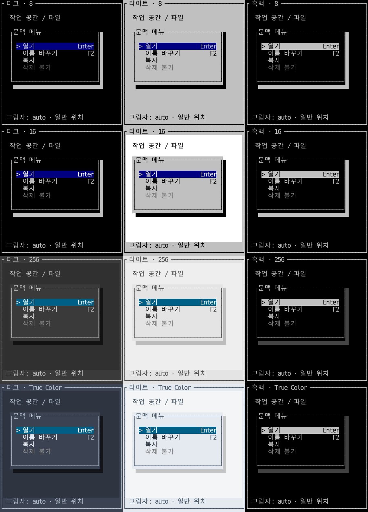

# 팝업 그림자 옵션

**한국어 (기본)** · [English](popup-shadows.en.md)

기본값은 **끄기**이며 앱이 메뉴·문맥 메뉴·일반 팝업별로 선택합니다. 포커스·전역 키·업무 동작은 앱이 결정합니다. TVR-19에서 API를 제공했고 **0.10.1 TVR-29**에서 auto/solid를 **오른쪽 1칸·아래 반 줄**로 통일했습니다. 0.10.0 이하 태그에는 반 줄 변경이 없습니다.

## 표현 방식

| 모드 | 동작 | 선택 기준 |
| --- | --- | --- |
| `off` / Go 영값 / Rust Default | 그림자 없음 | 기본값 |
| `auto` | 실제 뒤쪽 배경색을 기준으로 대비를 확보하고 `▄`·`▀`로 반 줄 모서리 표현 | 권장 |
| `solid` | 같은 반 줄 형태를 고정 검정으로 표시 | 검정 배경에서는 구별되지 않을 수 있음 |
| `dim` | 기존 글자·색·배경을 유지하고 글자에 Dim 속성 추가 | 호환 모드. 셀 전체의 속성이므로 반 줄 표현은 불가능하며 일반 예제 순환에서 제외 |

Auto는 어두운 배경(RGB 최대 채널 17–96)에 RGB 40% 밝기를 사용해 색감을 남기면서 대비를 확보합니다. 256색은 인접 회색으로 양자화하고 8/16색은 검정으로 대체합니다. 검정에 가까운 배경(최대 채널 16 이하)에는 중성 회색(True Color 64/64/64, 256색 인덱스 238, 8/16색 인덱스 7)을 사용합니다. 다른 배경은 True Color에서 RGB 80% 밝기, 256색에서 인접 회색, 8/16색에서 검정으로 표현합니다. 테마 이름을 가정하지 않으며 커스텀 팔레트에도 같은 규칙을 적용합니다.

빈 반쪽은 원래 배경색을 유지합니다. **반 블록을 그린 셀의 배경 글자는 대체**하며, 글자를 보존하는 dim과 다릅니다. ASCII에서는 같은 정수 칸 범위에 `.`를 그리므로 실제 반 줄을 표현하지는 못합니다. 팔레트는 실제 단말의 색상 수에 맞춰야 합니다. 단말을 직접 감지하거나 팔레트를 변경하지 않습니다. Dim 참조 화면은 0.45 불투명도로 근사합니다.

[끄기](images/popup-shadow-off.svg) · [Auto 12팔레트](images/popup-shadow-auto.svg) · [검정](images/popup-shadow-solid.svg) · [모서리](images/popup-shadow-edge.svg) · [ASCII](images/popup-shadow-ascii.svg) · [호환 Dim](images/popup-shadow-dim.svg). 열은 다크·라이트·흑백, 행은 8·16·256·True Color입니다. `+`는 앱이 전달한 합성 호출점입니다.



## 크기와 위치

`ShadowOptions`는 `Mode / OffsetX / OffsetY`(Rust snake_case)를 갖습니다. 켠 모드에서 두 오프셋이 0이면 **오른쪽 1칸·아래 반 줄**을 사용합니다. 이전 2칸·1행 기본 형태는 제거했습니다. 반 줄도 배치에서는 **1행을 예약**하므로 Bounds는 카드보다 가로 1칸·세로 1행 큽니다. 오른쪽 첫 셀은 `▄`, 맨 아래 행은 `▀`, 그 사이 오른쪽은 단색입니다.

명시적 오프셋은 유지합니다. auto/solid에서 `OffsetY=N`은 N행을 예약하고 시각적으로 N−0.5행 내려갑니다. 한 축만 0인 설정도 가능하며 명시적 Y=0은 반 줄 모서리 없이 수평 이동만 표시합니다. 높이가 1행이면 세로 그림자를 생략합니다. dim은 같은 기본 1칸·1행 예약에 셀 전체 Dim을 적용합니다. 음수는 허용하지 않으며 그림자를 없애려면 off를 사용합니다.

`PopupPlacement/popup_placement`에 카드의 희망 크기·앱 호출 기준점·viewport를 전달합니다.

- `Bounds/bounds`: 카드와 그림자의 전체 정수 칸 할당 영역.
- `Card/card`: 실제 콘텐츠·테두리와 입력 판정 영역.
- `Shadow/shadow`: 반 블록을 포함한 그림자의 정수 셀 경계. 카드와 겹칠 수 있으며 auto/solid의 세로 길이는 카드보다 1행 큽니다.
- `ShadowRegions/shadow_regions()`: 카드와 겹치지 않는 오른쪽·아래 띠.

배치 도구는 전체 Bounds를 기준으로 위로 뒤집거나 왼쪽으로 보정합니다. 좁은 할당은 카드·오프셋을 줄이며 한 칸만 남으면 그림자를 생략할 수 있습니다. 이미 정한 할당에는 `ShadowOptions.Layout/layout`을 사용합니다. 고정 좌표를 추측하지 말고 반환한 Card/Bounds를 사용하세요. 기존 `MenuPlacement/menu_placement`는 그림자 없는 카드 배치 도구입니다.

## Go

기존 패널·모달·다른 tview primitive를 공통 `ShadowView`로 감쌉니다. 제목·테두리 등은 감싼 원래 패널에 설정합니다.

```go
options := tuivory.ShadowOptions{Mode: tuivory.ShadowAuto}
menuView, _ := tuivory.NewMenuView(menu, palette, false, onEvent)
card, _ := tuivory.NewPanelView(menuView, palette)
card.SetTitle("문맥 메뉴")
popup, err := tuivory.NewShadowView(card, palette, options)
if err != nil { return err }

// 앱의 Draw: 먼저 배경을 그린 뒤 실행. w/h는 카드 희망 크기.
layout := tuivory.PopupPlacement(anchor, viewport, w, h, options)
r := layout.Bounds
popup.SetRect(r.X, r.Y, r.Width, r.Height)
popup.Draw(screen)
```

`SetShadow(options)`는 유효성을 확인한 뒤 옵션을 교체하며 잘못된 값은 이전 상태를 유지합니다. `SetPalette`는 래퍼 팔레트만 갱신하므로 자식 패널/메뉴도 앱이 평소처럼 갱신합니다. `ASCII`는 그림자 패턴을 바꾸며 자식의 ASCII 설정도 따로 지정합니다. `Layout()`으로 현재 Card/Bounds를 읽습니다.

`InRect`와 마우스 전달은 **Card만** 대상으로 하며 그림자에서는 자식 클릭·포커스 콜백을 부르지 않습니다. 키보드·붙여넣기·실제 포커스는 기존 자식에 전달합니다. 그림자를 클릭했을 때 바깥 클릭으로 팝업을 닫을지는 앱이 정합니다.

## Rust

```rust
use tuivory::popup::{popup_placement, ShadowMode, ShadowOptions};
use tuivory::ratatui::{MenuPopupWidget, ShadowWidget};

let options = ShadowOptions { mode: ShadowMode::Auto, ..Default::default() };
let layout = popup_placement(anchor, viewport, width, height, options);
let b = layout.bounds;
frame.render_widget(
    MenuPopupWidget::new(&mut menu, &styles, "문맥 메뉴")
        .ascii(false)
        .shadow(options),
    ratatui::layout::Rect::new(b.x as u16, b.y as u16, b.width as u16, b.height as u16),
);
```

일반 위젯은 `ShadowWidget::new(widget, &styles, options)`로 감쌉니다. `ascii`는 자식 메뉴에 먼저 설정하면 그림자 패턴에도 반영됩니다. 일반 래퍼의 `ascii`는 그림자 패턴만 바꿉니다. 위젯은 그리기만 담당하므로 앱은 `layout.card`로 입력 영역을 판단하고 모델의 입력 함수를 호출합니다. 그림자가 새 입력 대상이 되지는 않습니다.

## 경계·다시 그리기·호환

할당한 화면/버퍼 안으로 자릅니다. 카드·그림자의 양쪽 가로 경계에 두 칸 문자가 걸리면 전체 grapheme을 공백 처리하고 바깥 셀의 스타일을 보존합니다. 이 때문에 경계에 걸친 문자의 인접 셀 하나가 공백이 될 수 있습니다. [공통 그리기](overlay-drawing.md).

앱은 매번 배경부터 그리고, 그림자 끄기·닫기·이동·리사이즈 때도 배경을 다시 그립니다. 오래된 화면 복사본을 자동 복원하지 않습니다. Auto는 실제 뒤쪽 배경색이 필요하며 기본색이 미해결이면 팔레트 surface를 사용합니다. 그림자 셀은 입력을 받지 않습니다. Go `PopupShadowStyle`·`DimRegion`은 유지하며 dim은 셀 전체 글자 속성을 유지합니다. [API 지원 상태](api-lifecycle.md).

## 실행 예제와 검증

```sh
make run-menu-go ARGS="--lang ko --shadow auto"
make run-menu-rust ARGS="--lang ko --shadow auto"
# F6: off → auto → solid → off
cargo run --manifest-path rust/Cargo.toml --features ratatui --example shadows -- \
  --lang ko --shadow auto --clean --snapshot popup-shadows.svg
python3 tools/snapshot_popup_shadows.py .cache/rust/debug/examples/shadows
```

예제 앱이 열기·원래 호출 위치·전역 키를 연결합니다. 문맥 메뉴 호출점은 합성이며 우클릭 위치 연결을 새로 구현한 것은 아닙니다. 참조 화면은 실제 TestBackend 위젯을 사용합니다. 기본 Auto·검정·끄기 화면은 --clean으로 정돈된 앱 배경 위에 표시하며, 모서리·ASCII·Dim 화면은 경계와 배경 글자를 확인하기 위한 반복 텍스트를 유지합니다. Go Show 이후 출력과 Rust TestBackend로 팔레트·Unicode/ASCII·클리핑·두 칸 문자 경계·배경 대비·복원을 검사합니다. [TVR-29 로컬 결과](evidence/tvr29-shadow-results.json)에서 로컬과 미실행 CI·게시를 구분하며 [이전 배포 결과](evidence/popup-shadow-results.json)는 과거 이력입니다. CentOS 검증은 수행하지 않습니다.
