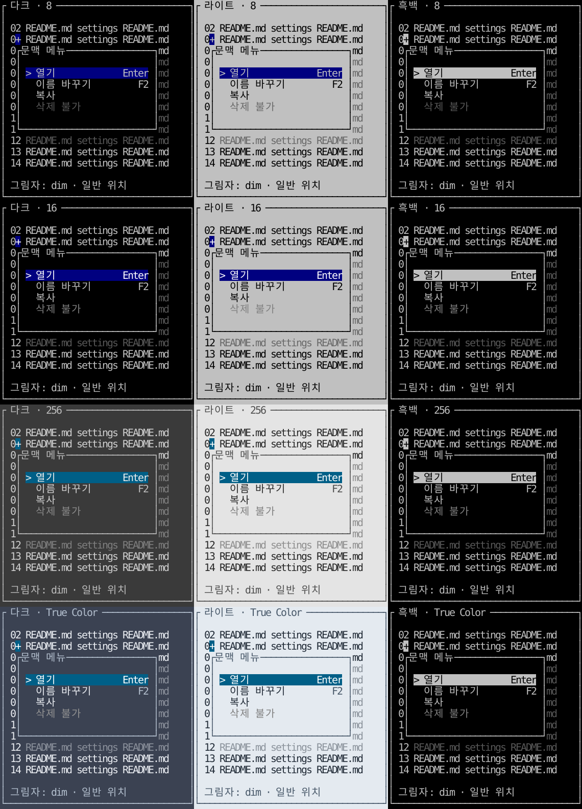

# 팝업 그림자 옵션

**한국어 (기본)** · [English](popup-shadows.en.md)

TVR-19의 **미배포 소스** 기능입니다. 현재 공개 0.4.0 태그에는 아래 새 API·예제가 없습니다. 기본값은 **끄기**이며, 앱이 메뉴·문맥 메뉴·일반 팝업별로 선택합니다. 그림자가 앱의 포커스·전역 키·업무 동작을 결정하지 않습니다.

## 표현 방식

| 모드 | 동작 | 선택 기준 |
| --- | --- | --- |
| `off` / Go 영값 / Rust Default | 그림자 없음. 기존 카드 크기·표시 유지 | 기본값 |
| `auto` | 실제 표면보다 어두운 색으로 노출 영역을 채움. 검정 바탕처럼 더 어둡게 할 수 없으면 `░`, ASCII에서는 `.` 패턴 | 그림자를 켤 때 권장 |
| `solid` | 기존 검정 그림자 스타일로 공백 채움 | 고전적인 검정 그림자. 검정 배경에서는 구별되지 않을 수 있음 |
| `dim` | 기존 글자·색·배경은 유지하고 글자에 Dim 속성 추가 | 아래 내용을 남기는 그림자. 빈 배경 자체는 어두워지지 않으며 단말이 Dim을 무시하면 효과가 없을 수 있음 |

Auto는 True Color에서 표면 RGB의 80% 밝기를 사용하고 256색에서는 그 밝기에 가까운 회색으로 양자화해 은은하게 표시합니다. 8/16색과 검정 표면의 패턴은 색상 수 제약으로 더 거칠게 보일 수 있습니다.

auto는 전달한 팔레트가 사용하는 색 표현에 맞춰 True Color에서는 RGB, 256색에서는 회색 인덱스, 8/16색에서는 검정과 패턴을 사용합니다. 단말을 직접 감지하거나 팔레트를 바꾸지 않습니다. 사용자 팔레트도 실제 단말 색상 수에 맞춰야 합니다. Dim 참조 이미지는 기존 견본과 같이 0.45 불투명도로 근사하며 실제 단말의 밝기를 보장하지 않습니다.

[끄기](images/popup-shadow-off.svg) · [Auto 12팔레트](images/popup-shadow-auto.svg) · [Dim 12팔레트](images/popup-shadow-dim.svg) · [검정](images/popup-shadow-solid.svg) · [모서리](images/popup-shadow-edge.svg) · [ASCII](images/popup-shadow-ascii.svg). 각 이미지의 열은 다크·라이트·흑백, 행은 8·16·256·True Color입니다. `+`는 앱이 전달한 합성 호출점이며 실제 마우스 캡처가 아닙니다.



## 크기와 위치

`ShadowOptions`는 `Mode / OffsetX / OffsetY`(Rust snake_case)를 갖습니다. 켠 모드에서 두 오프셋이 모두 0이면 기본 **오른쪽 2칸·아래 1행**을 사용합니다. 한 축만 0인 사용자 오프셋도 가능합니다. 음수 오프셋은 허용하지 않습니다. 그림자를 없애려면 off를 사용합니다.

`PopupPlacement/popup_placement`에 **카드 자체의 희망 크기**와 앱의 호출 기준점·viewport를 전달합니다. 반환값은 다음과 같습니다.

- `Bounds/bounds`: 카드와 그림자가 함께 차지하는 할당 영역. 뷰/위젯에 이 사각형을 전달합니다.
- `Card/card`: 실제 메뉴·본문·테두리 영역. 클릭·메뉴 항목 판정에 사용합니다.
- `Shadow/shadow`: 이동된 그림자의 전체 범위. 카드와 겹칠 수 있습니다.
- `ShadowRegions/shadow_regions()`: 실제 칠할 오른쪽·아래의 서로 겹치지 않는 두 띠. 카드 부분을 제외하므로 Dim 속성이 본문까지 번지지 않습니다.

아래 공간이 부족하면 **전체 Bounds**를 위로 올리고 오른쪽을 넘으면 왼쪽으로 보정합니다. 작은 화면에서는 카드·오프셋을 줄이며 1칸만 남으면 그림자를 생략할 수 있습니다. 이미 정해진 할당 공간에는 `ShadowOptions.Layout/layout`을 사용합니다. 기존 `MenuPlacement/menu_placement`는 그림자 없는 카드 위치 도구로 유지합니다.

## Go

기존 패널·모달·다른 tview primitive를 공통 `ShadowView`로 감쌉니다. 제목·테두리 등은 감싼 원래 패널에 설정합니다.

```go
options := tuivory.ShadowOptions{Mode: tuivory.ShadowAuto}
menuView, _ := tuivory.NewMenuView(menu, palette, false, onEvent)
card, _ := tuivory.NewPanelView(menuView, palette)
card.SetTitle("문맥 메뉴")
popup, err := tuivory.NewShadowView(card, palette, options)
if err != nil { return err }

// 앱의 Draw: 먼저 배경을 그린 뒤 실행. w/h는 카드 희망 크기.
layout := tuivory.PopupPlacement(anchor, viewport, w, h, options)
r := layout.Bounds
popup.SetRect(r.X, r.Y, r.Width, r.Height)
popup.Draw(screen)
```

`SetShadow(options)`는 유효성을 확인한 뒤 옵션을 교체하며 잘못된 값은 이전 상태를 유지합니다. `SetPalette`는 래퍼 팔레트만 갱신하므로 자식 패널/메뉴도 앱이 평소처럼 갱신합니다. `ASCII`는 그림자 패턴을 바꾸며 자식의 ASCII 설정도 따로 지정합니다. `Layout()`으로 현재 Card/Bounds를 읽습니다.

`InRect`와 마우스 전달은 **Card만** 대상으로 하며 그림자에서는 자식 클릭·포커스 콜백을 부르지 않습니다. 키보드·붙여넣기·실제 포커스는 기존 자식에 전달합니다. 그림자를 클릭했을 때 바깥 클릭으로 팝업을 닫을지는 앱이 정합니다.

## Rust

```rust
use tuivory::popup::{popup_placement, ShadowMode, ShadowOptions};
use tuivory::ratatui::{MenuPopupWidget, ShadowWidget};

let options = ShadowOptions { mode: ShadowMode::Auto, ..Default::default() };
let layout = popup_placement(anchor, viewport, width, height, options);
let b = layout.bounds;
frame.render_widget(
    MenuPopupWidget::new(&mut menu, &styles, "문맥 메뉴")
        .ascii(false)
        .shadow(options),
    ratatui::layout::Rect::new(b.x as u16, b.y as u16, b.width as u16, b.height as u16),
);
```

일반 위젯은 `ShadowWidget::new(widget, &styles, options)`로 감쌉니다. `ascii`는 자식 메뉴에 먼저 설정하면 그림자 패턴에도 반영됩니다. 일반 래퍼의 `ascii`는 그림자 패턴만 바꿉니다. 위젯은 그리기만 담당하므로 앱은 `layout.card`로 입력 영역을 판단하고 모델의 입력 함수를 호출합니다. 그림자가 새 입력 대상이 되지는 않습니다.

## 경계·다시 그리기·저수준 API

그림자는 할당 영역 안에서만 칠하며 화면/버퍼 경계로 자릅니다. 카드·그림자의 가로 경계에 두 칸 문자가 걸리면 전체 grapheme을 공백 처리하고 바깥 셀의 스타일을 보존합니다. 이 경계 보정 때문에 할당 영역에 걸친 문자의 **인접 셀 하나**가 공백이 될 수 있습니다. 일반 메뉴와 사용자 위젯의 경계도 검사합니다. [TVR-14 원칙](overlay-drawing.md).

그림자를 끄거나 팝업을 닫기·이동·리사이즈할 때 앱이 배경을 다시 그려야 합니다. 오래된 화면 복사본을 자동 복원하지 않으므로 그동안 바뀐 앱 데이터를 덮지 않습니다. 그림자를 그리기 전에 배경이 이미 있어야 dim 모드가 실제 내용을 흐리게 할 수 있습니다.

Go `PopupShadowStyle`·`DimRegion`은 제거하지 않았습니다. solid는 기존 검정 스타일을, dim은 기존 안전한 영역 처리 함수를 사용합니다. 새 래퍼는 팝업 주위의 제한된 영역을 자동 처리하므로 임의의 배경 영역·독자적인 스타일 조합까지 대체하지 않습니다. [API 지원 상태](api-lifecycle.md).

## 실행 예제와 검증

```sh
make run-menu-go ARGS="--lang ko --shadow dim"
make run-menu-rust ARGS="--lang en --shadow auto"
# 메뉴 예제에서 F6: off → auto → solid → dim → off
cargo run --manifest-path rust/Cargo.toml --features ratatui --example shadows -- \
  --lang ko --shadow dim --snapshot popup-shadows.svg
```

메뉴의 열기·원래 호출 위치·전역 단축키는 예제 앱이 연결합니다. 현재 문맥 메뉴 견본의 호출점은 고정 좌표이며 우클릭 위치 연결을 새로 구현한 것은 아닙니다. shadows는 DB·대화형 단말 없이 실제 공통 위젯을 TestBackend에 그리는 비교 예제입니다. 색상 수/모드·Unicode/ASCII·위치 보정·배경/그림자 경계, Go Show 이후 출력과 Rust TestBackend를 검사합니다. 로컬 결과·원격 CI·게시 여부는 [검증 결과](../evidence/popup-shadow-results.json)에서 구분합니다. CentOS 검증은 수행하지 않습니다.

```sh
python3 tools/snapshot_popup_shadows.py rust/target/debug/examples/shadows
```
