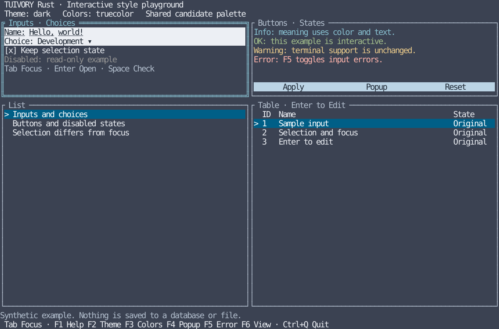

# Rust interactive playground

[한국어 (default)](rust-playground.md) · **English**

This database-free host example uses the [Rust package](../rust/README.en.md)'s Ratatui adapter. It requires Ratatui 0.30.2, Crossterm 0.29, and Rust 1.88+. Inputs, selections, and table edits remain in memory and are never saved to files or databases. Shared candidate colors do not claim parity with the full Go-derived widget styles.

## Run

From the repository root, select English on the same executable that defaults to Korean:

```sh
make run-rust ARGS="--lang en"
make run-rust ARGS="--lang en --theme light --colors 16 --mouse=false"
make build-rust
./bin/rust/tuivory-linux-arm64 --lang en
```

After `rustup target add aarch64-unknown-linux-musl`, `make build-rust` uses musl and bundled `rust-lld` to produce one static `bin/rust/tuivory-linux-arm64`. For x86_64, run `rustup target add x86_64-unknown-linux-musl` and `make build-rust-x86_64`. See [static distribution, CentOS checks and existing release differences](static-build.en.md). Default `make build` still produces only the Go executable.

`--theme` accepts dark/light/blackwhite; `--colors` accepts auto/8/16/256/truecolor. Auto uses the color count reported by Crossterm. Explicit profile selection is a preview, not a change to terminal capabilities or user palettes. Interactive execution requires a TTY.

## Controls

| Key/action | Result |
| --- | --- |
| Tab / Shift+Tab | Move focus among name, choice, checkbox, buttons, list, and table |
| Arrows | Navigate lists, tables, and choice popup; scroll help/token views |
| Enter | Activate, open choices, or edit a table cell |
| Space | Toggle the checkbox |
| F1 | Help popup |
| F2 / F3 | Cycle theme / color profile |
| F4 / F5 / F6 | Preview / input error indicator / components, tokens, and controls views |
| Esc | Close popup and restore previous focus |
| Ctrl+Q | Exit and restore the previous screen and terminal mode |
| Click/wheel | Focus inputs, select items, activate buttons, navigate lists/tables |

Name input appends characters and deletes with Backspace; long input scrolls horizontally. Press Enter on the table to edit, then Enter or Tab to focus Save and Enter to save. Esc cancels. Changed rows show `* Edited`. Popups block background clicks and retain focus internally. F2/F3 also work inside popups, preserving inputs, selections, edits, and focus.

Below 80×24 cells, a resize notice replaces the view and all input except Ctrl+Q is suspended. Resizing back restores the prior state. Selection markers differ from focus borders; warning, error, and edited states also have text labels.

## Views and validation



Other views: [light](images/rust-playground-light-en.svg) · [black and white](images/rust-playground-blackwhite-en.svg) · [popup](images/rust-playground-popup-en.svg)

These reference SVGs reproduce the actual example's Ratatui TestBackend 120×36 buffer. They are not remote terminal captures; indexed colors use reference RGB values. Regenerate after building:

```sh
python3 tools/snapshot_rust.py bin/rust/tuivory-linux-arm64
make test-rust-ui check-rust-ui
python3 tools/smoke_playground.py bin/rust/tuivory-linux-arm64 --lang ko
python3 tools/smoke_playground.py bin/rust/tuivory-linux-arm64 --lang en
python3 tools/check_rust_module.py --ratatui
```

Local checks passed for twelve palette roles/rendering, state preservation across theme changes, modal/mouse/resize behavior, English UI, Korean/English PTY startup/exit/restoration, and external packaged imports. GitHub CI results are recorded in TVR; remote terminals and actual LazyBeaver integration require separate verification. The crate, adapter, and example are included in v0.1.0. Shared product components such as trees and tabs are separate TVR-7 work.
