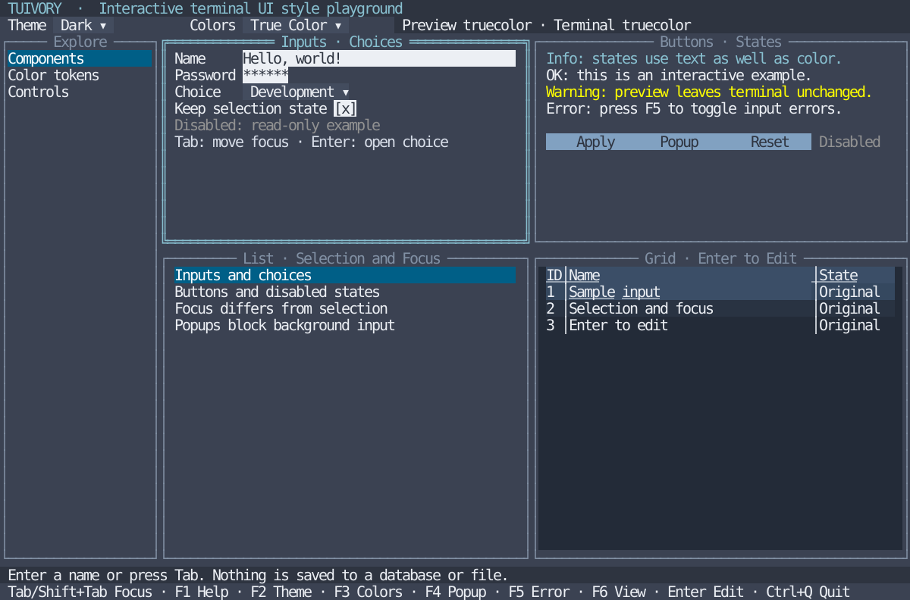

# Rust interactive playground

[한국어 (default)](rust-playground.md) · **English**

**0.9.1 TVR-27:** [Unified example executables](examples.en.md) provide one file per language, built only for the current Linux host architecture. Select examples with `--demo tree`, `--demo menu`, `--demo syntax`, etc.

This database-free host example uses the [Rust package](../rust/README.en.md)'s Ratatui adapter. It requires Ratatui 0.30.2, Crossterm 0.29, and Rust 1.88+. Inputs, selections, and table edits remain in memory and are never saved to files or databases. The default playground follows the Go example for layout, labels, themes/colors, and focus order. It embeds an example-only copy of the Go palette; Go regression tests check all twelve palettes and both localized guides. The public Rust SDK continues to use the shared candidate palette.

## Run

From the repository root, select English on the same executable that defaults to Korean:

```sh
make run-rust ARGS="--lang en"
make run-rust ARGS="--lang en --theme light --colors 16 --mouse=false"
make build-rust
./bin/rust/tuivory-linux-arm64 --lang en
```

`make build-rust` produces one unified static executable matching the host architecture, using the matching musl standard library and bundled rust-lld without mandatory native runtime dependencies. [Build and demo selection](examples.en.md) · [Static distribution](static-build.en.md).

`--theme` accepts dark/light/blackwhite; `--colors` accepts auto/8/16/256/truecolor. Auto uses the color count reported by Crossterm. Explicit profile selection is a preview, not a change to terminal capabilities or user palettes. Interactive execution requires a TTY.

## Controls

| Key/action | Result |
| --- | --- |
| Tab / Shift+Tab | Move through theme, colors, navigation, name, password, choice, checkbox, buttons, list, and table; skip disabled buttons |
| Arrows | Navigate lists, tables, and choice popup; scroll help/token views |
| Enter | Activate, open choices, or edit a table cell |
| Space | Toggle the checkbox |
| F1 | Help popup |
| F2 / F3 | Cycle theme / color profile |
| F4 / F5 / F6 | Preview / input error indicator / components, tokens, and controls views |
| Esc | Close popup and restore previous focus |
| Ctrl+Q | Exit and restore the previous screen and terminal mode |
| Click/wheel | Focus inputs, select items, activate buttons, navigate lists/tables |

Click or press Enter on the top theme/color selectors. F3 cycles Auto → 8 → 16 → 256 → True Color. Left navigation appears at 100 columns or wider and supports clicks, arrows, and Enter. Passwords use `*` and are omitted from previews. Disabled buttons ignore clicks and are skipped by Tab. Name/password input appends characters and removes them with Backspace. Long input scrolls horizontally. Press Enter on the table to edit, then Enter or Tab to focus Save and Enter to save. Esc cancels. Changed rows show `* Edited`. Popups block background clicks and retain focus internally. F2/F3 also work inside popups, preserving inputs, selections, edits, and focus.

Below 80×24 cells, a resize notice replaces the view and all input except Ctrl+Q is suspended. Resizing back restores the prior state. Selection markers differ from focus borders; warning, error, and edited states also have text labels.

## Views and validation

Go styles the page tree before its first layout, keeping card padding consistent before and after a theme round trip.

The TVR-27 follow-up directly exercised both `bin/` executables through 48 bilingual demo interaction scenarios and 48 theme/color screens. Checks compare name-input and disabled-text foreground/background colors against Go, and verify password masking and navigation. Rust buffer regressions also cover disabled Dim, click blocking, focus order, and Auto color round trips. [Local validation record](evidence/example-parity-results.json). Remote CI, publication, and release were not run for this change.

The example-only palette copy is generated from Go. After changing Go styles, update it with `TUIVORY_UPDATE_GO_PLAYGROUND_PALETTE=1 go -C go test ./internal/playground -run TestRustPlaygroundPaletteMatchesGo -count=1`. Normal tests fail if the twelve palettes or either localized guide drift from Go. This cross-repository check is skipped when only the Go module has been downloaded.



Other views: [light](images/rust-playground-light-en.svg) · [black and white](images/rust-playground-blackwhite-en.svg) · [popup](images/rust-playground-popup-en.svg)

These reference SVGs reproduce the actual example's Ratatui TestBackend 120×36 buffer. They are not remote terminal captures; indexed colors use reference RGB values. Regenerate after building:

```sh
python3 tools/snapshot_rust.py bin/rust/tuivory-linux-arm64
make test-rust-ui check-rust-ui
python3 tools/smoke_playground.py bin/rust/tuivory-linux-arm64 --lang ko
python3 tools/smoke_playground.py bin/rust/tuivory-linux-arm64 --lang en
python3 tools/check_rust_module.py --ratatui
```

Local checks passed for twelve palette roles/rendering, state preservation across theme changes, modal/mouse/resize behavior, English UI, Korean/English PTY startup/exit/restoration, and external packaged imports. GitHub CI results are recorded in TVR; remote terminals and actual LazyBeaver integration require separate verification. The crate, adapter, and example are included in v0.1.0. Shared product components such as trees and tabs are separate TVR-7 work.
