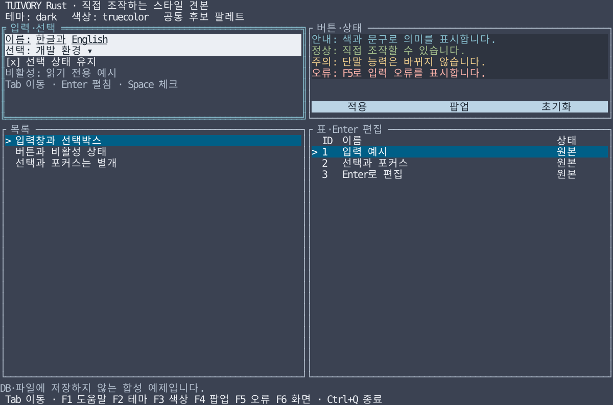

# Rust 대화형 견본

**한국어 (기본)** · [English](rust-playground.en.md)

[Rust 패키지](../rust/README.md)의 Ratatui 어댑터를 사용하는 DB 없는 호스트 예제입니다. Ratatui 0.30.2·Crossterm 0.29, Rust 1.88 이상이 필요합니다. 입력·선택·표 편집은 메모리에만 남으며 파일이나 DB에 저장하지 않습니다. 공통 후보 팔레트를 사용하므로 Go의 실제 추출 스타일 전체와 같지는 않습니다.

## 실행

저장소 루트에서 실행합니다. 기본 언어는 한국어이며 같은 실행파일에서 영어도 선택합니다.

```sh
make run-rust ARGS="--lang ko"
make run-rust ARGS="--lang en --theme light --colors 16 --mouse=false"
make build-rust
./bin/rust/tuivory-linux-arm64 --lang ko
```

`rustup target add aarch64-unknown-linux-musl` 후 `make build-rust`는 musl과 번들 `rust-lld`로 정적 `bin/rust/tuivory-linux-arm64` 하나를 만듭니다. x86_64는 `rustup target add x86_64-unknown-linux-musl` 후 `make build-rust-x86_64`입니다. [정적 배포·CentOS 검증·기존 릴리스와의 차이](static-build.md)를 확인하세요. 기본 `make build`는 계속 Go 실행파일 하나만 생성합니다.

`--theme`는 dark/light/blackwhite, `--colors`는 auto/8/16/256/truecolor입니다. auto는 Crossterm이 보고한 색상 수를 사용합니다. 명시적 프로필 선택은 미리보기이며 단말의 실제 능력이나 사용자 팔레트를 바꾸지 않습니다. 대화형 실행에는 TTY가 필요합니다.

## 조작

| 키·동작 | 결과 |
| --- | --- |
| Tab / Shift+Tab | 이름·선택·체크·버튼·목록·표 사이 포커스 이동 |
| 방향키 | 목록·표·선택 팝업 이동, 도움말·토큰 화면 스크롤 |
| Enter | 실행·선택 팝업 열기·표 셀 편집 |
| Space | 체크박스 전환 |
| F1 | 도움말 팝업 |
| F2 / F3 | 테마 / 색상 프로필 순환 |
| F4 / F5 / F6 | 미리보기 / 입력 오류 표시 / 컴포넌트·토큰·안내 화면 전환 |
| Esc | 팝업을 닫고 이전 포커스로 복귀 |
| Ctrl+Q | 종료·원래 화면과 단말 모드 복원 |
| 클릭·휠 | 입력 포커스·선택·버튼 실행, 목록·표 탐색 |

이름은 문자를 끝에 입력하고 Backspace로 지웁니다. 긴 입력은 가로로 스크롤합니다. 표에서 Enter로 편집하고 Enter 또는 Tab으로 저장 버튼에 이동한 뒤 Enter로 저장합니다. Esc는 취소합니다. 변경된 행은 `* 변경됨`으로 표시합니다. 팝업은 배경 클릭을 막고 포커스를 내부에 유지합니다. F2/F3은 팝업 중에도 동작하며 입력·선택·편집·포커스를 보존합니다.

80×24보다 좁으면 크기 조정 안내를 표시하고 Ctrl+Q 외 입력은 보류합니다. 화면을 키우면 이전 상태로 돌아옵니다. 선택 표시와 포커스 테두리를 구분하고 경고·오류·변경됨은 텍스트도 함께 표시합니다.

## 화면과 검증



다른 화면: [밝은 테마](images/rust-playground-light.svg) · [흑백](images/rust-playground-blackwhite.svg) · [팝업](images/rust-playground-popup.svg)

이미지는 실제 예제의 Ratatui TestBackend 120×36 버퍼를 SVG로 옮긴 참조 렌더링입니다. 실제 원격 단말 캡처가 아니며 인덱스 색상은 참조 RGB로 표시합니다. 재생성하려면 빌드 후 실행합니다.

```sh
python3 tools/snapshot_rust.py bin/rust/tuivory-linux-arm64
make test-rust-ui check-rust-ui
python3 tools/smoke_playground.py bin/rust/tuivory-linux-arm64 --lang ko
python3 tools/smoke_playground.py bin/rust/tuivory-linux-arm64 --lang en
python3 tools/check_rust_module.py --ratatui
```

로컬에서 12팔레트 역할·렌더링, 테마 전환 상태 유지, 모달·마우스·화면 크기, 영문 UI, 한·영 PTY 시작·종료·복원과 외부 패키지 import 검사를 통과했습니다. GitHub CI 결과는 TVR 일감에 기록하며 원격 단말·실제 LazyBeaver 적용은 별도 확인 대상입니다. crate·어댑터·예제는 v0.1.0에 포함합니다. 공통 트리·탭 등의 제품 컴포넌트는 TVR-7에서 별도로 다룹니다.
