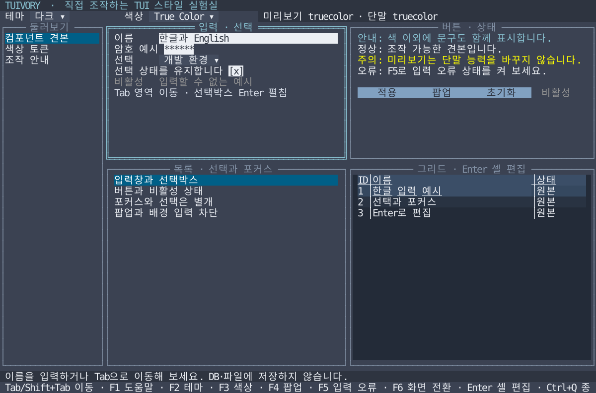

# Rust 대화형 견본

**한국어 (기본)** · [English](rust-playground.en.md)

**0.9.1 TVR-27:** [통합 예제 실행파일](examples.md)은 언어별 하나이며 현재 Linux 서버 아키텍처만 빌드합니다. `--demo tree`, `--demo menu`, `--demo syntax` 등으로 선택합니다.

[Rust 패키지](../rust/README.md)의 Ratatui 어댑터를 사용하는 DB 없는 호스트 예제입니다. Ratatui 0.30.2·Crossterm 0.29, Rust 1.88 이상이 필요합니다. 입력·선택·표 편집은 메모리에만 남으며 파일이나 DB에 저장하지 않습니다. 기본 playground는 Go 견본을 기준으로 화면 구성·표시 문구·테마/색상·포커스 순서를 맞춥니다. 예제 전용 Go 팔레트 사본을 포함하며, Go 회귀 검사가 12팔레트와 한영 도움말의 일치를 확인합니다. 공개 Rust SDK의 공통 후보 팔레트는 그대로 유지합니다.

## 실행

저장소 루트에서 실행합니다. 기본 언어는 한국어이며 같은 실행파일에서 영어도 선택합니다.

```sh
make run-rust ARGS="--lang ko"
make run-rust ARGS="--lang en --theme light --colors 16 --mouse=false"
make build-rust
./bin/rust/tuivory-linux-arm64 --lang ko
```

`make build-rust`는 현재 호스트 아키텍처의 통합 정적 실행파일 하나를 만듭니다. 호스트에 맞는 musl 표준 라이브러리와 번들 rust-lld를 사용하며 필수 네이티브 런타임 의존성은 추가하지 않습니다. [빌드·예제 선택](examples.md) · [정적 배포](static-build.md).

`--theme`는 dark/light/blackwhite, `--colors`는 auto/8/16/256/truecolor입니다. auto는 Crossterm이 보고한 색상 수를 사용합니다. 명시적 프로필 선택은 미리보기이며 단말의 실제 능력이나 사용자 팔레트를 바꾸지 않습니다. 대화형 실행에는 TTY가 필요합니다.

## 조작

| 키·동작 | 결과 |
| --- | --- |
| Tab / Shift+Tab | 테마·색상·탐색·이름·암호·선택·체크·버튼·목록·표 사이 이동; 비활성 버튼 제외 |
| 방향키 | 목록·표·선택 팝업 이동, 도움말·토큰 화면 스크롤 |
| Enter | 실행·선택 팝업 열기·표 셀 편집 |
| Space | 체크박스 전환 |
| F1 | 도움말 팝업 |
| F2 / F3 | 테마 / 색상 프로필 순환 |
| F4 / F5 / F6 | 미리보기 / 입력 오류 표시 / 컴포넌트·토큰·안내 화면 전환 |
| Esc | 팝업을 닫고 이전 포커스로 복귀 |
| Ctrl+Q | 종료·원래 화면과 단말 모드 복원 |
| 클릭·휠 | 입력 포커스·선택·버튼 실행, 목록·표 탐색 |

상단 테마·색상 선택창은 클릭 또는 Enter로 열며 F3은 자동 → 8 → 16 → 256 → True Color 순환입니다. 왼쪽 탐색 메뉴는 100열 이상에서 표시하며 클릭·방향키·Enter로 이동합니다. 암호는 `*`로 표시하고 미리보기에서 숨깁니다. 비활성 버튼은 클릭·Tab 대상에서 제외합니다. 이름·암호는 문자를 끝에 입력하고 Backspace로 지웁니다. 긴 입력은 가로로 스크롤합니다. 표에서 Enter로 편집하고 Enter 또는 Tab으로 저장 버튼에 이동한 뒤 Enter로 저장합니다. Esc는 취소합니다. 변경된 행은 `* 변경됨`으로 표시합니다. 팝업은 배경 클릭을 막고 포커스를 내부에 유지합니다. F2/F3은 팝업 중에도 동작하며 입력·선택·편집·포커스를 보존합니다.

80×24보다 좁으면 크기 조정 안내를 표시하고 Ctrl+Q 외 입력은 보류합니다. 화면을 키우면 이전 상태로 돌아옵니다. 선택 표시와 포커스 테두리를 구분하고 경고·오류·변경됨은 텍스트도 함께 표시합니다.

## 화면과 검증

Go는 첫 화면을 배치하기 전에 페이지 트리에도 스타일을 적용하여 카드 여백이 테마 전환 전후 같은 배경을 유지합니다.

TVR-27 후속에서는 `bin/`의 Go·Rust 실행파일을 직접 사용해 한영 48개 예제 조작 시나리오와 48개 테마·색상 조합 화면을 확인했습니다. 이름 입력·비활성 문구의 전경/배경이 Go 기준과 일치하고 암호 마스킹·탐색 메뉴가 표시되는지 검사했습니다. Rust 버퍼 회귀 검사로 비활성 Dim·클릭 차단·포커스 순서·자동 색상 왕복도 확인합니다. [로컬 검증 기록](evidence/example-parity-results.json). 이번 변경의 원격 CI·게시·릴리스는 수행하지 않았습니다.

예제 전용 팔레트 사본은 Go 구현에서 생성합니다. Go 스타일을 수정한 뒤 `TUIVORY_UPDATE_GO_PLAYGROUND_PALETTE=1 go -C go test ./internal/playground -run TestRustPlaygroundPaletteMatchesGo -count=1`로 갱신합니다. 일반 테스트는 12팔레트와 한영 안내가 Go 기준에서 달라지면 실패합니다. Go 모듈만 내려받은 환경에서는 이 저장소 간 검사를 생략합니다.



다른 화면: [밝은 테마](images/rust-playground-light.svg) · [흑백](images/rust-playground-blackwhite.svg) · [팝업](images/rust-playground-popup.svg)

이미지는 실제 예제의 Ratatui TestBackend 120×36 버퍼를 SVG로 옮긴 참조 렌더링입니다. 실제 원격 단말 캡처가 아니며 인덱스 색상은 참조 RGB로 표시합니다. 재생성하려면 빌드 후 실행합니다.

```sh
python3 tools/snapshot_rust.py bin/rust/tuivory-linux-arm64
make test-rust-ui check-rust-ui
python3 tools/smoke_playground.py bin/rust/tuivory-linux-arm64 --lang ko
python3 tools/smoke_playground.py bin/rust/tuivory-linux-arm64 --lang en
python3 tools/check_rust_module.py --ratatui
```

로컬에서 12팔레트 역할·렌더링, 테마 전환 상태 유지, 모달·마우스·화면 크기, 영문 UI, 한·영 PTY 시작·종료·복원과 외부 패키지 import 검사를 통과했습니다. GitHub CI 결과는 TVR 일감에 기록하며 원격 단말·실제 LazyBeaver 적용은 별도 확인 대상입니다. crate·어댑터·예제는 v0.1.0에 포함합니다. 공통 트리·탭 등의 제품 컴포넌트는 TVR-7에서 별도로 다룹니다.
