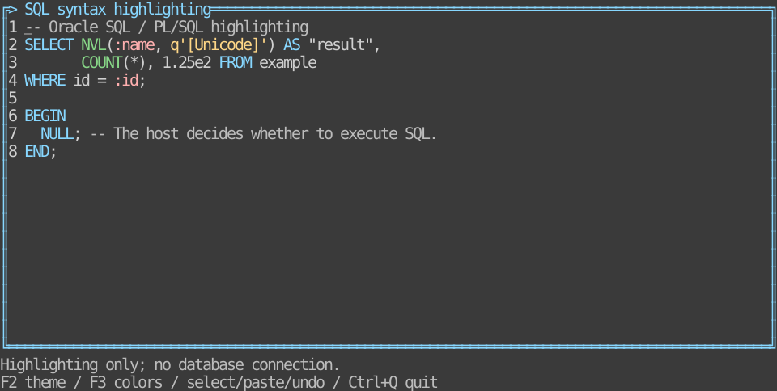
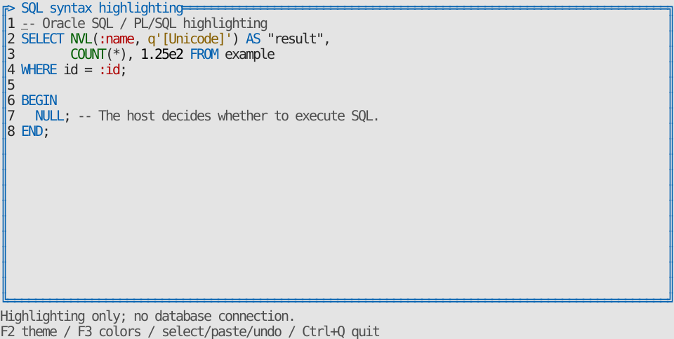
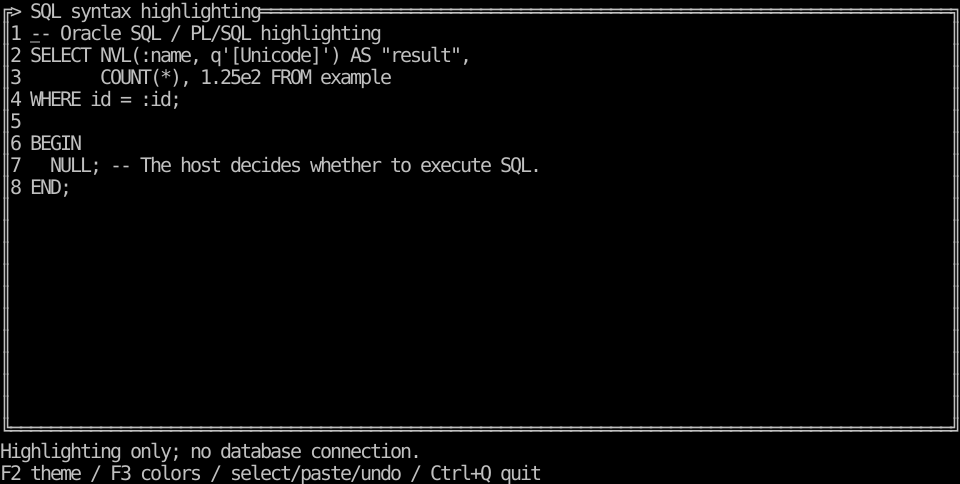
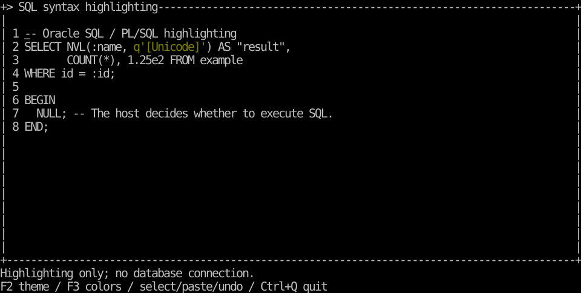

# Syntax analysis, highlighting and editor migration

[한국어 (default)](syntax.md) · **English**

**0.9.1 TVR-27:** [Unified example executables](examples.en.md) provide one file per language, built only for the current Linux host architecture. Select examples with `--demo tree`, `--demo menu`, `--demo syntax`, etc.

**Syntax analyzers and editing APIs available since 0.9.0.** See [release and installation](release-0.9.0.en.md). [Shared specification](../design/syntax.en.md) · [Go API](api/go.en.md) · [Rust API](api/rust.en.md).

Tuivory provides optional highlighting analyzers, common tokens and rendering. Hosts select a supplied analyzer or inject their own. **Highlighting does not decide executable syntax, dangerous DDL/DML, permissions or transaction safety.** Database access, SQL execution, Oracle metadata and global keys remain host responsibilities.

| Highlighted source | Go SDK | Rust SDK |
| --- | --- | --- |
| Oracle SQL/PLSQL | NewSQLAnalyzer() | syntax_sql::SQLAnalyzer, optional syntax-sql feature |
| Go source | Classification specification only | Classification specification only |
| Rust source | Classification specification only | Classification specification only |
| Custom analyzer | SyntaxAnalyzer / SyntaxAnalyzerFunc | syntax::SyntaxAnalyzer implementation or function/closure |

SDK implementation language differs from the highlighted source language. Both current SDKs analyze SQL; Python/JS/TS/C/C++ remain future SDK targets.

## Go: one Tuivory import

```go
import ui "github.com/leechis7/tuivory/go"

doc := ui.NewEditor("SELECT NVL(:id, q'[Unicode]') FROM dual")
err := doc.SetSyntaxAnalyzer(ui.NewSQLAnalyzer(), ui.SyntaxRequest{
    Language: "sql", Dialect: "oracle",
})
// Check err, then connect the existing NewEditorView(doc, palette, onEvent).
```

No extra analyzer import/package is required. Go opts in by calling the factory, without global vocabulary initialization, external tools or new native dependencies. Unused analyzer code is eligible for normal Go linker elimination.

## Rust: optional feature, one dependency

```toml
[dependencies]
tuivory = { git = "https://github.com/leechis7/tuivory", tag = "rust/v0.9.0", features = ["terminal", "syntax-sql"] }
```

```rust
use std::sync::Arc;
use tuivory::{syntax::SyntaxRequest, syntax_sql::SQLAnalyzer, text::TextDocument};

let mut doc = TextDocument::editor("SELECT NVL(:id, q'[Unicode]') FROM dual");
doc.set_syntax_analyzer(Some(Arc::new(SQLAnalyzer::new())), SyntaxRequest {
    language: "sql".into(), dialect: "oracle".into(),
})?;
```

Default core and ratatui/terminal do not require SQL analysis. Analysis-only users enable syntax-sql alone. Core/SQL requires Rust 1.85+; UI examples require 1.88+. No new external crate, runtime or native dependency.

## Tokens, errors and refresh

SyntaxToken carries **half-open original UTF-8 byte offsets** start/end and a semantic role. SyntaxAnalysis retains unchanged source, language, dialect and ordered nonoverlapping tokens; whitespace may be omitted. SyntaxSpan/TextRange/cursor/selection use **grapheme indices**, while viewports use **cells**. Never mix units.

- SetSyntaxAnalyzer/set_syntax_analyzer validates/applies initial results atomically; errors retain the prior binding/highlighting. nil/None detaches automatic analysis.
- Editing, undo/redo and paste trigger reclassification. Direct buffer edits/byte replacements refresh on the next Layout or explicit RefreshSyntax/refresh_syntax. Scroll/theme/profile-only renders reuse classification.
- Failed analysis of changed source **clears stale highlighting and renders plain text**. Inspect SyntaxError/syntax_error. The same failed source is not retried every frame; source changes or resetting the analyzer retries it.
- SetSyntaxAnalysis/set_syntax_analysis also accepts host-worker results. It validates exact source and ranges before switching to supplied-result mode. Stale/overlapping/reversed/out-of-bounds/character-or-grapheme-splitting ranges return errors atomically.
- Custom analyzers implement the same contract. Unknown roles fall back to body. The SQL analyzer assigns a display grapheme the role of its first intersecting token, preventing boundaries inside emoji/combining clusters.
- Automatic analysis cannot attach to secret buffers. Entering secret mode clears highlighting; diagnostics exclude cached analyzer/search source.

The tokenizer scans the complete source linearly. Layout still visits the complete document; syntax application expands spans once rather than searching every token for every character. No incremental parser, rope or background scheduler. Tests cover 10,000-line analysis/binding/scroll/original preservation and benchmarks.

## Roles, styles and precedence

The seven existing families keyword/function/type/string/number/comment/parameter map to syntax.* rendering roles. Extended roles follow the [shared fallbacks](../design/syntax.en.md). No source language creates a separate palette. Default foregrounds reuse shared roles and bind to the **actual surface background**.

Precedence: **disabled > selection > search match > syntax > body**. Cursor focus decoration retains the winning background. SetSearchMatches/set_search_matches accepts host grapheme ranges, uses the edited style and expires when source changes. Hosts choose search behavior and global keys.

Preserve the existing seven Go syntax colors and monochrome/limited-color attributes with this optional adapter; refresh it when theme/profile changes:

```go
legacy, err := ui.NewStyles(theme, profile)
// After checking err:
view.SyntaxStyle = ui.SyntaxStyleFunc(legacy)
```

## Oracle scope

Defaults are sql/oracle; plsql is also accepted. Handles an explicit case-insensitive keyword/builtin/type vocabulary, normal/N strings and doubled quotes, q/nq paired/same/multibyte delimiters, quoted identifiers/binds, numeric fractions/exponents/f-d suffixes, line/block/hint comments and incomplete input. It does not rewrite whitespace/CRLF/source or insert color tags.

Unknown names are not guessed to be functions/types. This is **minimal vocabulary-based highlighting**, without shadowing, overload/schema/type inference or executable grammar validation. Other dialects and Go/Rust source requests currently return explicit errors. [Oracle literals](https://docs.oracle.com/en/database/oracle/oracle-database/19/sqlrf/Literals.html) · [PL/SQL lexical units](https://docs.oracle.com/en/database/oracle/oracle-database/21/lnpls/plsql-language-fundamentals.html).

## Supported LazyOra migration path

Highlighting-only colorSQL/sqlWords can consume AnalyzeSyntax/analyze_syntax original tokens. Keep execution parsers, dangerous-SQL checks and database integration in the host. This repository does not migrate/build the LazyOra application.

| Existing editor usage | Shared SDK path |
| --- | --- |
| Byte selection/original range | Buffer.SelectBytes/SelectionBytes, select_bytes/selection_bytes |
| Replace(start,end,text) | ReplaceBytes/replace_bytes: literal source and one undoable edit |
| GetText/execution/copy source | Buffer.Text/text; host handles copy/cut requests |
| Fork SetTextStyleFunc | Shared NewEditor/NewEditorView, analysis and optional Go SyntaxStyleFunc |
| Scroll/wrap/keymaps | TextDocument ScrollX/Y, Wrap, input requests; host global-key policy |

ReplaceBytes preserves history and blocks read-only/disabled/Busy edits; invalid byte/grapheme boundaries fail. **The existing TextArea alias remains; it is not a drop-in adapter adding fork-only methods.** Move to the SDK editor, verify actual selection/keymap/undo/large-document/colors/literal execution/copy regressions, then remove the host third_party replacement.

## Runnable examples, references and validation

```sh
make run-syntax-go ARGS="--lang ko"
make run-syntax-rust ARGS="--lang en"
```

Build the unified static executables for the host with `make build build-rust`, then select `--demo syntax`. No separate SQL executable is produced. [Build and demo selection](examples.en.md).

F2 theme, F3 profile, Ctrl+Q exit. Ctrl+C emits a copy request; no database/clipboard execution. --ascii switches decorations.






References render real Rust SDK widgets through TestBackend, separately from remote-terminal captures. Tests inspect Go post-Show buffers and Rust TestBackend across twelve palettes/state precedence, plus real PTY editing/resize/mouse/restoration. [Shared fixtures](../design/syntax-cases.json) · [Validation record](evidence/syntax-results.json). Analyzer/vocabulary code is this repository's AGPL-3.0-only implementation; no third-party lexer/license was added. No CentOS checks.
