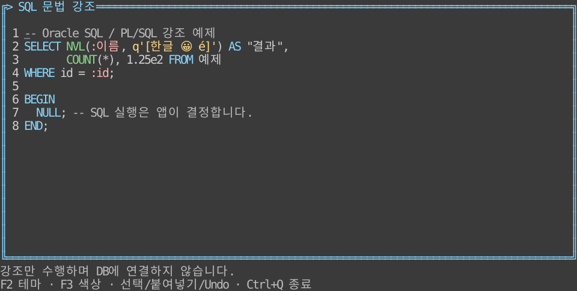
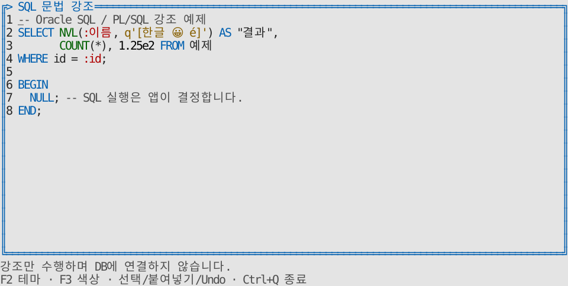
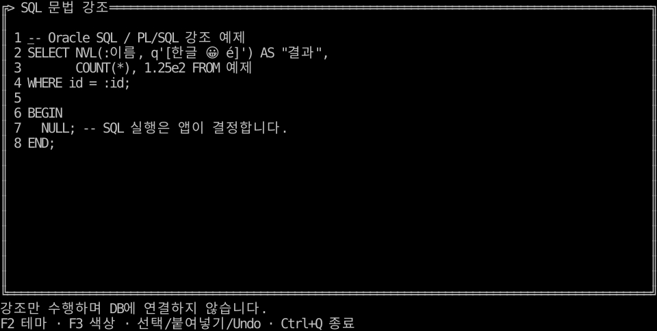
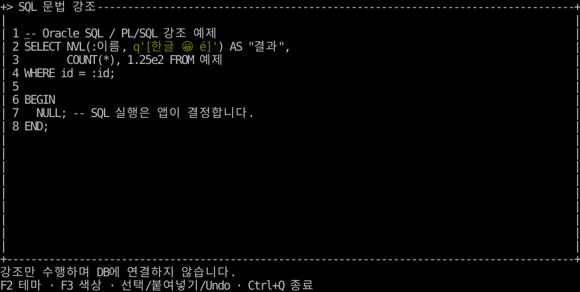
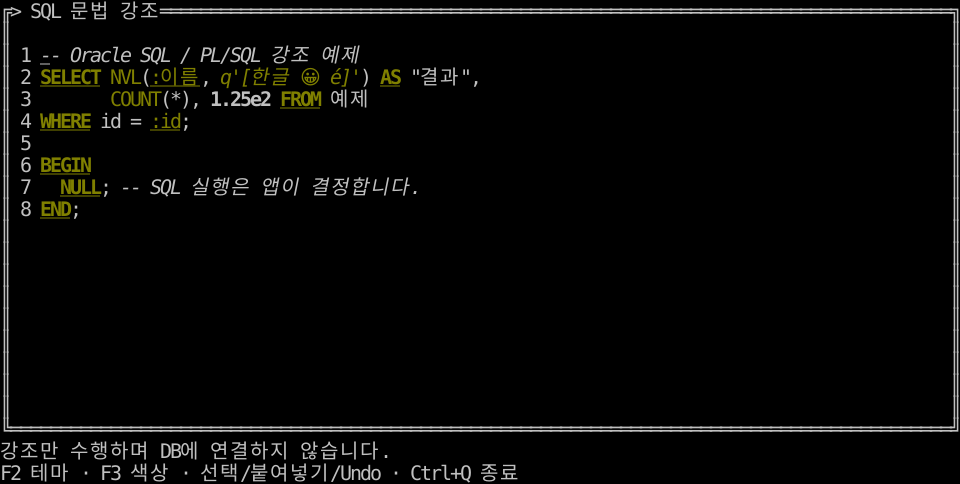

# 문법 분석·강조와 편집기 전환

**한국어 (기본)** · [English](syntax.en.md)

**0.9.1 TVR-27:** [통합 예제 실행파일](examples.md)은 언어별 하나이며 현재 Linux 서버 아키텍처만 빌드합니다. `--demo tree`, `--demo menu`, `--demo syntax` 등으로 선택합니다.

**0.9.0부터 제공하는 문법 분석기와 편집 API입니다.** [릴리스·설치](release-0.9.0.md)를 참고하세요. [공통 규격](../design/syntax.md) · [Go API](api/go.md) · [Rust API](api/rust.md).

Tuivory는 선택적 강조용 분석기, 공통 토큰과 렌더러를 제공합니다. 앱은 제공 분석기를 선택하거나 자체 분석기를 주입합니다. **분석 결과는 실행 가능성·위험 DDL/DML·권한·트랜잭션 안전성을 판단하지 않습니다.** DB 연결·SQL 실행·Oracle 메타데이터·전역 키는 앱 책임입니다.

| 강조 대상 | Go SDK | Rust SDK |
| --- | --- | --- |
| Oracle SQL·PL/SQL | `NewSQLAnalyzer()` | `syntax_sql::SQLAnalyzer`, 선택 기능 `syntax-sql` |
| Go 소스 | 분류 명세만 제공 | 분류 명세만 제공 |
| Rust 소스 | 분류 명세만 제공 | 분류 명세만 제공 |
| 자체 분석기 | `SyntaxAnalyzer` / `SyntaxAnalyzerFunc` | `syntax::SyntaxAnalyzer`, 구현체 또는 함수/클로저 |

SDK 구현 언어와 강조 대상 언어는 별개입니다. Go 앱도 Rust 앱도 현재 SQL을 분석할 수 있습니다. Python·JS/TS·C·C++는 후속 SDK 대상입니다.

## Go: Tuivory 한 번만 import

```go
import ui "github.com/leechis7/tuivory/go"

doc := ui.NewEditor("SELECT NVL(:id, q'[한글 😀]') FROM dual")
err := doc.SetSyntaxAnalyzer(ui.NewSQLAnalyzer(), ui.SyntaxRequest{
    Language: "sql", Dialect: "oracle",
})
// err를 확인한 뒤 기존 NewEditorView(doc, palette, onEvent)에 연결합니다.
```

추가 import나 렉서 패키지가 필요 없습니다. Go 분석기는 호출로 선택하며 전역 사전 초기화·외부 도구·추가 네이티브 의존성을 만들지 않습니다. 사용하지 않는 분석 코드는 일반 Go 링커의 제거 대상입니다.

## Rust: 선택 기능과 단일 의존성

```toml
[dependencies]
tuivory = { git = "https://github.com/leechis7/tuivory", tag = "rust/v0.9.0", features = ["terminal", "syntax-sql"] }
```

```rust
use std::sync::Arc;
use tuivory::{syntax::SyntaxRequest, syntax_sql::SQLAnalyzer, text::TextDocument};

let mut doc = TextDocument::editor("SELECT NVL(:id, q'[Unicode]') FROM dual");
doc.set_syntax_analyzer(Some(Arc::new(SQLAnalyzer::new())), SyntaxRequest {
    language: "sql".into(), dialect: "oracle".into(),
})?;
```

기본 core와 `ratatui`/`terminal`은 SQL 분석기를 요구하지 않습니다. 분석만 필요하면 `syntax-sql`만 켭니다. 코어/SQL은 Rust 1.85+, UI 예제는 1.88+입니다. 새 외부 crate·런타임·네이티브 의존성은 없습니다.

## 토큰·오류·재분류

`SyntaxToken`은 **원문 UTF-8 바이트 반열림 범위** `start/end`와 의미 역할 `role`입니다. `SyntaxAnalysis`는 변경하지 않은 `source`, `language`, `dialect`, 정렬된 비중첩 토큰을 보관합니다. 공백은 토큰에서 생략할 수 있습니다. `SyntaxSpan`·`TextRange`와 커서/선택은 **grapheme 인덱스**, 뷰포트는 **셀 좌표**입니다. 단위를 섞지 않습니다.

- `SetSyntaxAnalyzer` / `set_syntax_analyzer`: 초기 분석·범위 검증을 원자적으로 적용합니다. 실패하면 이전 분석기·강조를 유지합니다. nil/None은 자동 분석을 해제합니다.
- 편집/Undo/Redo/붙여넣기 변경은 자동 재분류합니다. 버퍼 직접 변경·바이트 치환은 다음 Layout 또는 `RefreshSyntax` / `refresh_syntax`에서 갱신합니다. 스크롤·테마·색상만 바뀌면 분석 결과를 재사용합니다.
- 변경된 원문의 분석이 실패하면 **오래된 강조를 지우고 평문으로 표시**합니다. `SyntaxError` / `syntax_error`로 오류를 확인합니다. 같은 실패 원문을 프레임마다 재시도하지 않으며, 원문 변경 또는 분석기 재설정으로 다시 시도합니다.
- `SetSyntaxAnalysis` / `set_syntax_analysis`는 앱의 작업 스레드에서 계산한 결과도 적용합니다. 정확히 같은 원문인지와 범위를 확인한 뒤 자동 분석 모드에서 공급 결과 모드로 전환합니다. 오래된 결과·중첩·역순·범위 초과·문자/그라핌 중간 경계는 오류이며 이전 설정을 유지합니다.
- 자체 분석기는 같은 규격을 구현합니다. 알 수 없는 역할은 body로 fallback합니다. 내장 SQL 분석기는 표시 grapheme과 겹치는 첫 토큰의 역할을 그 grapheme 전체에 적용해 이모지/결합 문자 내부 경계를 만들지 않습니다.
- 비밀 버퍼에는 자동 분석을 붙이지 않습니다. 비밀 상태로 바뀌면 강조를 비우며 진단 출력은 분석/검색용 원문 캐시를 노출하지 않습니다.

전체 원문을 분류하는 선형 토크나이저입니다. Layout은 여전히 전체 원문을 순회하며, 강조 적용은 토큰을 문자마다 재검색하지 않고 한 번 펼칩니다. 증분 파서·rope·백그라운드 스케줄러는 제공하지 않습니다. 1만 줄 분류·바인딩·스크롤/원문 보존과 벤치마크를 검증합니다.

## 역할·스타일·우선순위

기존 7종 keyword/function/type/string/number/comment/parameter를 유지하고 `syntax.*` 렌더링 역할로 연결합니다. 확장 역할의 fallback은 [공통 명세](../design/syntax.md)를 따릅니다. 언어마다 별도 팔레트를 만들지 않습니다. 기본 전경은 기존 공유 역할을 재사용하고 **실제 surface 배경에 결합**합니다.

우선순위는 **비활성 > 선택 > 검색 일치 > 문법 > 본문**입니다. 커서는 해당 상태의 배경을 유지하며 포커스 표시를 더합니다. `SetSearchMatches` / `set_search_matches`는 앱이 준 grapheme 범위를 edited 역할로 표시하고 원문 변경 시 폐기합니다. 검색 알고리즘/전역 단축키는 앱이 정합니다.

Go의 기존 7종 추출 색상·흑백/저색상 속성을 유지하려면 다음처럼 연결합니다. 테마/프로필을 바꿀 때 이 어댑터도 갱신합니다.

```go
legacy, err := ui.NewStyles(theme, profile)
// err 확인 후:
view.SyntaxStyle = ui.SyntaxStyleFunc(legacy)
```

### 8색의 구문 색상

0.9.2는 기존 대부분 silver인 다크/8색 정책을 실제로 개선합니다. keyword/function/string/parameter는 olive(3), type/number/comment는 silver(7)이며 keyword는 굵게+밑줄, function은 일반, type은 밑줄, string은 기울임, number는 굵게, comment는 기울임, parameter는 밑줄로 7종 전경·속성 조합을 구분합니다. 검정 배경의 참조 본문 대비 >=4.5:1을 유지하며 밝은 색 인덱스·RGB·Dim·반전·토큰 배경을 요구하지 않습니다. Go 기존 SyntaxStyle과 기본 Go/Rust 의미 기반 편집기에 같은 원칙을 적용합니다. 선택·검색·비활성 우선순위와 흑백 표현은 유지합니다. 굵기·기울임·밑줄의 실제 지원은 단말을 따르며 일부 단말은 굵기를 밝은 ANSI 색으로 표시합니다.

## Oracle 지원 범위

기본 언어는 sql, 방언은 oracle이며 plsql도 지원합니다. 대소문자를 구분하지 않는 명시적 키워드·내장 함수·자료형 사전, 일반/N 문자열과 이중 작은따옴표, q/nq 인용(쌍/같은 문자/다중 바이트 구분자), 큰따옴표 식별자·바인드 변수, 숫자·소수·지수·f/d 접미사, 줄/블록 주석·힌트와 미완성 입력을 처리합니다. 원문·공백·CRLF를 재작성하거나 색상 태그를 삽입하지 않습니다.

알 수 없는 이름을 함수·타입으로 추측하지 않습니다. 고정 사전 기반의 **강조용 최소 분류**이며 이름 가림·오버로드·스키마·타입 추론·실행 문법 검증을 하지 않습니다. 현재 다른 방언이나 Go/Rust 소스 분석 요청은 명시적 오류입니다. [Oracle 문자열 규칙](https://docs.oracle.com/en/database/oracle/oracle-database/19/sqlrf/Literals.html) · [PL/SQL 어휘 단위](https://docs.oracle.com/en/database/oracle/oracle-database/21/lnpls/plsql-language-fundamentals.html).

## LazyOra의 공식 전환 경로

기존 강조 전용 colorSQL/sqlWords는 `AnalyzeSyntax` / `analyze_syntax`의 원문 토큰으로 대체할 수 있습니다. 실행 파서·위험 SQL 판별·DB 연결은 그대로 앱에 둡니다. 앱의 구체적인 전환·빌드는 이 저장소에서 수행하지 않습니다.

| 기존 편집기 사용 | 공통 SDK 경로 |
| --- | --- |
| byte 선택/원문 범위 | Buffer.SelectBytes/SelectionBytes, select_bytes/selection_bytes |
| Replace(start,end,text) | ReplaceBytes/replace_bytes: 리터럴 원문·한 번의 Undo/Redo 편집 |
| GetText/원문 실행·복사 | Buffer.Text/text; copy/cut 요청은 호스트가 처리 |
| 포크의 SetTextStyleFunc | 공통 NewEditor/NewEditorView와 분석기·선택적 Go SyntaxStyleFunc |
| 스크롤·wrap·키맵 | TextDocument의 ScrollX/Y·Wrap·입력 요청; 전역 키는 앱 정책 |

`ReplaceBytes`는 SetText처럼 이력을 초기화하지 않으며 읽기 전용·비활성·Busy 편집을 막습니다. 유효하지 않은 byte/grapheme 경계는 오류로 거부합니다. **기존 TextArea 별칭은 유지하며 포크 전용 메서드를 추가한 drop-in 어댑터라고 주장하지 않습니다.** SDK 편집기로 이동한 뒤 실제 선택·키맵·Undo/Redo·긴 문서·색상/원문 실행/복사 회귀를 확인하고 앱의 third_party replace를 제거하세요.

## 실행 예제·화면·검증

```sh
make run-syntax-go ARGS="--lang ko"
make run-syntax-rust ARGS="--lang en"
```

`make build build-rust`로 현재 호스트의 통합 정적 실행파일을 만들고 `--demo syntax`로 실행합니다. 별도 SQL 실행파일은 만들지 않습니다. [빌드·예제 선택](examples.md).

F2 테마, F3 색상 수, Ctrl+Q 종료. Ctrl+C는 복사 요청이며 DB·클립보드를 실행하지 않습니다. `--ascii`로 장식 대체를 확인합니다.






화면은 실제 Rust SDK 위젯의 TestBackend 참조이며 원격 단말 캡처와 구분합니다. Go Show 이후 버퍼와 Rust TestBackend로 12팔레트·상태 우선순위를 검사하고, 별도로 실제 PTY의 편집·크기 변경·마우스·복원을 검사합니다. [공통 fixture](../design/syntax-cases.json) · [검증 기록](evidence/syntax-results.json). 분석기·사전은 이 저장소의 AGPL-3.0-only 구현이며 추가 타사 렉서/라이선스는 도입하지 않습니다. CentOS 검증은 하지 않습니다.


