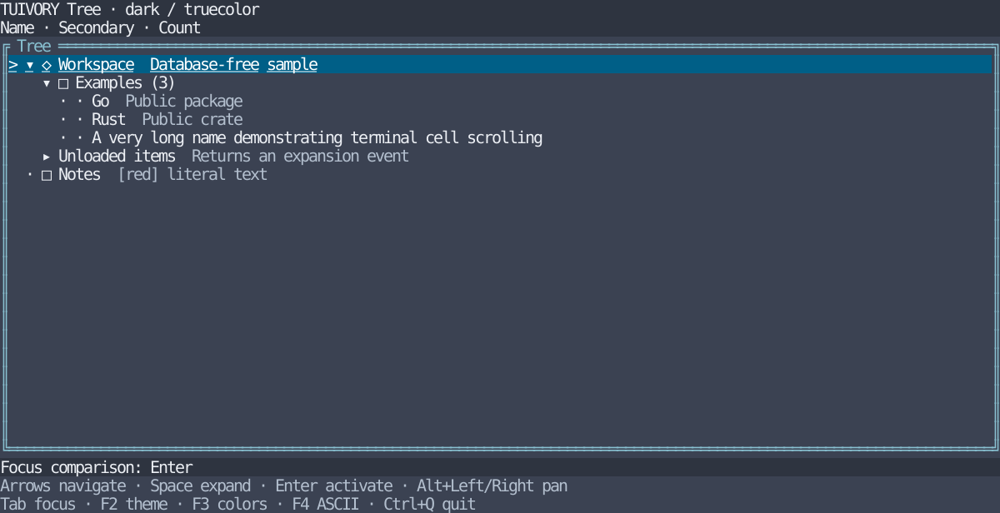

# Shared Tree guide

[한국어 (default)](tree.md) · **English**

Public components for Go/tview and Rust/Ratatui share candidate colors, state, and interaction principles. Added as TVR-7's first implementation after the [support audit](component-audit.en.md). Existing `Styler.Tree` continues to style stock tview nodes; the new `TreeView` is a separate API.

## Data, state, and event specification

- Nodes provide stable unique IDs, parent IDs (empty for roots), primary/secondary text, Unicode/ASCII icons, optional counts, and unloaded-branch flags. Parents must precede children. Empty/duplicate IDs, missing parents, self-reference, and depths beyond 128 are rejected. Zero counts differ from omitted counts.
- Data is separate from selected ID, expanded-ID set, and vertical/horizontal scroll. The host owns state and replaces only the palette on theme/profile changes. Input focus belongs to the framework/host.
- `Reconcile`/`reconcile` normalizes state after replacement/resizing. Hidden selection moves to its nearest visible ancestor; removed selection uses the first row. Removed expansion IDs are discarded, surviving IDs retained.
- Hosts handle `select`, `expand`, `collapse`, and `activate` events. Expanding an empty `Branch`/`branch` never loads data. Supply a replacement model with children and reuse the existing state. A disclosure click returns one expansion/collapse event instead of a separate selection event, while also updating selected ID.

## Controls and presentation

| Input | Result |
| --- | --- |
| Up / Down, Home / End | Select visible rows; stop at boundaries |
| PageUp / PageDown | Move by viewport height |
| Right | Expand a closed branch; enter its first child when already open |
| Left | Collapse an open branch; otherwise move to parent |
| Space | Toggle branch expansion |
| Enter | Request activation of selected ID, including branches; host decides the action |
| Alt+Left / Alt+Right | Pan content by four cells; selection gutter stays fixed |
| Row / disclosure click | Select / select and toggle; neither activates immediately |
| Wheel | Move selection one row and keep it visible |

The Rust widget renders only: map keys to `TreeAction` and inner-viewport coordinates to `Tree::click`, as in the example. Go TreeView maps tview events and calls `OnEvent`. Hosts decide Tab navigation and focus policy.

Indentation is two cells. Disclosure uses `▸`/`▾`, or ASCII `>`/`v`; leaves use `·`/`.`. ASCII mode omits a host icon when its ASCII substitute is empty. Selection uses `>` and a selection surface; input focus adds an underline and border cue. Name/count use primary text, descriptions use hint style, and selected rows use a consistent readable selection style. Text is literal rather than markup; control characters become spaces.

Long names/deep nesting clip and pan in terminal cells. Partially clipped wide/combining glyphs are not rendered as half characters. Narrow viewports retain vertical scrolling, including safe zero-sized rendering. Example icons work with ordinary fonts; actual terminal width differences still require separate evidence.

## Go usage

Use a replace directive pointing to the checkout's `go/`. Install with `go get github.com/leechis7/tuivory/go@v0.6.0`. The first `go/v0.0.1` tag does not contain these APIs.

```go
tree, err := tuivory.NewTree([]tuivory.TreeNode{
    {ID: "root", Name: "Workspace"},
    {ID: "child", Parent: "root", Name: "Example", Secondary: "Details"},
})
if err != nil { return err }
state := &tuivory.TreeState{Expanded: map[string]bool{"root": true}}
document, err := tuivory.CandidateTokens()
if err != nil { return err }
tokens, err := document.Palette("dark", "256")
if err != nil { return err }
palette, err := tuivory.Resolve(tokens)
if err != nil { return err }
view, err := tuivory.NewTreeView(tree, state, palette)
if err != nil { return err }
view.OnEvent = func(event tuivory.TreeEvent) { /* connect host actions */ }
```

Replace colors with `view.SetPalette(palette)`, data with `view.SetTree(tree)`, and select ASCII with `view.ASCII = true`. Required palette roles are body/hint/surface/selection/focus.border. The tview Application owns the terminal, screen, focus, and input loop.

## Rust usage

The core requires Rust 1.85+; the Ratatui 0.30.2 adapter requires Rust 1.88+. Use `tuivory = { path = "/path/to/tuivory/rust", features = ["ratatui"] }`.

```rust
use tuivory::tree::{Tree, TreeNode, TreeState, TreeAction};
use tuivory::ratatui::{Styles, TreeWidget};
use tuivory::{Theme, ColorProfile};

let tree = Tree::new(vec![TreeNode {
    id: "root".into(), name: "Workspace".into(), branch: true,
    ..Default::default()
}])?;
let mut state = TreeState::default();
let event = tree.handle(&mut state, TreeAction::Right, 10);
let styles = Styles::new(Theme::Dark, ColorProfile::Indexed256)?;
let mut widget = TreeWidget::new(&tree, &styles)?;
widget.focused = true;
// frame.render_stateful_widget(widget, inner_rect, &mut state);
```

`Tree::new` returns structural errors as String; style errors use `tuivory::Error`. Host functions can use `Result<_, Box<dyn std::error::Error>>`. `TreeWidget::new` checks required surface/hint/selection roles. Draw a `Styles::block` panel separately and pass its inner rectangle to rendering and click handling.

## Run and validate

```sh
make run-tree-go ARGS="--lang en"
make run-tree-rust ARGS="--lang en --ascii"
make test check
make test-rust-ui check-rust-ui
python3 tools/check_go_module.py
python3 tools/check_rust_module.py --ratatui
```

Both examples support F2 themes, F3 color profiles, F4 Unicode/ASCII, Tab focus comparison, and Ctrl+Q exit. Korean is the default. Sources stay in `go/examples/tree/` and `rust/examples/tree/`; the default product build does not gain more targets.



The SVG renders the actual Rust example into a 120×28 Ratatui TestBackend. It is not a remote terminal capture or a Go screenshot. Regenerate with `cargo run --manifest-path rust/Cargo.toml --features playground --example tree -- --lang en --colors truecolor --snapshot docs/images/tree-dark-en.svg`.

Shared source `design/tree-navigation.json` defines expected state/events for an identical navigation sequence, including keys, unloaded expansion, horizontal scrolling, and clicks. `tools/export_tree_cases.py` generates module-local test copies; `--check` verifies equality. Both languages test the same expected results, plus twelve palettes, independent focus, literal text, cell widths, and data replacement. External imports and Korean/English PTY startup/exit/restoration are also checked. Remote terminals, remote CI, and actual LazyOra/LazyBeaver integration remain unverified. TVR-7 changes are included in v0.1.0.
