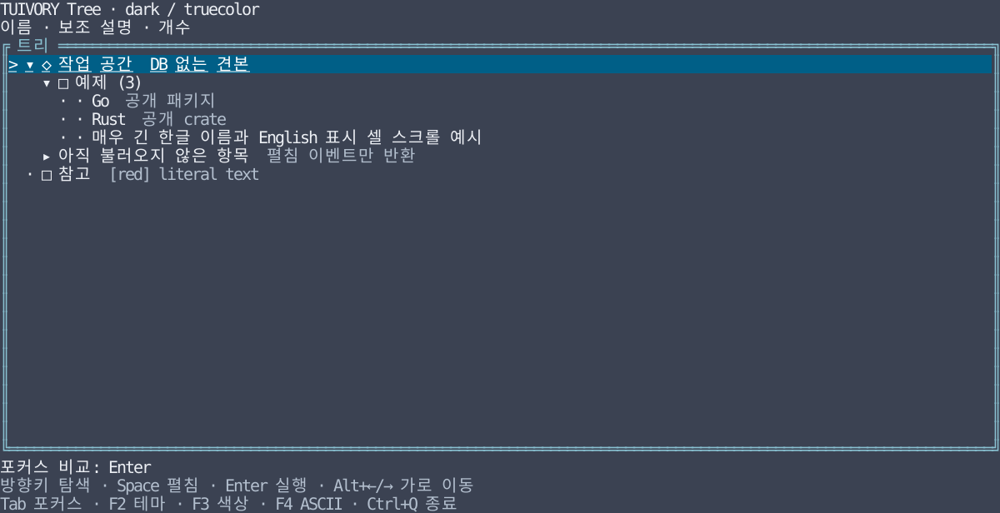

# 공통 Tree 사용법

**한국어 (기본)** · [English](tree.en.md)

Go/tview와 Rust/Ratatui에서 같은 후보 팔레트·상태·조작 원칙을 따르는 공개 컴포넌트입니다. [지원 범위 점검](component-audit.md) 뒤 TVR-7의 첫 구현 단계로 추가했습니다. 기존 `Styler.Tree`는 계속 stock tview 노드에 스타일만 적용하며 새 `TreeView`와 별도 API입니다.

## 데이터·상태·이벤트 명세

- 노드는 안정된 고유 ID, 부모 ID(루트는 빈 문자열), 이름·보조 설명·Unicode/ASCII 아이콘·선택적 개수·미로딩 분기 여부를 가집니다. 부모는 자식보다 먼저 제공해야 합니다. 빈/중복 ID, 없는 부모·자기 참조, 깊이 128 초과는 오류입니다. 개수 0과 생략을 구분합니다.
- 노드 데이터와 선택 ID·펼침 ID 집합·세로/가로 스크롤을 분리합니다. 호스트가 상태를 소유하며 테마/프로필 변경은 팔레트만 교체합니다. 입력 포커스는 프레임워크/호스트가 소유합니다.
- `Reconcile`/`reconcile`은 데이터 교체·크기 변경 후 상태를 정리합니다. 숨겨진 선택은 가장 가까운 보이는 부모로, 삭제된 선택은 첫 행으로 이동합니다. 삭제된 펼침 ID를 제거하고 살아 있는 ID는 유지합니다.
- `select`, `expand`, `collapse`, `activate` 이벤트는 호스트가 처리합니다. `Branch`/`branch`인 빈 분기를 펼쳐도 라이브러리는 데이터를 읽지 않습니다. 앱이 자식을 제공한 새 모델로 교체하고 기존 상태를 다시 사용합니다. 클릭에서 펼침 이벤트가 생기면 선택 이벤트 대신 펼침 이벤트 하나를 반환하며 선택 ID도 함께 갱신됩니다.

## 조작과 표현

| 조작 | 결과 |
| --- | --- |
| ↑ / ↓ · Home / End | 보이는 행의 선택 이동, 끝에서 멈춤 |
| PageUp / PageDown | 현재 뷰포트 높이만큼 이동 |
| → | 접힌 분기 펼침, 이미 펼쳐졌으면 첫 자식 이동 |
| ← | 펼친 분기 접기, 아니면 부모 이동 |
| Space | 분기 펼침/접힘 |
| Enter | 선택 ID의 실행 요청; 분기도 자동 실행하지 않음 |
| Alt+← / Alt+→ | 본문 4셀 가로 이동. 선택 표식은 고정 |
| 행 클릭 / 펼침 표시 클릭 | 선택 / 선택 후 펼침·접힘. 즉시 실행하지 않음 |
| 휠 | 선택 한 행 이동, 보이도록 스크롤 |

Rust 위젯은 렌더링만 담당합니다. 예제처럼 키를 `TreeAction`, 내부 뷰포트 좌표를 `Tree::click`에 전달합니다. Go TreeView는 tview 이벤트를 변환하며 `OnEvent`로 앱에 전달합니다. Tab 영역 이동·포커스 정책은 호스트가 결정합니다.

들여쓰기 2셀, 펼침/접힘 `▸`/`▾`와 ASCII `>`/`v`, 리프 `·`/`.`를 사용합니다. 앱 아이콘의 ASCII 대체가 없으면 ASCII 모드에서는 아이콘을 생략합니다. 선택은 `>`와 선택 면으로, 포커스는 선택 행 밑줄과 테두리로 구분합니다. 이름·개수는 주 텍스트, 보조 설명은 hint 역할이며 선택 행에서는 전체를 읽을 수 있는 선택 스타일로 표시합니다. 텍스트는 마크업으로 해석하지 않고 제어 문자를 공백으로 표시합니다.

긴 이름·깊은 계층은 셀 단위로 잘라 가로 이동합니다. 한글/결합 문자 중간에서 잘린 글자는 반쪽으로 그리지 않습니다. 좁은 뷰포트에서 세로 스크롤을 유지하고 0 크기 영역도 처리합니다. 일반 폰트용 아이콘만 예제에서 쓰며 글리프 폭의 실제 단말 차이는 별도 검증 대상입니다.

## Go 사용

현재 체크아웃의 `go/`를 replace로 연결합니다. `go get github.com/leechis7/tuivory/go@v0.5.0`으로 설치합니다. 첫 태그 `go/v0.0.1`에는 새 API가 없습니다.

```go
tree, err := tuivory.NewTree([]tuivory.TreeNode{
    {ID: "root", Name: "Workspace"},
    {ID: "child", Parent: "root", Name: "Example", Secondary: "Details"},
})
if err != nil { return err }
state := &tuivory.TreeState{Expanded: map[string]bool{"root": true}}
document, err := tuivory.CandidateTokens()
if err != nil { return err }
tokens, err := document.Palette("dark", "256")
if err != nil { return err }
palette, err := tuivory.Resolve(tokens)
if err != nil { return err }
view, err := tuivory.NewTreeView(tree, state, palette)
if err != nil { return err }
view.OnEvent = func(event tuivory.TreeEvent) { /* 앱 동작 연결 */ }
```

테마 변경은 `view.SetPalette(palette)`, 데이터 교체는 `view.SetTree(tree)`, ASCII 표시는 `view.ASCII = true`입니다. 팔레트는 body/hint/surface/selection/focus.border를 요구합니다. tview Application이 단말·화면·포커스와 입력 루프를 소유합니다.

## Rust 사용

코어는 Rust 1.85 이상, Ratatui 0.30.2 어댑터는 Rust 1.88 이상입니다. `tuivory = { path = "/path/to/tuivory/rust", features = ["ratatui"] }`로 연결합니다.

```rust
use tuivory::tree::{Tree, TreeNode, TreeState, TreeAction};
use tuivory::ratatui::{Styles, TreeWidget};
use tuivory::{Theme, ColorProfile};

let tree = Tree::new(vec![TreeNode {
    id: "root".into(), name: "Workspace".into(), branch: true,
    ..Default::default()
}])?;
let mut state = TreeState::default();
let event = tree.handle(&mut state, TreeAction::Right, 10);
let styles = Styles::new(Theme::Dark, ColorProfile::Indexed256)?;
let mut widget = TreeWidget::new(&tree, &styles)?;
widget.focused = true;
// frame.render_stateful_widget(widget, inner_rect, &mut state);
```

`Tree::new`의 구조 오류는 String, 스타일 오류는 `tuivory::Error`입니다. 호스트 함수에서 `Result<_, Box<dyn std::error::Error>>` 등으로 처리할 수 있습니다. `TreeWidget::new`는 필요한 surface/hint/selection 역할을 검사합니다. 패널 테두리는 `Styles::block`으로 그리고 그 내부 좌표를 위젯과 클릭에 전달합니다.

## 실행·검증

```sh
make run-tree-go ARGS="--lang ko"
make run-tree-rust ARGS="--lang en --ascii"
make test check
make test-rust-ui check-rust-ui
python3 tools/check_go_module.py
python3 tools/check_rust_module.py --ratatui
```

두 예제 모두 F2 테마, F3 색상 프로필, F4 Unicode/ASCII 전환, Tab 포커스 비교, Ctrl+Q 종료를 지원합니다. 기본 언어는 한국어입니다. 실행 소스는 `go/examples/tree/`, `rust/examples/tree/`이며 제품 바이너리의 기본 빌드 대상을 늘리지 않습니다.



이미지는 실제 Rust 예제를 Ratatui TestBackend 120×28에 그린 참조 SVG이며 원격 단말 캡처가 아닙니다. `cargo run --manifest-path rust/Cargo.toml --features playground --example tree -- --lang ko --colors truecolor --snapshot docs/images/tree-dark.svg`로 재생성합니다. Go 화면 캡처로 해석하지 않습니다.

공통 원본 `design/tree-navigation.json`은 키보드·미로딩 펼침·가로 스크롤·클릭을 포함한 동일 탐색 시퀀스의 기대 상태·이벤트입니다. `tools/export_tree_cases.py`로 각 모듈의 테스트 사본을 생성하고 `--check`로 일치 여부를 검사합니다. 양쪽 테스트는 같은 기대 결과를 검증하며 12팔레트·포커스 분리·리터럴 텍스트·셀 폭·데이터 교체도 확인합니다. 외부 프로젝트 import·한영 PTY 시작/종료/복원도 검사합니다. 실제 원격 단말, 원격 CI, LazyOra/LazyBeaver 적용은 미검증입니다. TVR-7 변경은 v0.1.0에 포함합니다.
