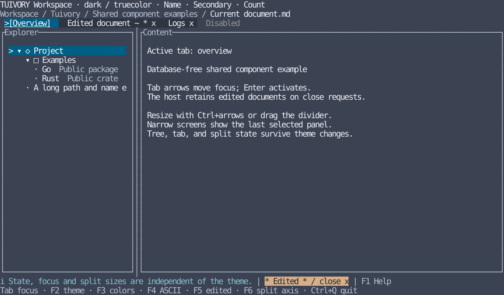

# Shared tabs, panels, status bar, and breadcrumbs

[한국어 (default)](workspace.md) · **English**

Following TVR-7's [Tree](tree.en.md), Go/tview and Rust/Ratatui provide shared workspace components. Hosts own data, focus, execution, close approval, and terminal I/O. No queries, SQL execution, or JDBC are included. These APIs are included in v0.1.0; CI evidence and real integration are tracked separately.

## Tabs

| Aspect | Behavior |
| --- | --- |
| Data | Stable unique ID, title, edited, closable, disabled; empty/duplicate IDs are errors |
| State | Independent active ID, navigation focus ID, and first visible index |
| Left/Right, Home/End | Move focus only, skipping disabled tabs; stop at boundaries |
| Enter / title click | Activation event / focus and activate the clicked tab |
| x, Delete / x marker click | Close request; the library never deletes documents |
| Overflow | Keep focused tab visible; `<`/`>` edges and wheel navigate previous/next |
| Presentation | Active `[title]`, navigation `>`, input-focus underline, edited `*`, close `x`, disabled `-` |

Long titles truncate with `~` inside a slot of up to 24 cells, reserving state indicators first. Extremely narrow slots show what fits; hidden close markers are not clickable. Widths of two cells or less render no tabs. Expanding the viewport fills available space with earlier tabs again. Theme changes preserve active/focused/edited state. After host-approved removal, replacement models retain surviving IDs and normalize missing IDs to the first enabled tab.

Go: `NewTabs`, `TabState`, `TabAction`, `TabEvent`, `Tabs.Layout/Handle/Click`, `NewTabView`. `TabView.SetTabs` replaces data; `SetPalette` changes styles only. Rust: `components::{Tabs, TabItem, TabState, TabAction, TabEvent}` and `ratatui::TabsWidget`. Rust hosts route keys/clicks into the model and handle returned events.

## Panels and splitters

Panels share titles, borders, surfaces, and default one-cell padding. Double borders and a `>` title cue identify focus; ASCII uses `+ - |` borders plus bold/title cues. Go `NewPanelView(child, palette)` wraps a host widget without replacing data or callbacks. Rust `Styles::panel(title, focused, padding, ascii)` returns a Block; render host content into its `inner()` rectangle.

`SplitSpec` defines minimum sizes; `SplitState` retains the user's preferred first-pane size. `Layout/layout(total)` calculates actual geometry including a one-cell divider. `Resize/resize` clamps user changes, while narrowing the viewport never overwrites the preference. Below the minimum-size sum, compact mode shows one host-selected pane and suspends resizing. Expanding restores the saved preference.

Go `NewSplitView(first, second, state, spec, palette)` provides column/row layout, mouse dragging, and resize-key handling. When a child owns application focus, route Ctrl+arrows through `split.ResizeKey(event)` in the host input capture. Rust `split_rects` returns panel/divider rectangles from the same model; hosts pass Ctrl+arrow adjustments and drag coordinates to `SplitSpec::resize`. Resizing does not recreate tree, tab, or edit data.

## Breadcrumbs and status bar

`Breadcrumbs/breadcrumbs` lays out `PathItem` IDs/labels into literal `LineRun` cell ranges. `/` separates items and `...` indicates omitted ancestors. Preserve root and current location when possible; prioritize current location when space is scarce. An oversized current label truncates its beginning with `~`, retaining the tail. Decorations have no navigation IDs; only visible items request host navigation. Go `NewBreadcrumbView` exposes the click callback; Rust hosts hit-test returned ranges.

`StatusLine/status_line` stably sorts `StatusItem` by descending priority; ties retain input order. Show the most important item first, pack remaining items whole, and report omissions with `+N`. Only the highest-priority item may truncate with `~`. At tiny widths its semantic cue takes precedence over the omission count.

Roles use candidate-token names directly. Prefixes warning/error `!`, edited `*`, success `+`, and info `i` provide non-color cues. Shortcuts use the same item model; hosts decide labels, context, and priority. Go `NewStatusView` and Rust `LineWidget::new` reject missing roles. `CellText/cell_text` preserve grapheme boundaries, including Korean and combining characters. All text is literal and control characters become spaces.

## Imports and examples

Go external projects install `github.com/leechis7/tuivory/go@v0.2.0` or use a replace directive for a local checkout. All APIs use the single `github.com/leechis7/tuivory/go` import. Resolve the candidate palette with `CandidateTokens → Palette → Resolve` and pass it to views. This does not claim equality with the complete LazyOra-derived Go styler.

```go
tabs, err := tuivory.NewTabs([]tuivory.TabItem{
    {ID: "overview", Title: "Overview"},
    {ID: "draft", Title: "Draft", Edited: true, Closable: true},
})
if err != nil { return err }
state := &tuivory.TabState{}
view, err := tuivory.NewTabView(tabs, state, palette)
if err != nil { return err }
view.OnEvent = func(event tuivory.TabEvent) { /* host activation/close approval */ }
```

The Rust core requires 1.85+; Ratatui adapters/examples require 1.88+. Enable `features = ["ratatui"]` on a Cargo path dependency.

```rust
use tuivory::components::{Tabs, TabItem, TabState, TabAction};
use tuivory::ratatui::TabsWidget;
let tabs = Tabs::new(vec![TabItem {
    id: "overview".into(), title: "Overview".into(), ..Default::default()
}])?;
let mut state = TabState::default();
let event = tabs.handle(&mut state, TabAction::Activate);
let widget = TabsWidget::new(&tabs, &styles)?;
// frame.render_stateful_widget(widget, area, &mut state);
```

Structural model errors use Rust String/Go error; style errors use Rust `tuivory::Error`/Go error. Hosts choose the terminal and framework backend. [Go host source](../go/examples/workspace/main.go) · [Rust host source](../rust/examples/workspace/main.rs)

```sh
make run-workspace-go ARGS="--lang en"
make run-workspace-rust ARGS="--lang en --ascii"
```

Both examples default to Korean and support `--lang en`, `--theme dark|light|blackwhite`, `--colors 8|16|256|truecolor`, and `--ascii`. Tab/Shift+Tab cycles tabs→tree→content focus. F1 shows guidance, F2 themes, F3 colors, F4 ASCII, F5 active-document edited state, and F6 column/row splits. Ctrl+arrows and divider dragging resize panes; Ctrl+Q exits. Hosts retain edited tabs on close requests; clear edited state with F5 and close again to remove the tab. Nothing is saved to files/databases. Default product output policies for `make build` and `make build-rust` remain.



[Light](images/workspace-light-en.svg) · [monochrome](images/workspace-blackwhite-en.svg) · [ASCII](images/workspace-ascii-en.svg). These 120×32 reference SVGs render the actual Rust host with Ratatui TestBackend; they are neither Go captures nor remote terminal results. Generate all eight language-matched images with `tools/snapshot_workspace.py`.

## Validation scope

Shared `design/components-cases.json` defines identical Go/Rust expectations for tab navigation/closing/overflow, breadcrumb omission, and status priority/packing. `tools/export_tree_cases.py` mirrors this and the Tree specification into module-local tests. Separate checks cover twelve-palette rendering, independent focus, close-request data preservation, split-preference restoration after narrow screens, dragging/clicks, zero-sized areas, and external imports/rendering.

```sh
make test check
make test-rust-ui check-rust-ui
python3 tools/check_go_module.py
python3 tools/check_rust_module.py --ratatui
python3 tools/smoke_workspace.py /path/to/go-workspace
python3 tools/smoke_workspace.py /path/to/rust-workspace
```

Local checks include bilingual PTY startup/exit/restoration and an English integrated input scenario: edited-close guard, keys, divider dragging, and narrow/expanded reflow. Distinguish these from GitHub CI results, remote terminals, and actual LazyOra/LazyBeaver integration. The epic stays open as requested; implementation is distributed in v0.1.0.

Go `PanelView` automatically uses the [shared wide-glyph repair](overlay-drawing.en.md). External cards and shadows use the public wrapper and DimRegion.

## Host-selected layout, focus and keys

Pass `--layout rows --focus-order content,tree,tabs --quit-key ctrl-x` to compose the same public components under different host policy. Defaults remain columns, tabs,tree,content and ctrl-q. Initial focus goes to the first item; Tab/Shift+Tab follows the supplied order. These are example-host CLI options, not library-global configuration or a required whole-screen standard. New host options are included in 0.4.0. [Boundary, localized references and commands](component-boundary.en.md).

Focus border rules: framed explorer trees/lists, input/editor areas, data grids and normal dialogs use double borders while receiving input and single borders when inactive. Do not add borders to individual unframed fields, buttons or tabs. Menus retain single borders with selection/open-state cues. Go playground cards/dialogs use tview’s existing double focus borders; 0.4.0 also aligns explorer/token/help focus colors. Rust shared panels already support double borders. [Validation](../evidence/focus-borders.en.md).

In 0.4.0, plain text follows the actual surface while explicit field/selection/edit backgrounds remain. See [surface/contrast design rules](../design/surfaces.en.md) and [fix evidence](../evidence/background-fix.en.md).
