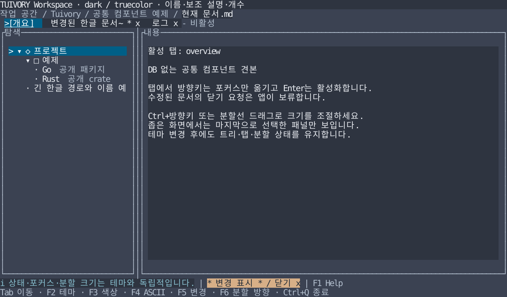

# 공통 탭·패널·상태 표시줄·경로

**한국어 (기본)** · [English](workspace.en.md)

TVR-7의 [Tree](tree.md)에 이어 Go/tview와 Rust/Ratatui의 공통 워크스페이스 컴포넌트를 제공합니다. 앱은 데이터·포커스·실행·닫기 승인과 단말 I/O를 소유합니다. DB 조회·SQL 실행·JDBC는 포함하지 않습니다. v0.1.0에 포함하며 GitHub CI·실제 앱 적용은 작업 기록에서 구분합니다.

## 탭

| 계약 | 동작 |
| --- | --- |
| 데이터 | 안정된 고유 ID·제목·변경됨·닫기 가능·비활성. 빈/중복 ID는 오류 |
| 상태 | 활성 ID, 탐색 포커스 ID, 첫 표시 인덱스를 분리 |
| ←/→ · Home/End | 비활성 탭을 건너뛰며 포커스만 이동. 끝에서 멈춤 |
| Enter / 제목 클릭 | 활성화 이벤트 / 클릭한 탭을 포커스·활성화 |
| x·Delete / x 표식 클릭 | 닫기 요청. 라이브러리가 문서를 삭제하지 않음 |
| 넘침 | 포커스 탭을 보이도록 이동하고 양끝 `<`/`>`로 이전·다음 탐색. 휠도 탐색 |
| 표현 | 활성 탭 `[제목]`, 탐색 위치 `>`, 입력 포커스 밑줄, 변경 `*`, 닫기 `x`, 비활성 `-` |

긴 제목은 최대 24셀 슬롯 안에서 `~`로 줄이고 상태 표식 공간을 먼저 확보합니다. 매우 좁은 슬롯에서는 표시 가능한 부분만 그리며, 보이지 않는 닫기 표식은 클릭되지 않습니다. 폭 2셀 이하는 탭을 그리지 않습니다. 넓히면 앞쪽 탭으로 표시 공간을 다시 채웁니다. 테마 변경은 활성/포커스/변경 상태를 바꾸지 않습니다. 닫기 승인 후 앱이 새 모델을 제공하면 유효한 ID는 유지하고 사라진 ID는 첫 활성 가능 탭으로 정리합니다.

Go: `NewTabs`, `TabState`, `TabAction`, `TabEvent`, `Tabs.Layout/Handle/Click`, `NewTabView`. `TabView.SetTabs`는 데이터, `SetPalette`는 스타일만 바꿉니다. Rust: `components::{Tabs, TabItem, TabState, TabAction, TabEvent}`와 `ratatui::TabsWidget`. Rust 호스트는 키/클릭을 모델에 전달하고 반환 이벤트를 처리합니다.

## 패널·분할선

패널은 제목·테두리·표면·기본 1셀 여백을 공유합니다. 입력 포커스는 이중 테두리와 `>` 제목 표식으로, ASCII 모드는 `+ - |` 테두리와 굵기·제목 표식으로 표현합니다. Go `NewPanelView(child, palette)`는 호스트 위젯을 감싸며 기존 위젯 데이터나 콜백을 교체하지 않습니다. Rust `Styles::panel(title, focused, padding, ascii)`는 Block을 반환하며, 그 `inner()`에 호스트 내용을 그립니다.

`SplitSpec`은 첫/둘째 영역의 최소 크기, `SplitState`는 사용자의 선호 크기를 가집니다. `Layout/layout(total)`은 분할선 1셀을 포함한 실제 크기를 계산합니다. `Resize/resize`는 경계를 제한하며, 화면이 좁아진 것만으로 선호 크기를 덮어쓰지 않습니다. 최소 크기 합보다 좁으면 compact 상태로 전환해 호스트가 선택한 패널 하나를 보여주고 크기 조절을 보류합니다. 넓히면 기존 선호 크기로 복귀합니다.

Go `NewSplitView(first, second, state, spec, palette)`는 열/행 배치·마우스 드래그·크기 조절 키 처리를 제공합니다. 자식이 입력 포커스를 소유할 때 앱의 input capture에서 `split.ResizeKey(event)`로 Ctrl+방향키를 전달합니다. Rust `split_rects`는 같은 모델의 패널/분할선 Rect를 계산합니다. 호스트가 Ctrl+방향키·드래그 좌표를 `SplitSpec::resize`로 전달합니다. 분할 크기를 바꿔도 트리/탭/편집 데이터는 재생성하지 않습니다.

## 경로·상태 표시줄

`Breadcrumbs/breadcrumbs`는 `PathItem { ID/id, Label/label }`을 셀 범위 `LineRun`으로 배치합니다. `/`는 구분자, `...`는 생략 구간입니다. 가능하면 루트와 현재 위치를 유지하고, 부족하면 현재 위치를 우선합니다. 현재 이름 자체가 너무 길면 앞을 `~`로 줄여 뒤쪽 이름을 보존합니다. 생략 표식/구분자에는 이동 ID가 없으며, 보이는 항목 클릭만 앱에 이동 요청을 전달합니다. Go `NewBreadcrumbView`는 클릭 콜백을 제공하며 Rust는 반환한 범위를 이용해 앱이 hit test합니다.

`StatusLine/status_line`은 `StatusItem`을 높은 priority 순으로 안정 정렬합니다. 같은 우선순위는 앱이 준 순서를 유지합니다. 가장 중요한 항목을 먼저 표시하고, 나머지는 완전한 항목 단위로 넣으며 빠진 개수는 `+N`으로 알립니다. 최고 우선순위 항목만 공간이 모자라면 `~`로 줄입니다. 극소 폭에서는 생략 개수보다 중요한 의미 표식을 우선합니다.

의미 역할은 후보 토큰 이름 그대로 사용합니다. warning/error `!`, edited `*`, success `+`, info `i`를 덧붙여 색상 없이도 구분합니다. 단축키도 같은 항목 모델로 제공하며 앱이 문구·우선순위·상황을 결정합니다. Go `NewStatusView`와 Rust `LineWidget::new`는 없는 역할을 오류로 처리합니다. `CellText/cell_text` 등은 한글·결합 문자 등 grapheme 경계를 지키며, 모든 텍스트는 리터럴이고 제어 문자는 공백이 됩니다.

## import와 예제

Go는 `go get github.com/leechis7/tuivory/go@v0.1.0`으로 설치하거나 로컬 체크아웃의 `go/`를 replace로 지정합니다. `github.com/leechis7/tuivory/go` 하나로 새 API를 사용하며, 후보 토큰을 `CandidateTokens → Palette → Resolve`로 해석해 뷰에 전달합니다. 기존 LazyOra 추출 스타일 전체와 같은 데이터라는 의미는 아닙니다.

```go
tabs, err := tuivory.NewTabs([]tuivory.TabItem{
    {ID: "overview", Title: "Overview"},
    {ID: "draft", Title: "Draft", Edited: true, Closable: true},
})
if err != nil { return err }
state := &tuivory.TabState{}
view, err := tuivory.NewTabView(tabs, state, palette)
if err != nil { return err }
view.OnEvent = func(event tuivory.TabEvent) { /* 앱의 활성화·닫기 승인 */ }
```

Rust 코어는 1.85 이상, Ratatui 어댑터/예제는 1.88 이상입니다. Cargo path 의존성에 `features = ["ratatui"]`를 지정합니다.

```rust
use tuivory::components::{Tabs, TabItem, TabState, TabAction};
use tuivory::ratatui::TabsWidget;
let tabs = Tabs::new(vec![TabItem {
    id: "overview".into(), title: "Overview".into(), ..Default::default()
}])?;
let mut state = TabState::default();
let event = tabs.handle(&mut state, TabAction::Activate);
let widget = TabsWidget::new(&tabs, &styles)?;
// frame.render_stateful_widget(widget, area, &mut state);
```

모델 구조 오류는 Rust String/Go error, 스타일 오류는 Rust `tuivory::Error`/Go error입니다. 단말과 프레임워크 백엔드는 호스트가 선택합니다. [Go 통합 소스](../go/examples/workspace/main.go) · [Rust 통합 소스](../rust/examples/workspace/main.rs)

```sh
make run-workspace-go ARGS="--lang ko"
make run-workspace-rust ARGS="--lang en --ascii"
```

두 예제는 기본 한국어, `--lang en`, `--theme dark|light|blackwhite`, `--colors 8|16|256|truecolor`, `--ascii`를 지원합니다. Tab/Shift+Tab으로 탭→트리→내용 포커스, F1 안내, F2 테마, F3 색상, F4 ASCII, F5 활성 문서 변경 상태, F6 열/행 분할을 바꿉니다. Ctrl+방향키와 분할선 드래그로 크기를 조절하고 Ctrl+Q로 종료합니다. 변경된 문서 닫기는 앱이 보류하며 F5로 변경 상태를 해제한 후 다시 닫으면 앱이 제거합니다. 파일·DB에 저장하지 않습니다. 기본 `make build`와 `make build-rust`의 제품 출력 정책은 유지합니다.



[밝은 테마](images/workspace-light.svg) · [흑백](images/workspace-blackwhite.svg) · [ASCII](images/workspace-ascii.svg). 실제 Rust 호스트의 Ratatui TestBackend 120×32 참조 SVG이며 Go 캡처나 원격 단말 결과가 아닙니다. `tools/snapshot_workspace.py`로 한영 8장을 생성합니다.

## 검증 범위

공통 `design/components-cases.json`은 탭 탐색/닫기/넘침, 경로 생략, 상태 우선순위·생략 결과를 Go/Rust에서 동일하게 검사합니다. `tools/export_tree_cases.py`는 이 파일과 Tree 계약의 테스트 사본을 함께 생성합니다. 별도로 12팔레트 렌더링·포커스 구분·닫기 요청의 데이터 보존·작은 화면 후 분할 선호 복원·드래그·클릭·0 크기 영역·외부 프로젝트 import/렌더링을 확인합니다.

```sh
make test check
make test-rust-ui check-rust-ui
python3 tools/check_go_module.py
python3 tools/check_rust_module.py --ratatui
python3 tools/smoke_workspace.py /path/to/go-workspace
python3 tools/smoke_workspace.py /path/to/rust-workspace
```

로컬 검증은 한영 PTY 시작·종료·화면 복원과 영문 통합 시나리오(변경 문서 닫기 보류, 키 입력, 분할 드래그, 화면 축소·복귀)를 포함합니다. 로컬 검증과 GitHub CI 결과·실제 원격 단말·LazyOra/LazyBeaver 적용을 구분합니다. 에픽은 요청대로 열어두며 구현은 v0.1.0으로 배포합니다.
